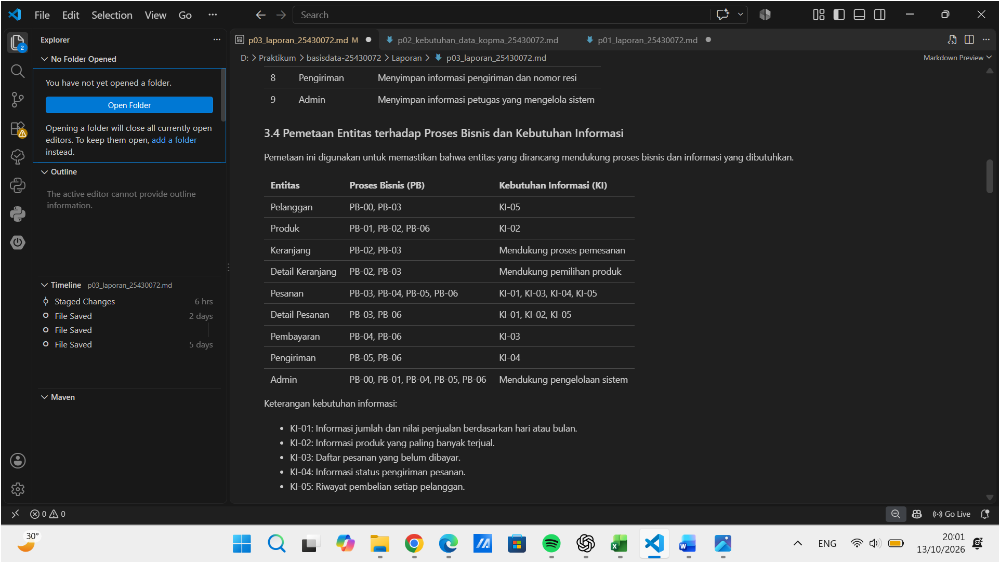
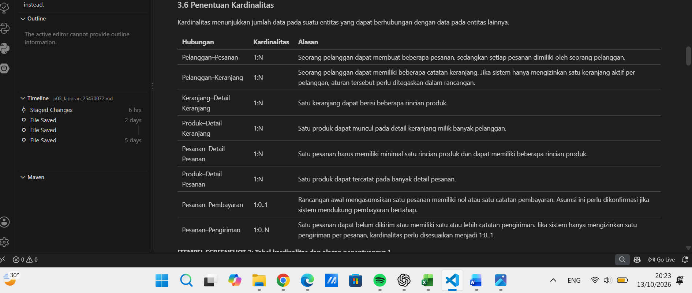
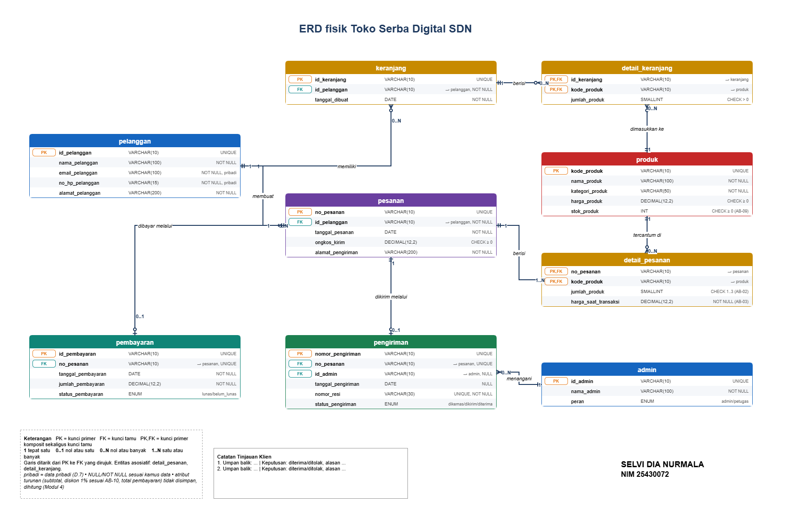

# LAPORAN PRAKTIKUM BASIS DATA - PERTEMUAN 3
## Perancangan Entity Relationship Diagram (ERD)

**Nama:** Selvi Dia Nurmala  
**NIM:** 25430072  
**Kelas:** C  
**Nama Proyek:** Toko Serba Digital SDN  
**Tema Proyek:** Toko Daring  
**Tanggal:** 13 Oktober 2026  

---

## 1. Tujuan Praktikum

1. Mengidentifikasi entitas dan hubungan antarentitas berdasarkan kebutuhan data organisasi.
2. Menyusun Entity Relationship Diagram (ERD) untuk menggambarkan struktur data.
3. Menentukan kardinalitas hubungan antarentitas sesuai aturan bisnis.
4. Memetakan entitas terhadap proses bisnis (PB) dan kebutuhan informasi (KI).
5. Menyiapkan dokumentasi hasil perancangan basis data untuk pengembangan proyek selanjutnya.

## 2. Ringkasan Dasar Teori

Entity Relationship Diagram (ERD) merupakan diagram yang digunakan untuk menggambarkan entitas, atribut, dan hubungan antarentitas dalam suatu sistem basis data. Entitas mewakili objek yang datanya perlu disimpan, sedangkan atribut merupakan informasi yang menjelaskan entitas tersebut.

Hubungan antarentitas memiliki kardinalitas yang menunjukkan jumlah keterkaitan data. Kardinalitas yang umum digunakan adalah one-to-one (1:1), one-to-many (1:N), dan many-to-many (M:N). Penentuan kardinalitas perlu didasarkan pada aturan bisnis agar struktur basis data sesuai dengan kebutuhan organisasi.

ERD juga perlu disesuaikan dengan proses bisnis dan kebutuhan informasi. Dengan demikian, data yang dirancang dapat mendukung kegiatan operasional sekaligus menghasilkan informasi yang dibutuhkan pengguna.

## 3. Hasil Langkah Percobaan

### 3.1 Identitas dan Konteks Proyek

Proyek yang dirancang adalah Toko Serba Digital SDN dengan tema toko daring. Sistem ini membutuhkan penyimpanan data pelanggan, produk, keranjang, pesanan, pembayaran, dan pengiriman.

Tujuan perancangan adalah menghasilkan struktur data yang mendukung pengelolaan transaksi serta penyediaan informasi penjualan dan status pesanan.

### 3.2 Identifikasi Proses Bisnis

Proses bisnis yang menjadi dasar perancangan adalah sebagai berikut.

| Kode PB | Nama Proses Bisnis | Aktor | Ringkasan Aktivitas |
|---|---|---|---|
| PB-00 | Mengelola data pelanggan | Pelanggan/Admin | Mendaftarkan dan memperbarui data pelanggan |
| PB-01 | Mengelola katalog produk | Admin | Menambah dan memperbarui data produk |
| PB-02 | Mengelola keranjang | Pelanggan | Memilih produk yang akan dibeli |
| PB-03 | Membuat pesanan | Pelanggan | Melakukan checkout dan membuat pesanan |
| PB-04 | Mencatat pembayaran | Pelanggan/Admin | Mencatat pembayaran dan statusnya |
| PB-05 | Mengelola pengiriman | Admin/Petugas | Mengelola pengiriman pesanan |
| PB-06 | Membuat laporan penjualan | Admin | Menyusun laporan penjualan |

### 3.3 Identifikasi Entitas

Entitas kandidat yang digunakan dalam perancangan ERD adalah sebagai berikut.

| No. | Entitas | Fungsi |
|---|---|---|
| 1 | Pelanggan | Menyimpan informasi pelanggan |
| 2 | Produk | Menyimpan informasi produk yang dijual |
| 3 | Keranjang | Menyimpan keranjang milik pelanggan |
| 4 | Detail Keranjang | Menyimpan produk dan jumlahnya dalam keranjang |
| 5 | Pesanan | Menyimpan informasi utama pesanan |
| 6 | Detail Pesanan | Menyimpan rincian produk dalam pesanan |
| 7 | Pembayaran | Menyimpan informasi pembayaran pesanan |
| 8 | Pengiriman | Menyimpan informasi pengiriman dan nomor resi |
| 9 | Admin | Menyimpan informasi petugas yang mengelola sistem |

### 3.4 Pemetaan Entitas terhadap Proses Bisnis dan Kebutuhan Informasi

Pemetaan ini digunakan untuk memastikan bahwa entitas yang dirancang mendukung proses bisnis dan informasi yang dibutuhkan.

| Entitas | Proses Bisnis (PB) | Kebutuhan Informasi (KI) |
|---|---|---|
| Pelanggan | PB-00, PB-03 | KI-05 |
| Produk | PB-01, PB-02, PB-06 | KI-02 |
| Keranjang | PB-02, PB-03 | Mendukung proses pemesanan |
| Detail Keranjang | PB-02, PB-03 | Mendukung pemilihan produk |
| Pesanan | PB-03, PB-04, PB-05, PB-06 | KI-01, KI-03, KI-04, KI-05 |
| Detail Pesanan | PB-03, PB-06 | KI-01, KI-02, KI-05 |
| Pembayaran | PB-04, PB-06 | KI-03 |
| Pengiriman | PB-05, PB-06 | KI-04 |
| Admin | PB-00, PB-01, PB-04, PB-05, PB-06 | Mendukung pengelolaan sistem |

Keterangan kebutuhan informasi:

- KI-01: Informasi jumlah dan nilai penjualan berdasarkan hari atau bulan.
- KI-02: Informasi produk yang paling banyak terjual.
- KI-03: Daftar pesanan yang belum dibayar.
- KI-04: Informasi status pengiriman pesanan.
- KI-05: Riwayat pembelian setiap pelanggan.

### 3.5 Aturan Bisnis

Aturan bisnis yang menjadi dasar perancangan sistem adalah sebagai berikut.

| Kode | Aturan Bisnis |
|---|---|
| AB-01 | Setiap pesanan memiliki nomor unik dan minimal satu produk. |
| AB-02 | Setiap pesanan dapat berisi maksimal tiga jenis barang sesuai ketentuan proyek. |
| AB-03 | Harga produk saat transaksi harus disimpan agar riwayat harga tetap tersedia. |
| AB-04 | Ongkos kirim disimpan pada setiap pesanan. |
| AB-05 | Alamat pengiriman disimpan pada setiap pesanan. |
| AB-06 | Pembayaran harus berhubungan dengan pesanan yang dibayarkan. |
| AB-07 | Pesanan yang belum dibayar tidak dapat dikirim. |
| AB-08 | Setiap pengiriman memiliki nomor resi yang unik. |
| AB-09 | Stok produk tidak boleh bernilai negatif. |
| AB-10 | Diskon dihitung sebesar 1% dari subtotal sesuai ketentuan proyek. |

Aturan bisnis tersebut digunakan untuk menentukan atribut, hubungan, dan kardinalitas dalam ERD.

### 3.6 Penentuan Kardinalitas

Kardinalitas menunjukkan jumlah data pada suatu entitas yang dapat berhubungan dengan data pada entitas lainnya.

| Hubungan | Kardinalitas | Alasan |
|---|---|---|
| Pelanggan–Pesanan | 1:N | Seorang pelanggan dapat membuat beberapa pesanan, sedangkan setiap pesanan dimiliki oleh seorang pelanggan. |
| Pelanggan–Keranjang | 1:N | Seorang pelanggan dapat memiliki beberapa catatan keranjang. Jika sistem hanya mengizinkan satu keranjang aktif per pelanggan, aturan tersebut perlu ditegaskan dalam rancangan. |
| Keranjang–Detail Keranjang | 1:N | Satu keranjang dapat berisi beberapa rincian produk. |
| Produk–Detail Keranjang | 1:N | Satu produk dapat muncul pada detail keranjang milik banyak pelanggan. |
| Pesanan–Detail Pesanan | 1:N | Satu pesanan harus memiliki minimal satu rincian produk dan dapat memiliki beberapa rincian produk. |
| Produk–Detail Pesanan | 1:N | Satu produk dapat tercatat pada banyak detail pesanan. |
| Pesanan–Pembayaran | 1:0..1 | Rancangan awal mengasumsikan satu pesanan memiliki nol atau satu catatan pembayaran. Asumsi ini perlu dikonfirmasi jika sistem mendukung pembayaran bertahap. |
| Pesanan–Pengiriman | 1:0..N | Satu pesanan dapat belum dikirim atau memiliki satu atau lebih catatan pengiriman. Jika sistem hanya mengizinkan satu pengiriman per pesanan, kardinalitas perlu disesuaikan menjadi 1:0..1. |

### 3.7 Perancangan ERD Toko Serba Digital SDN

ERD dirancang menggunakan Draw.io untuk menggambarkan entitas, atribut, hubungan, dan kardinalitas pada sistem Toko Serba Digital SDN.

Gambar ERD berikut merupakan hasil ekspor dari Draw.io.

**File sumber:** `p03_erd_25430072.drawio`

**File gambar:** `p03_erd_25430072.png`

Atribut penting yang perlu diperhatikan antara lain:

- **Pelanggan:** id_pelanggan, nama_pelanggan, email_pelanggan, no_hp_pelanggan, alamat_pelanggan.
- **Produk:** kode_produk, nama_produk, kategori_produk, harga_produk, stok_produk.
- **Keranjang:** id_keranjang, id_pelanggan, tanggal_pembuatan.
- **Detail Keranjang:** id_keranjang, kode_produk, jumlah_produk.
- **Pesanan:** no_pesanan, tanggal_pesanan, id_pelanggan, ongkos_kirim, alamat_pengiriman.
- **Detail Pesanan:** no_pesanan, kode_produk, jumlah_produk, harga_saat_transaksi.
- **Pembayaran:** id_pembayaran, no_pesanan, tanggal_pembayaran, jumlah_pembayaran, status_pembayaran.
- **Pengiriman:** id_pengiriman, no_pesanan, tanggal_pengiriman, nomor_resi, status_pengiriman.
- **Admin:** id_admin, nama_admin, peran_admin.

Kunci utama dan kunci asing perlu ditandai pada diagram. Harga saat transaksi disimpan pada Detail Pesanan agar perubahan harga produk tidak mengubah catatan transaksi sebelumnya.

### 3.8 Perancangan ERD Kopma

ERD Kopma dibuat menggunakan Draw.io untuk menggambarkan entitas dan hubungan data pada sistem koperasi mahasiswa.

**File sumber:** `p03_erd_kopma_25430072.drawio`

**File gambar:** `p03_erd_kopma_25430072.png`

Entitas utama yang digunakan meliputi:

| Entitas | Fungsi |
|---|---|
| Anggota | Menyimpan data anggota koperasi |
| Barang | Menyimpan data barang dan stok |
| Penjualan | Menyimpan transaksi penjualan |
| Detail Penjualan | Menyimpan barang dan jumlah dalam transaksi |
| Petugas | Menyimpan data petugas koperasi |
| Pemasok | Menyimpan data pemasok barang |
| Pembelian | Menyimpan transaksi pembelian barang dari pemasok |
| Detail Pembelian | Menyimpan rincian barang yang dibeli |

Aturan bisnis penting pada Kopma meliputi nomor transaksi yang unik, transaksi memiliki minimal satu rincian barang, diskon 5% untuk anggota aktif, stok tidak boleh negatif, dan harga jual harus disimpan pada setiap rincian penjualan.

ERD Kopma perlu memperlihatkan hubungan antara penjualan dengan detail penjualan, barang dengan detail penjualan, pemasok dengan pembelian, serta pembelian dengan detail pembelian.

### 3.9 Catatan Peninjauan Klien

Peninjauan rancangan ERD dilakukan dengan meminta masukan secara langsung kepada teman. Berdasarkan hasil peninjauan, rancangan ERD perlu mencantumkan atribut secara lengkap, seperti pada rancangan ERD Kopma sebelumnya. Selain itu, penanda `NOT NULL` perlu dicantumkan pada atribut yang wajib diisi.

Berdasarkan masukan tersebut, dilakukan perbaikan terhadap rancangan ERD dengan melengkapi atribut dan mencantumkan penanda `NOT NULL` sesuai kebutuhan data.

| No. | Bagian yang Ditinjau | Masukan Klien | Tindak Lanjut |
|---|---|---|---|
| 1 | Entitas dan atribut | Atribut pada ERD perlu dicantumkan secara lengkap seperti pada rancangan ERD Kopma sebelumnya. | Melengkapi atribut pada setiap entitas sesuai kebutuhan sistem. |
| 2 | Ketentuan atribut | Penanda `NOT NULL` perlu dicantumkan pada atribut yang wajib diisi. | Menambahkan penanda `NOT NULL` pada atribut yang wajib memiliki nilai. |

**Bukti Peninjauan:**

Screenshot percakapan peninjauan digunakan sebagai bukti masukan yang diberikan. Gambar ERD versi terbaru digunakan untuk menunjukkan hasil perbaikan rancangan.

**Hasil Perbaikan:** Rancangan ERD diperbaiki berdasarkan masukan peninjau dengan melengkapi atribut dan mencantumkan ketentuan `NOT NULL` pada atribut yang wajib diisi.

## 4. Jawaban Titik Analisis

### 4.1 Mengapa identifikasi entitas perlu dilakukan sebelum menggambar ERD?

Identifikasi entitas perlu dilakukan sebelum menggambar ERD agar objek yang datanya harus disimpan dapat diketahui dengan jelas. Jika entitas belum lengkap, sistem berisiko kehilangan data penting atau memerlukan perubahan struktur ketika sudah digunakan.

### 4.2 Mengapa harga saat transaksi perlu disimpan pada Detail Pesanan?

Harga saat transaksi perlu disimpan agar sistem dapat mempertahankan harga yang berlaku ketika pesanan dibuat. Jika sistem hanya mengambil harga terbaru dari tabel Produk, perubahan harga dapat menyebabkan riwayat transaksi lama menampilkan nilai yang salah.

### 4.3 Mengapa tabel Detail Pesanan diperlukan?

Detail Pesanan diperlukan untuk menyimpan rincian produk yang terdapat pada suatu pesanan. Satu pesanan dapat berisi beberapa produk, dan satu produk dapat muncul pada banyak pesanan. Tabel Detail Pesanan membantu menghubungkan kedua entitas tersebut.

### 4.4 Mengapa kardinalitas harus sesuai dengan aturan bisnis?

Kardinalitas harus sesuai dengan aturan bisnis agar hubungan data yang diizinkan oleh sistem sesuai dengan kegiatan organisasi. Kardinalitas yang keliru dapat menyebabkan data tidak konsisten atau membatasi transaksi yang seharusnya diperbolehkan.

### 4.5 Bagaimana ERD mendukung kebutuhan informasi?

ERD membantu menentukan data yang perlu disimpan agar sistem dapat menghasilkan informasi seperti laporan penjualan, daftar pesanan yang belum dibayar, produk terlaris, status pengiriman, dan riwayat pembelian pelanggan.

## 5. Hasil Latihan dan Modifikasi

Pada tahap ini, entitas dan hubungan disusun berdasarkan proses bisnis serta aturan bisnis. Rancangan juga memperhatikan penggunaan kunci utama, kunci asing, dan atribut yang diperlukan untuk menjaga konsistensi data.

Perbaikan rancangan yang perlu diperiksa sebelum dikumpulkan meliputi:

1. Memastikan setiap entitas memiliki kunci utama.
2. Memastikan hubungan antarentitas memiliki kardinalitas yang jelas.
3. Memastikan setiap kunci asing mengarah ke entitas yang tepat.
4. Memastikan harga saat transaksi disimpan pada Detail Pesanan.
5. Memastikan aturan stok, pembayaran, dan pengiriman tercermin dalam rancangan.
6. Memastikan diagram dapat dibaca dan tidak memiliki garis hubungan yang membingungkan.

## 6. Tugas Mandiri: Milestone Proyek 3

Milestone P3 berfokus pada penyusunan ERD untuk proyek toko daring dan Kopma.

Hasil perancangan perlu menunjukkan hubungan antara entitas, proses bisnis, kebutuhan informasi, dan aturan bisnis. Diagram juga harus memiliki judul organisasi serta identitas perancang berupa nama dan NIM.

## 7. Pembahasan dan Kendala

Salah satu hal penting dalam perancangan ERD adalah menentukan hubungan dan kardinalitas yang sesuai dengan aturan bisnis. Beberapa hubungan memerlukan konfirmasi lebih lanjut, misalnya apakah satu pesanan hanya dapat memiliki satu pembayaran dan apakah satu pesanan hanya dapat memiliki satu pengiriman.

Kendala lain yang perlu diperhatikan adalah menjaga agar diagram tetap terbaca meskipun memiliki beberapa entitas dan hubungan. Oleh karena itu, posisi entitas, penamaan atribut, penandaan kunci utama, kunci asing, dan garis kardinalitas perlu diperiksa sebelum diagram diekspor menjadi gambar.

Catatan kendala aktual selama pengerjaan akan ditambahkan setelah proses perancangan dan pemeriksaan selesai.

## 8. Kesimpulan

Perancangan ERD membantu menggambarkan struktur data yang diperlukan oleh toko daring dan Kopma. Entitas, atribut, hubungan, kardinalitas, serta aturan bisnis perlu disusun secara konsisten agar sistem dapat mendukung transaksi dan menghasilkan informasi yang dibutuhkan.

ERD yang baik harus sesuai dengan kebutuhan organisasi, mudah dibaca, serta dapat menjadi dasar untuk tahap perancangan basis data berikutnya.

## 9. Pernyataan Penggunaan AI

GPT AI digunakan sebagai alat bantu untuk menyusun struktur dokumentasi, merapikan penjelasan, dan membantu mengidentifikasi kemungkinan entitas serta hubungan data. Hasil rancangan tetap perlu diperiksa dan disesuaikan dengan modul praktikum, aturan bisnis, serta hasil peninjauan yang sebenarnya.

## 10. Bukti Git

**Tautan repositori GitHub:**

https://github.com/selvidianurmala9-oss/basisdata_25430072

**Hash commit Milestone 3:**

`a16c05e21d57c92774fdf864dbe160dbfe8da258`

**Pesan commit:**

`p03: laporan dan perancangan ERD`

Checklist pengumpulan melalui Git:

- [x] Memeriksa perubahan menggunakan `git status`.
- [x] Menambahkan berkas yang diperlukan menggunakan `git add`.
- [x] Membuat commit dengan pesan `p03: laporan dan perancangan ERD`.
- [x] Melakukan push ke repositori GitHub.
- [x] Memastikan semua berkas P3 tampil pada repositori.
- [x] Mencatat hash commit P3 yang sebenarnya.

## Checklist Pengumpulan Laprak P3

- [x] Laporan Markdown sudah lengkap.
- [x] ERD Toko Serba Digital SDN (.drawio dan .png).
- [x] ERD Kopma (.drawio dan .png).
- [x] Pemetaan entitas ke PB dan KI.
- [x] Tabel kardinalitas beserta alasannya.
- [x] Catatan peninjauan dan perbaikan ERD.
- [x] Semua berkas sudah di-push ke GitHub.
- [x] Tautan repositori dan hash commit sudah dicantumkan.