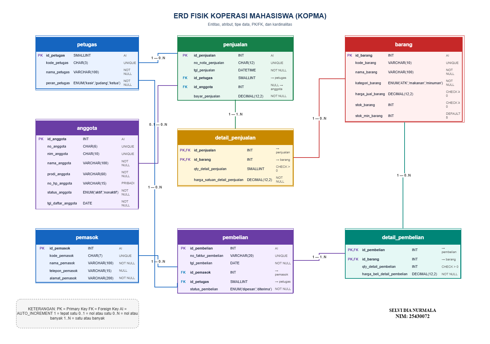

# Laporan Praktikum Basis Data - Pertemuan 3

**Nama:** Selvi Dian Nurmala  
**NIM:** 25430072  
**Kelas:** C  
**Program Studi:** S1 Ilmu Komputer  
**Mata Kuliah:** Basis Data  
**Dosen Pengampu:** Dedi Irawan, S.Kom., M.T.I.  
**Tanggal:** 12 Oktober 2026

---

## 1. Tujuan Praktikum

Praktikum ini bertujuan untuk:

1. Mengidentifikasi entitas, atribut, dan kunci dalam perancangan basis data.
2. Menentukan relasi antarentitas berdasarkan aturan bisnis.
3. Menentukan kardinalitas dan partisipasi setiap relasi.
4. Memodelkan hubungan banyak ke banyak menggunakan entitas asosiatif.
5. Membuat Entity Relationship Diagram (ERD) menggunakan draw.io.
6. Memeriksa kesesuaian ERD dengan proses bisnis dan kebutuhan informasi proyek Kopma.

## 2. Ringkasan Dasar Teori

Entity Relationship Diagram (ERD) merupakan diagram yang digunakan untuk menggambarkan entitas, atribut, dan hubungan antardata dalam suatu sistem basis data.

Entitas merupakan objek yang datanya disimpan dalam basis data, sedangkan atribut merupakan informasi yang menjelaskan entitas tersebut. Primary Key (PK) digunakan untuk mengidentifikasi data secara unik. Foreign Key (FK) digunakan untuk menghubungkan data pada entitas yang berbeda.

Relasi menggambarkan hubungan antarentitas. Kardinalitas menjelaskan jumlah keterhubungan data, misalnya satu ke satu, satu ke banyak, atau banyak ke banyak.

Hubungan banyak ke banyak dapat dimodelkan menggunakan entitas asosiatif. Dalam proyek Kopma, hubungan antara penjualan dan barang dihubungkan melalui detail_penjualan. Hubungan antara pembelian dan barang dihubungkan melalui detail_pembelian.

ERD harus disusun berdasarkan kebutuhan data, proses bisnis, dan aturan bisnis agar struktur data mendukung kegiatan operasional serta penyusunan laporan.

## 3. Hasil Langkah Percobaan

### 3.1 Identifikasi Entitas dan Atribut

Berdasarkan kebutuhan data proyek Kopma, ERD terdiri atas delapan entitas utama berikut.

1. **anggota**, untuk menyimpan informasi anggota koperasi.
2. **barang**, untuk menyimpan informasi barang yang dijual dan dibeli.
3. **petugas**, untuk menyimpan informasi petugas koperasi.
4. **penjualan**, untuk menyimpan informasi transaksi penjualan.
5. **detail_penjualan**, untuk menyimpan rincian barang pada transaksi penjualan.
6. **pemasok**, untuk menyimpan informasi pemasok barang.
7. **pembelian**, untuk menyimpan informasi transaksi pembelian dari pemasok.
8. **detail_pembelian**, untuk menyimpan rincian barang dalam transaksi pembelian.

Setiap entitas dilengkapi dengan atribut sesuai kebutuhan proyek. PK digunakan sebagai identitas data, sedangkan FK digunakan untuk menunjukkan hubungan antarentitas.

### 3.2 Pemetaan Entitas terhadap Proses Bisnis dan Kebutuhan Informasi

Pemetaan entitas berikut disusun berdasarkan dokumen kebutuhan data dan matriks CRUD proyek Kopma pada Pertemuan 2. Pemetaan untuk entitas yang tidak tercantum secara eksplisit dalam matriks CRUD ditandai sebagai inferensi berdasarkan fungsi entitas dalam proses bisnis.

| Entitas | Proses Bisnis (PB) | Kebutuhan Informasi (KI) | Keterangan |
|---|---|---|---|
| anggota | PB-01, PB-02, PB-05 | KI-04 | Data anggota digunakan untuk pendaftaran, identifikasi anggota saat penjualan, dan analisis belanja anggota. |
| barang | PB-02, PB-03, PB-04, PB-05 | KI-02, KI-03 | Data barang digunakan dalam penjualan, pemesanan, penerimaan barang, laporan barang terlaris, dan pemantauan stok. |
| petugas | PB-02, PB-03, PB-04, PB-05 | Tidak disebutkan secara langsung | Data petugas mendukung identifikasi petugas yang menangani kegiatan koperasi. |
| penjualan | PB-02, PB-05 | KI-01, KI-04 | Data penjualan digunakan untuk menghitung omzet, jumlah nota, dan belanja anggota. |
| detail_penjualan | PB-02, PB-05 | KI-01, KI-02, KI-04 | Rincian penjualan digunakan untuk menghitung nilai transaksi dan jumlah barang terjual. |
| pemasok | PB-03, PB-04, PB-05, PB-06 | Tidak disebutkan secara langsung | Data pemasok digunakan dalam pemesanan, penerimaan barang, pelaporan, dan pengelolaan pemasok. |
| pembelian | PB-03, PB-04, PB-05 | Tidak disebutkan secara langsung | Data pembelian digunakan untuk mencatat transaksi pembelian dan mendukung pencatatan penerimaan barang. |
| detail_pembelian | PB-03, PB-04, PB-05 | Tidak disebutkan secara langsung | Rincian pembelian digunakan untuk mencatat barang dan jumlah barang dalam transaksi pembelian. |

**Keterangan:**
- PB merupakan Proses Bisnis.
- KI merupakan Kebutuhan Informasi.
- KI-01: omzet dan jumlah nota per hari atau bulan.
- KI-02: lima barang terlaris setiap bulan berdasarkan jumlah terjual.
- KI-03: barang dengan stok di bawah batas minimum.
- KI-04: sepuluh anggota dengan belanja terbesar setiap bulan.
- Pemetaan entitas disusun berdasarkan matriks CRUD dan kebutuhan data pada Pertemuan 2. Pemetaan yang tidak tercantum secara eksplisit dalam matriks CRUD ditentukan berdasarkan fungsi entitas dalam proses bisnis Kopma.

**Bukti tangkapan layar pemetaan entitas ke PB/KI:**

### 3.3 Penentuan Relasi dan Kardinalitas

Relasi antarentitas ditentukan berdasarkan aturan bisnis proyek Kopma. Kardinalitas menunjukkan jumlah keterhubungan antara data pada dua entitas.

| No. | Relasi | Kardinalitas | Alasan |
|---|---|---|---|
| 1 | petugas melayani penjualan | Satu petugas dapat melayani nol atau banyak penjualan; setiap penjualan dilayani satu petugas. | Transaksi penjualan dicatat bersama petugas yang melayani. |
| 2 | anggota melakukan penjualan | Satu anggota dapat memiliki nol atau banyak penjualan; satu penjualan dapat tidak memiliki anggota atau terhubung dengan satu anggota. | Pembeli dapat merupakan anggota atau pembeli umum. |
| 3 | penjualan berisi detail_penjualan | Satu penjualan memiliki satu atau banyak detail; setiap detail mengacu pada satu penjualan. | Satu nota dapat berisi beberapa jenis barang. |
| 4 | barang tercantum dalam detail_penjualan | Satu barang dapat muncul pada nol atau banyak detail penjualan; setiap detail mengacu pada satu barang. | Barang yang sama dapat muncul pada transaksi berbeda. |
| 5 | pemasok memasok pembelian | Satu pemasok dapat berhubungan dengan nol atau banyak pembelian; setiap pembelian mengacu pada satu pemasok. | Satu pemasok dapat terlibat dalam beberapa transaksi pembelian. |
| 6 | pembelian berisi detail_pembelian | Satu pembelian memiliki satu atau banyak detail; setiap detail mengacu pada satu pembelian. | Satu transaksi pembelian dapat mencakup beberapa barang. |
| 7 | barang tercantum dalam detail_pembelian | Satu barang dapat muncul pada nol atau banyak detail pembelian; setiap detail mengacu pada satu barang. | Barang yang sama dapat dibeli pada transaksi berbeda. |

Kardinalitas pada tabel harus sesuai dengan simbol Crow's Foot yang ditampilkan pada diagram ERD. Setiap relasi juga perlu memiliki nama yang menjelaskan hubungan antardata.

**Bukti tangkapan layar alasan kardinalitas:**

### 3.4 Pembuatan ERD Menggunakan draw.io

ERD proyek Kopma dibuat menggunakan draw.io. Diagram terdiri atas delapan entitas yang dilengkapi atribut, PK, FK, tipe data, constraint, relasi, dan kardinalitas sesuai rancangan yang digunakan.

Diagram juga memuat nama organisasi Kopma serta identitas mahasiswa berupa nama dan NIM.

**Bukti tangkapan layar ERD:**

Berkas sumber diagram disimpan dalam format draw.io agar dapat dibuka dan diedit kembali.

Nama berkas sumber: `p03_erd_kopma_25430072.drawio`

### 3.5 Tinjauan Klien

Tinjauan klien dilakukan dengan meminta masukan dari teman yang berperan sebagai ketua Kopma. Masukan tersebut digunakan untuk menilai kesesuaian rancangan ERD dengan kebutuhan koperasi.

**Masukan pertama:**

[Tuliskan masukan yang benar-benar diberikan oleh teman.]

**Keputusan dan alasan:**

[Tuliskan apakah masukan diterima atau ditolak beserta alasannya.]

**Masukan kedua:**

[Tuliskan masukan kedua yang benar-benar diberikan oleh teman.]

**Keputusan dan alasan:**

[Tuliskan apakah masukan diterima atau ditolak beserta alasannya.]

**Bukti tangkapan layar tinjauan klien:**

## 4. Jawaban Titik Analisis

### 4.1 Penelusuran KI-01

KI-01 adalah kebutuhan informasi mengenai omzet dan jumlah nota per hari atau bulan. Entitas penjualan menyimpan informasi transaksi, sedangkan detail_penjualan menyimpan rincian barang yang terjual. Kedua entitas digunakan untuk mendukung perhitungan omzet dan jumlah nota dalam periode tertentu.

### 4.2 Penelusuran KI-02

KI-02 adalah kebutuhan informasi mengenai lima barang terlaris setiap bulan. Entitas barang menyimpan identitas barang, sedangkan detail_penjualan menyimpan jumlah barang yang terjual. Data tersebut dapat digunakan untuk menentukan barang dengan jumlah penjualan tertinggi dalam satu bulan.

### 4.3 Penelusuran KI-03

KI-03 adalah kebutuhan informasi mengenai barang dengan stok di bawah batas minimum. Informasi ini menggunakan atribut stok_barang dan batas_minimum_stok pada entitas barang.

### 4.4 Penelusuran KI-04

KI-04 adalah kebutuhan informasi mengenai sepuluh anggota dengan belanja terbesar setiap bulan. Informasi ini menggunakan entitas anggota, penjualan, dan detail_penjualan untuk menghubungkan identitas anggota dengan transaksi serta nilai belanjanya.

### 4.5 Hubungan Banyak ke Banyak

Hubungan antara penjualan dan barang dimodelkan melalui detail_penjualan. Satu transaksi penjualan dapat mencakup beberapa barang, sedangkan satu barang dapat muncul pada banyak transaksi.

Hubungan antara pembelian dan barang dimodelkan melalui detail_pembelian. Entitas tersebut menyimpan rincian barang pada setiap transaksi pembelian.

## 5. Hasil Latihan dan Modifikasi

Dalam pengerjaan ERD, data transaksi dipisahkan dari rincian transaksinya. Entitas penjualan dipisahkan dari detail_penjualan, sedangkan pembelian dipisahkan dari detail_pembelian.

Pemisahan tersebut memungkinkan satu transaksi mencakup beberapa jenis barang tanpa menyimpan seluruh rincian barang dalam satu atribut transaksi.

PK digunakan untuk mengidentifikasi data, sedangkan FK digunakan untuk menghubungkan entitas. Relasi dan kardinalitas disusun berdasarkan kebutuhan proses bisnis dan aturan bisnis proyek Kopma.

Modifikasi akhir yang dilakukan harus sesuai dengan diagram yang benar-benar dibuat dan disimpan.

## 6. Tugas Mandiri: Milestone Proyek 3

Tugas mandiri pada Pertemuan 3 adalah menyusun ERD proyek Kopma berdasarkan dokumen kebutuhan data dari Pertemuan 2.

Berkas yang disiapkan meliputi:
1. `p03_erd_kopma_25430072.drawio`
2. `p03_erd_kopma_25430072.png`
3. `p03_laporan_25430072.md`

ERD memuat delapan entitas utama, atribut, PK, FK, relasi, dan kardinalitas. Diagram menjadi dasar untuk tahap perancangan struktur tabel pada pertemuan berikutnya.

Sebelum milestone diselesaikan, diagram perlu diperiksa terhadap kebutuhan proses bisnis, kebutuhan informasi, aturan bisnis, dan masukan klien.

## 7. Pembahasan dan Kendala

Penyusunan ERD membutuhkan ketelitian dalam menentukan entitas, atribut, kunci, relasi, dan kardinalitas. Hubungan yang tidak sesuai dapat menyebabkan rancangan basis data tidak memenuhi kebutuhan operasional.

Kendala yang dialami selama praktikum:

[Tuliskan kendala yang benar-benar dialami selama pengerjaan.]

Penyelesaian kendala:

[Tuliskan cara yang benar-benar dilakukan untuk mengatasi kendala tersebut.]

## 8. Kesimpulan

Praktikum Pertemuan 3 membahas pemodelan data menggunakan Entity Relationship Diagram. Dalam proyek Kopma, delapan entitas utama digunakan untuk mendukung pencatatan anggota, barang, petugas, penjualan, rincian penjualan, pemasok, pembelian, dan rincian pembelian.

Setiap entitas memiliki atribut dan kunci yang diperlukan. Relasi serta kardinalitas disusun berdasarkan kebutuhan data dan aturan bisnis proyek.

ERD yang dihasilkan menjadi dasar untuk melanjutkan perancangan struktur tabel dan implementasi basis data. Diagram perlu diperiksa kembali agar sesuai dengan dokumen kebutuhan data dan ketentuan Modul 3.

## 9. Pernyataan Penggunaan AI

AI digunakan sebagai alat bantu untuk memahami materi ERD dan merapikan penyusunan laporan. Isi akhir laporan, diagram, tangkapan layar, dan bukti pengerjaan harus sesuai dengan pekerjaan yang benar-benar dilakukan.

## 10. Bukti Git

**Tautan repositori GitHub:**

[Masukkan tautan repositori GitHub proyek.]

**Hash commit Milestone 3:**

[Masukkan hash commit setelah perubahan selesai di-commit.]

**Pesan commit:**

`p03: erd kopma`

Bukti Git dilengkapi setelah berkas diperiksa, perubahan di-commit, dan hasilnya berhasil di-push ke GitHub.

## Checklist Laporan Pertemuan 3

### Berkas wajib
- [ ] Berkas sumber ERD draw.io tersedia.
- [ ] Berkas gambar ERD tersedia.
- [ ] Nama berkas sesuai ketentuan Modul 3.
- [ ] Laporan disimpan sebagai `p03_laporan_25430072.md`.

### Bukti tangkapan layar
- [ ] Pemetaan setiap entitas ke PB/KI dari Pertemuan 2.
- [ ] Alasan kardinalitas relasi utama.
- [ ] ERD di draw.io dengan kardinalitas terbaca.
- [ ] Catatan tinjauan klien.

### Pemeriksaan ERD
- [ ] Entitas dan atribut telah diperiksa.
- [ ] PK dan FK telah ditandai.
- [ ] Nama relasi dan kardinalitas telah diperiksa.
- [ ] Hubungan banyak ke banyak menggunakan entitas asosiatif.
- [ ] Nama organisasi tercantum pada judul diagram.
- [ ] Nama dan NIM tercantum pada sudut diagram.
- [ ] ERD telah diperiksa terhadap kebutuhan proyek Kopma.

### Laporan dan Git
- [ ] Seluruh bagian laporan telah diperiksa.
- [ ] Tautan repositori GitHub telah dicantumkan.
- [ ] Hash commit telah dicantumkan setelah commit dibuat.
- [ ] Perubahan telah di-commit dengan pesan yang sesuai.
- [ ] Perubahan telah di-push ke GitHub.