# LAPORAN PRAKTIKUM BASIS DATA
## PERTEMUAN 04 — NORMALISASI DAN SKEMA RELASIONAL

**Nama:** Selvi Dia Nurmala  **NIM:** 25430072  **Kelas:** C  **Pertemuan:** 04  **Tanggal Pelaksanaan:** [20 Oktober 2026]  **Dosen/Asisten:** [Dedi Irawan, S.Kom., M.T.I.]

---

## 1. Tujuan Praktikum

1. Mengidentifikasi anomali ubah, sisip, dan hapus pada data yang belum dinormalisasi.
2. Menentukan dependensi fungsional berdasarkan aturan bisnis.
3. Melakukan normalisasi dari UNF hingga 3NF.
4. Memeriksa BCNF dan menyusun skema relasional.
5. Menentukan penyimpanan nilai turunan berdasarkan kebutuhan data.

## 2. Ringkasan Dasar Teori

Normalisasi adalah proses penyusunan data ke dalam tabel yang terstruktur untuk mengurangi pengulangan data dan mencegah anomali ubah, sisip, serta hapus. Bentuk tidak normal (UNF) masih dapat memiliki kelompok atribut berulang. Bentuk normal pertama (1NF) mengharuskan setiap atribut memiliki nilai atomik. Bentuk normal kedua (2NF) menghilangkan ketergantungan parsial terhadap sebagian kunci komposit, sedangkan bentuk normal ketiga (3NF) menghilangkan ketergantungan transitif yang tidak sesuai. Boyce-Codd Normal Form (BCNF) mengharuskan setiap penentu dalam dependensi fungsional nontrivial merupakan superkey. Dependensi fungsional digunakan untuk mengetahui hubungan antaratribut, sedangkan kunci primer dan kunci tamu digunakan untuk mengidentifikasi baris dan menghubungkan tabel.

## 3. Hasil Langkah Percobaan

### 3.1 Tahap UNF

Pada tahap UNF, data penjualan masih digabungkan dalam satu relasi yang berisi informasi nota, petugas, anggota, dan barang. Satu nota dapat memiliki beberapa barang sehingga kelompok atribut barang dapat berulang.

**Bukti tangkapan layar:**

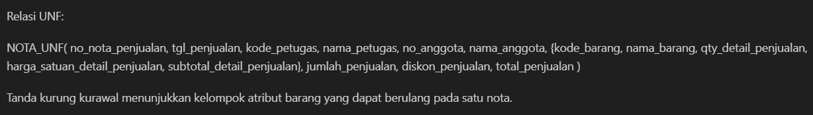

**Keterangan:** Tangkapan layar menunjukkan struktur data penjualan sebelum dilakukan normalisasi.

### 3.2 Tahap 1NF

Pada tahap 1NF, kelompok atribut barang yang berulang dihilangkan sehingga setiap baris mewakili satu barang pada satu nota. Kunci primer komposit yang digunakan adalah `(no_nota_penjualan, kode_barang)`.

**Bukti tangkapan layar:**

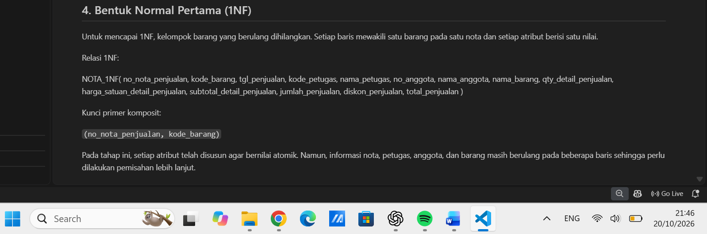

**Keterangan:** Setiap baris menunjukkan satu barang dalam transaksi penjualan dan setiap atribut memiliki nilai atomik.

### 3.3 Tahap 2NF

Pada tahap 2NF, relasi dipisahkan menjadi PENJUALAN, BARANG, dan DETAIL_PENJUALAN. Pemisahan dilakukan untuk menghilangkan ketergantungan parsial terhadap sebagian kunci komposit.

**Bukti tangkapan layar:**

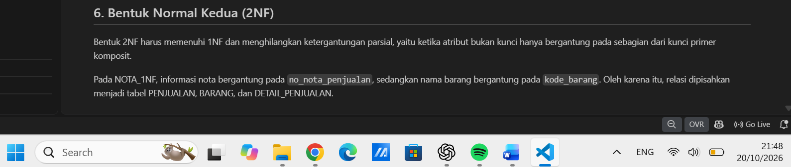

**Keterangan:** Tabel dipisahkan berdasarkan atribut yang bergantung pada kunci masing-masing relasi.

### 3.4 Tahap 3NF

Pada tahap 3NF, informasi petugas dan anggota dipisahkan dari tabel PENJUALAN. Pemisahan ini dilakukan untuk menghilangkan ketergantungan transitif dan mengurangi pengulangan informasi.

**Bukti tangkapan layar:**

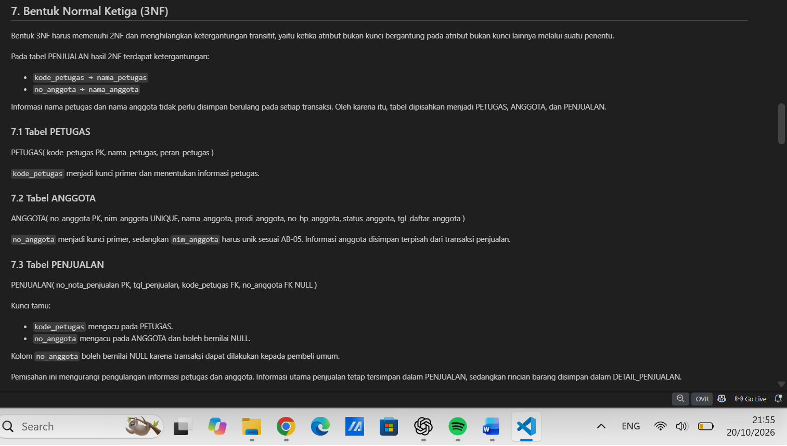

**Keterangan:** Struktur tabel telah memisahkan informasi petugas, anggota, barang, penjualan, dan detail penjualan.

### 3.5 Skema Relasional

Skema relasional Kopma terdiri dari tabel PETUGAS, ANGGOTA, BARANG, PEMASOK, PENJUALAN, DETAIL_PENJUALAN, PEMBELIAN, dan DETAIL_PEMBELIAN.

Tabel PEMASOK_TELEPON ditambahkan untuk menyimpan beberapa nomor telepon milik satu pemasok.

**Bukti tangkapan layar:**

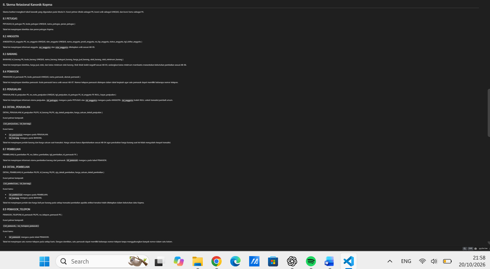

**Keterangan:** Skema relasional menunjukkan tabel, kunci primer, kunci tamu, dan hubungan antartabel.

## 4. Jawaban Titik Analisis

### 4.1 Titik Analisis 1 — Dependensi Fungsional Harga Satuan

Dependensi fungsional FD5 menempatkan `qty_detail_penjualan` dan `harga_satuan_detail_penjualan` pada gabungan kunci `(no_nota_penjualan, kode_barang)`. Hal ini karena jumlah dan harga satuan merupakan informasi detail suatu barang dalam transaksi tertentu. Harga transaksi tidak selalu sama dengan harga barang saat ini.

Jika harga satuan transaksi hanya disimpan dalam tabel BARANG, perubahan harga dapat menyebabkan laporan omzet tahun sebelumnya menggunakan harga yang berbeda dari harga ketika transaksi terjadi. Oleh karena itu, harga satuan transaksi perlu disimpan pada DETAIL_PENJUALAN agar riwayat harga setiap transaksi tetap terjaga.

### 4.2 Titik Analisis 2 — Penyimpanan Nilai Total

Pada data operasional, subtotal dan total penjualan dapat dihitung berdasarkan jumlah barang, harga satuan, dan aturan diskon. Penghitungan ini membantu mengurangi risiko ketidakkonsistenan apabila data transaksi berubah.

Namun, pada arsip transaksi yang telah disahkan, nilai total dapat disimpan sebagai snapshot agar catatan historis tidak berubah ketika harga barang atau aturan lain diperbarui.

Dengan demikian, nilai turunan pada data operasional dapat dihitung saat dibutuhkan, sedangkan nilai historis dapat disimpan apabila diperlukan untuk audit dan pelaporan.

### 4.3 Titik Analisis 3 — Informasi Pemasok Barang

Informasi pemasok barang dapat diketahui melalui tabel PEMBELIAN dan DETAIL_PEMBELIAN. Tabel PEMBELIAN menghubungkan transaksi pembelian dengan PEMASOK melalui `id_pemasok`, sedangkan DETAIL_PEMBELIAN menghubungkan transaksi pembelian dengan BARANG melalui `id_barang`.

Dengan hubungan tersebut, sistem dapat mengetahui pemasok barang berdasarkan riwayat transaksi pembelian tanpa harus menyimpan informasi pemasok berulang kali pada tabel BARANG.

## 5. Hasil Latihan dan Modifikasi

### 5.1 Relasi PEMASOK_TELEPON

Jika satu pemasok dapat memiliki beberapa nomor telepon, nomor telepon sebaiknya disimpan dalam relasi terpisah agar setiap nomor dicatat pada baris tersendiri.

Struktur relasinya adalah:

`PEMASOK_TELEPON(id_pemasok, no_telepon_pemasok)`

Keterangan:

- **Primary Key:** `(id_pemasok, no_telepon_pemasok)`.
- **Foreign Key:** `id_pemasok` mengacu pada tabel PEMASOK.

Relasi tersebut memungkinkan satu pemasok memiliki beberapa nomor telepon tanpa menggabungkan seluruh nomor ke dalam satu kolom.

### 5.2 Anomali Perubahan Nama Anggota

Jika `nama_anggota` disimpan langsung dalam tabel PENJUALAN, informasi nama anggota dapat berulang pada beberapa nota.

Contoh data:

| no_nota_penjualan | no_anggota | nama_anggota |
|---|---|---|
| N001 | A001 | Siti Aminah |
| N002 | A001 | Siti Aminah |
| N003 | A001 | Siti Aminah |

Dependensi fungsional yang berlaku adalah:

`no_anggota → nama_anggota`

Jika nama anggota hanya diubah pada satu nota, data nama anggota pada nota lainnya menjadi tidak konsisten. Kondisi ini merupakan anomali perubahan.

Contoh kueri pada rancangan yang belum dinormalisasi:

```sql
UPDATE PENJUALAN
SET nama_anggota = 'Siti A.'
WHERE no_nota_penjualan = 'N001';
```
### 5.3 Hasil Normalisasi Proyek

Proyek Toko Serba Digital menggunakan tabel PELANGGAN, PESANAN, PRODUK, dan DETAIL_PESANAN. Normalisasi proyek dilakukan berdasarkan aturan bisnis dan dependensi fungsional yang telah diidentifikasi pada pertemuan sebelumnya.

Tahapan normalisasi proyek meliputi:

1. **UNF (Unnormalized Form):** Mengidentifikasi struktur data awal sebelum normalisasi.
2. **1NF (First Normal Form):** Memastikan setiap atribut memiliki nilai atomik dan tidak terdapat kelompok atribut berulang.
3. **2NF (Second Normal Form):** Menghilangkan ketergantungan parsial terhadap sebagian kunci komposit.
4. **3NF (Third Normal Form):** Menghilangkan ketergantungan transitif yang tidak sesuai.
5. **BCNF (Boyce-Codd Normal Form):** Memeriksa apakah setiap penentu dalam dependensi fungsional nontrivial merupakan superkey.

**Bukti Tangkapan Layar:**

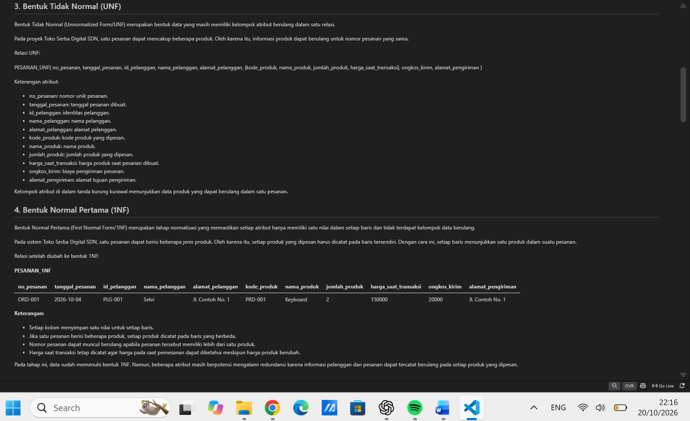

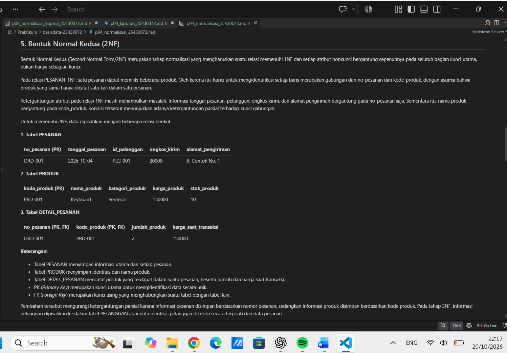

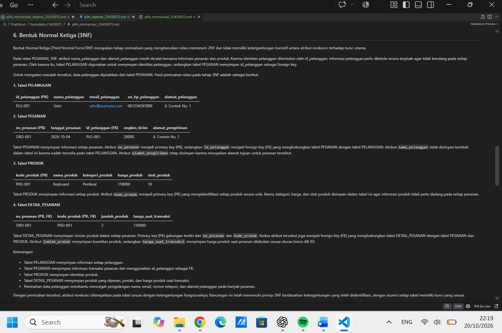


**Keterangan:** Tangkapan layar menunjukkan hasil normalisasi proyek Toko Serba Digital dari UNF hingga 3NF beserta pemeriksaan BCNF.

**Keputusan Nilai Turunan:**

Nilai turunan pada proyek perlu ditentukan berdasarkan aturan bisnis. Nilai yang dapat dihitung dari atribut lain dapat dihitung saat dibutuhkan untuk mengurangi redundansi. Apabila nilai perlu dipertahankan sebagai catatan historis transaksi, penyimpanannya harus disesuaikan dengan kebutuhan sistem.

**Pemeriksaan ERD:**

Hasil normalisasi dibandingkan dengan ERD dari Pertemuan 3. Jika terdapat perubahan tabel, atribut, kunci primer, kunci tamu, atau hubungan antartabel, perubahan tersebut dicatat dalam dokumen normalisasi proyek.

## 6. Tugas Mandiri: Milestone Proyek 04

Tugas mandiri Pertemuan 4 adalah melakukan normalisasi terhadap proyek Toko Serba Digital berdasarkan hasil analisis kebutuhan data dari Pertemuan 2.

Berkas yang berkaitan dengan pekerjaan ini adalah:

1. `p04_normalisasi_25430072.md`
2. `p04_normalisasi_kopma_25430072.md`
3. `Laporan/p04_laporan_25430072.md`

Normalisasi proyek mencakup identifikasi dependensi fungsional berdasarkan aturan bisnis, penyusunan tahap UNF hingga 3NF, pemeriksaan BCNF, dan penentuan penyimpanan nilai turunan.

Hasil normalisasi perlu dibandingkan dengan ERD dari Pertemuan 3. Jika terdapat perubahan struktur tabel, atribut, kunci primer, kunci tamu, atau hubungan antartabel, perubahan tersebut harus dicatat dalam dokumen normalisasi proyek.

**Bukti Tangkapan Layar:**

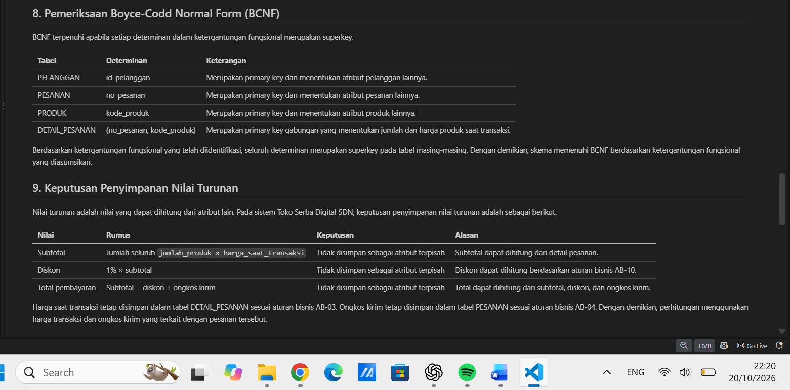

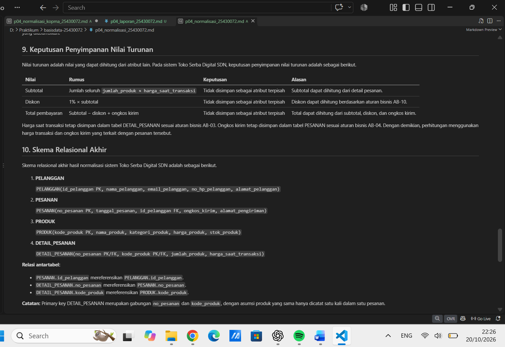

**Keterangan:** Tangkapan layar menunjukkan dokumen normalisasi proyek Toko Serba Digital, termasuk dependensi fungsional, pemeriksaan BCNF, keputusan penyimpanan nilai turunan, dan skema relasional akhir.

## 7. Pembahasan dan Kendala

Normalisasi membantu mengurangi pengulangan data dan mencegah anomali ubah, sisip, dan hapus. Pemisahan informasi berdasarkan dependensi fungsional membuat struktur data lebih terorganisasi.

Harga satuan pada detail transaksi perlu dipertahankan agar riwayat harga ketika transaksi terjadi tidak berubah. Sementara itu, subtotal dan total operasional dapat dihitung berdasarkan detail transaksi dan aturan bisnis. Nilai historis dapat disimpan sebagai snapshot apabila diperlukan untuk audit dan pelaporan.

**Kendala yang Dialami:**

Kendala yang dialami adalah memastikan dokumen normalisasi dan laporan tersusun dengan rapi serta seluruh tangkapan layar ditampilkan dengan benar.

**Cara Mengatasi Kendala:**

Kendala diatasi dengan memeriksa kembali isi dokumen, menyesuaikan nama berkas gambar dengan tautan Markdown, dan melihat hasilnya melalui pratinjau Markdown.

## 8. Kesimpulan

Normalisasi dilakukan untuk mengurangi pengulangan data dan menghilangkan ketergantungan yang tidak sesuai melalui tahapan UNF, 1NF, 2NF, dan 3NF. Dependensi fungsional menjadi dasar pemisahan tabel serta penentuan kunci primer dan kunci tamu. Nilai turunan dapat dihitung pada data operasional, sedangkan nilai historis dapat disimpan sebagai snapshot apabila diperlukan.

## 9. Pernyataan Penggunaan AI

AI ChatGPT digunakan sebagai alat bantu untuk memahami konsep, menyusun draf penjelasan, dan memeriksa struktur laporan. Isi laporan diperiksa kembali dan disesuaikan dengan materi praktikum, dokumen proyek, serta hasil pekerjaan sendiri.

## 10. Bukti Git

**Repositori:** https://github.com/selvidianurmala9-oss/basisdata_25430072

**Pesan Commit:** `p04: normalisasi kopma`

**Hash Commit:** [Isi dengan hash commit setelah commit berhasil dilakukan.]

**Bukti Tangkapan Layar:**

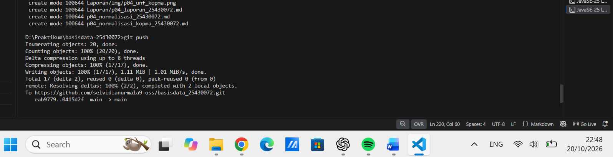

**Keterangan:** Tangkapan layar menunjukkan bukti commit dan push berkas praktikum ke repositori GitHub.

## Checklist Umum

- [x] Identitas lengkap: nama, NIM, kelas, pertemuan, tanggal, dan nama dosen/asisten.
- [x] Ringkasan teori maksimal setengah halaman.
- [x] Langkah percobaan dilengkapi tangkapan layar asli dan keterangan singkat.
- [x] Semua Titik Analisis dijawab lengkap dengan alasan.
- [x] Hasil latihan dan modifikasi disertakan.
- [x] Tugas mandiri dan berkas milestone proyek dijelaskan.
- [x] Pembahasan dan kendala disertakan.
- [x] Kesimpulan terdiri dari 2–4 kalimat.
- [x] Pernyataan penggunaan AI ditulis dengan jujur.
- [x] Tautan repositori dan hash commit dicantumkan.
- [x] Tangkapan layar sesuai dengan hasil pekerjaan sebenarnya.
- [x] Nama berkas gambar sesuai dengan tautan Markdown.
- [x] Pratinjau Markdown diperiksa menggunakan `Ctrl+Shift+V`.
- [x] Perubahan diperiksa sebelum commit dan push