# Laporan Praktikum Basis Data - Pertemuan 05

**Nama:** Selvi Dia Nurmala
**NIM:** 25430072
**Kelas:** C
**Tanggal:** 27 Oktober 2026
**Asisten/Dosen:** Dedi Irawan, S.Kom., M.T.I.

---

## 1. Tujuan Praktikum

1. Membangun struktur basis data praktik (`kopma_072`) dan proyek (`toko_072`) dengan perintah DDL (`CREATE TABLE`).
2. Menerapkan constraint (PRIMARY KEY, FOREIGN KEY, UNIQUE, NOT NULL, DEFAULT, CHECK) agar aturan bisnis ditegakkan oleh basis data.
3. Membuktikan constraint bekerja dengan sengaja melanggarnya dan membaca kode galat yang muncul.
4. Menyusun ERD fisik yang sesuai dengan skrip DDL.

## 2. Ringkasan Dasar Teori

DDL (*Data Definition Language*) dipakai untuk mendefinisikan struktur objek basis data, misalnya `CREATE TABLE`. Pemilihan tipe data menentukan ketepatan dan ukuran penyimpanan: nilai uang memakai `DECIMAL` agar tidak ada galat pembulatan, tanggal memakai `DATE`/`DATETIME`, dan nilai yang terbatas pilihannya memakai `ENUM` atau `CHECK`.

Constraint adalah aturan integritas yang dijaga langsung oleh mesin basis data. `PRIMARY KEY` menjamin baris unik dan tidak kosong, `UNIQUE` mencegah nilai ganda pada kolom non-kunci, `NOT NULL` mewajibkan nilai, `CHECK` membatasi rentang nilai, dan `FOREIGN KEY` menjaga agar nilai yang merujuk tabel lain selalu ada di tabel induknya. Aksi referensial (`ON UPDATE`/`ON DELETE`) menentukan perlakuan baris anak saat baris induk berubah atau dihapus. Dengan constraint, data yang salah ditolak di tingkat basis data, tidak bergantung pada aplikasi.

## 3. Hasil Langkah Percobaan

### 3.1 Pembuatan tabel basis data praktik `kopma_072`

Skrip `p05_ddl_kopma_25430072.sql` diawali `SET FOREIGN_KEY_CHECKS = 0`, lalu `DROP TABLE IF EXISTS` untuk semua tabel agar skrip dapat dijalankan ulang, kemudian `FOREIGN_KEY_CHECKS` dikembalikan ke 1. Tabel dibuat berurutan dari tabel induk (`petugas`, `anggota`, `barang`, `pemasok`) ke tabel anak (`penjualan`, `detail_penjualan`, `pembelian`, `detail_pembelian`).

Potongan contoh (tabel `barang`):

```sql
CREATE TABLE barang (
    id_barang INT UNSIGNED AUTO_INCREMENT,
    kode_barang VARCHAR(15) NOT NULL,
    nama_barang VARCHAR(100) NOT NULL,
    kategori_barang VARCHAR(50),
    harga_jual_barang DECIMAL(12,2) NOT NULL,
    stok_barang INT NOT NULL DEFAULT 0,
    stok_minimum_barang INT NOT NULL DEFAULT 0,
    CONSTRAINT pk_barang PRIMARY KEY (id_barang),
    CONSTRAINT uq_barang_kode UNIQUE (kode_barang),
    CONSTRAINT chk_barang_harga CHECK (harga_jual_barang >= 0),
    CONSTRAINT chk_barang_stok CHECK (stok_barang >= 0),
    CONSTRAINT chk_barang_stok_minimum CHECK (stok_minimum_barang >= 0)
) ENGINE=InnoDB;
```

**Bukti 1 - Struktur basis data `kopma_072` (8 tabel, mesin InnoDB).**
Delapan tabel terbentuk: `anggota`, `barang`, `detail_pembelian`, `detail_penjualan`, `pemasok`, `pembelian`, `penjualan`, `petugas`.

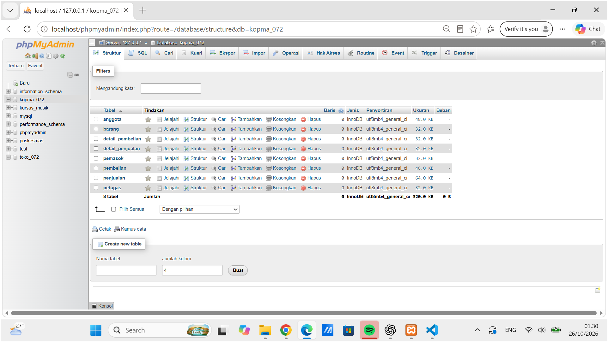

**Bukti 2 - Tabel `barang` masih kosong sebelum uji.**
`SELECT * FROM barang` mengembalikan nol baris dan memperlihatkan ketujuh kolom tabel, sehingga pengujian dimulai dari kondisi bersih.

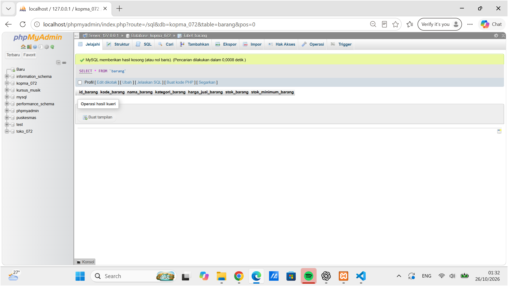

### 3.2 Uji pelanggaran constraint pada `kopma_072`

| No | Constraint diuji | Perintah | Hasil yang diharapkan | Hasil nyata | Status |
|---|---|---|---|---|---|
| 1 | CHECK stok | `INSERT INTO barang (...) VALUES (..., 'Barang Uji Stok', 'Uji', 10000, -1, 0)` | Ditolak | `#4025 - CONSTRAINT chk_barang_stok failed for kopma_072.barang` | Sesuai |
| 2 | UNIQUE kode | `INSERT` barang kedua dengan `kode_barang` = `BRG-UJI-02` yang sudah ada | Ditolak | `#1062 - Duplicate entry 'BRG-UJI-02' for key 'uq_barang_kode'` | Sesuai |
| 3 | FOREIGN KEY | `INSERT INTO penjualan (...)` dengan `id_petugas` = 99999 (tidak ada di `petugas`), `id_anggota` = NULL | Ditolak | `#1452 - Cannot add or update a child row: a foreign key constraint fails (... fk_penjualan_petugas ...)` | Sesuai |
| 4 | CHECK stok (UPDATE) | `UPDATE barang SET stok_barang = -1 WHERE kode_barang = 'BRG-UJI-03'` | Ditolak | `#4025 - CONSTRAINT chk_barang_stok failed for kopma_072.barang` | Sesuai |

**Bukti 3 - INSERT dengan stok negatif ditolak.**

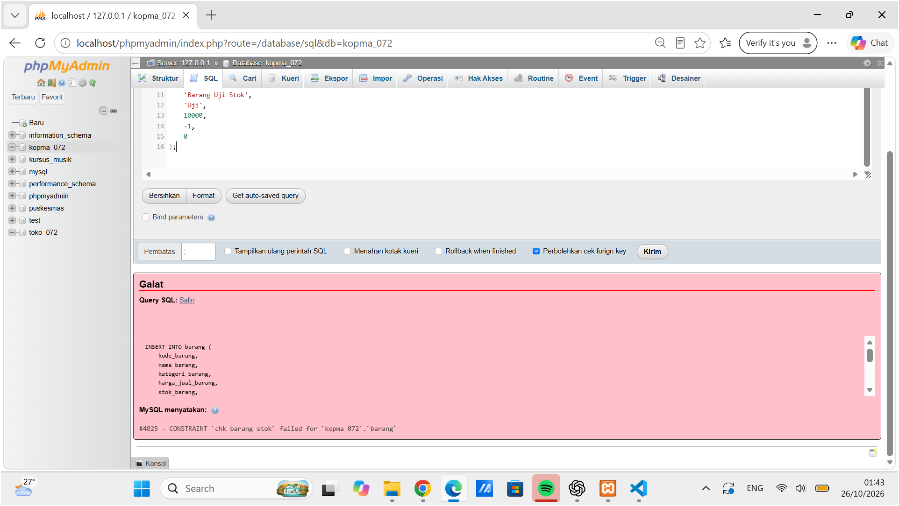

**Bukti 4 - INSERT dengan kode barang duplikat ditolak.**

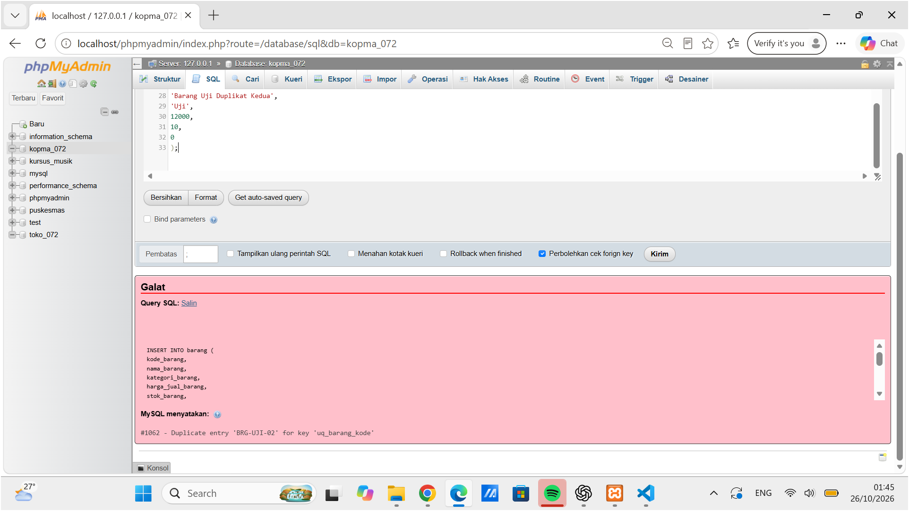

**Bukti 5 - INSERT dengan foreign key tidak valid ditolak.**

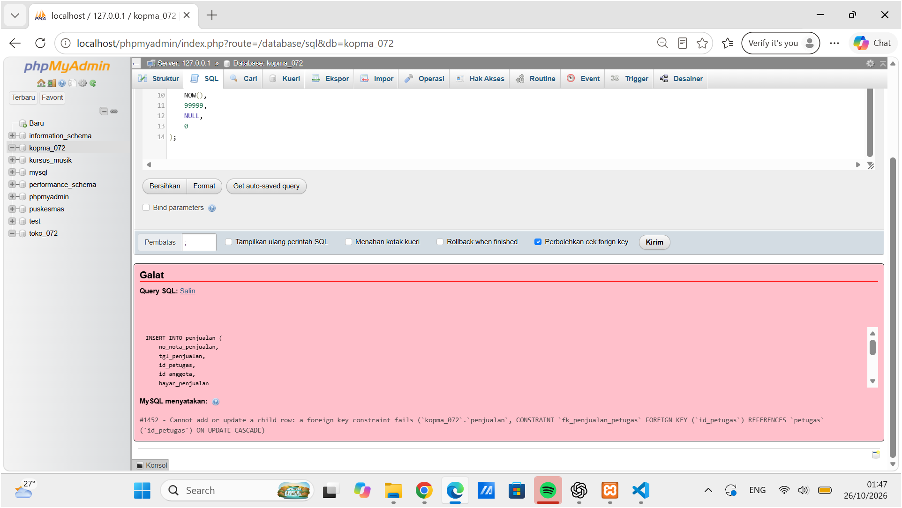

**Bukti 6 - UPDATE stok menjadi negatif ditolak.**
Constraint `CHECK` bekerja pada `INSERT` maupun `UPDATE`. Perintah ini membuktikan baris yang sudah ada tidak bisa diubah menjadi nilai tidak valid.

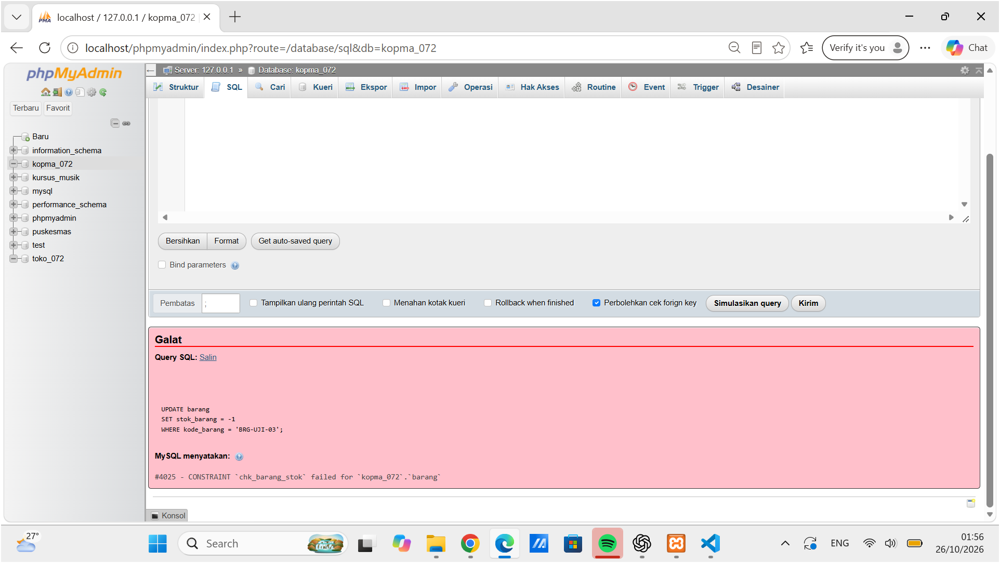

**Bukti 7 - `SHOW CREATE TABLE penjualan`.**
Definisi tabel `penjualan` memperlihatkan constraint `fk_penjualan_petugas` dan `fk_penjualan_anggota` yang menjadi dasar uji foreign key pada Bukti 5.

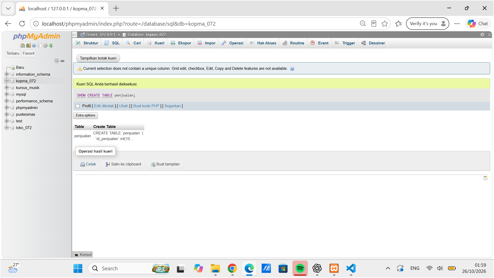

### 3.3 Pembuatan tabel proyek `toko_072`

Skrip `p05_ddl_25430072.sql` membuat basis data `toko_072` berisi 9 tabel: `pelanggan`, `produk`, `admin`, `keranjang`, `detail_keranjang`, `pesanan`, `detail_pesanan`, `pembayaran`, dan `pengiriman`. Urutan pembuatan mengikuti ketergantungan FK (induk lebih dulu).

**Bukti 8 - Struktur basis data `toko_072` (9 tabel).**

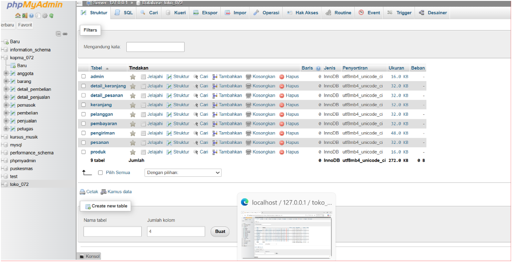

**Bukti 9 - `SHOW CREATE TABLE produk` berhasil dijalankan.**

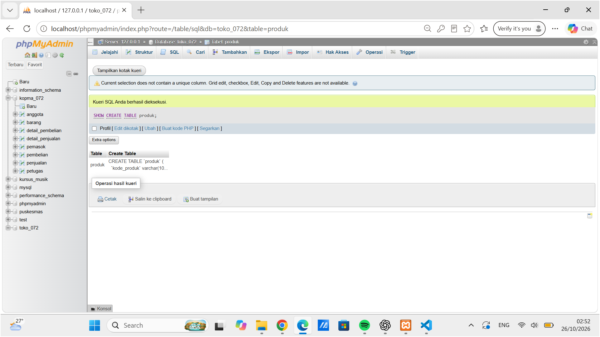

**Bukti 10 - Uji CHECK stok pada tabel `produk`.**

```sql
INSERT INTO produk (kode_produk, nama_produk, kategori_produk, harga_produk, stok_produk)
VALUES ('PR999', 'Produk Uji', 'Elektronik', 10000, -1);
```

Hasil: `#4025 - CONSTRAINT chk_stok_produk failed for toko_072.produk`. Stok negatif ditolak, sesuai aturan bisnis AB-09 (stok tidak boleh negatif).

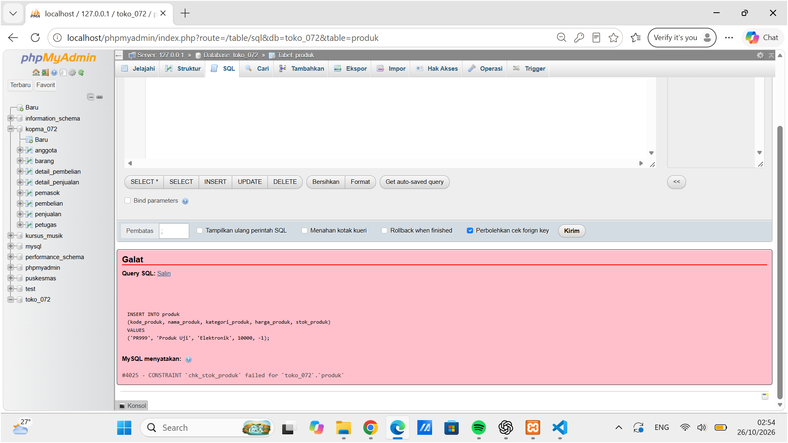

### 3.4 ERD fisik

ERD fisik dibuat di draw.io berdasarkan skrip DDL masing-masing basis data, memuat tipe data, PK/FK, constraint, dan kardinalitas. Tampilan Designer phpMyAdmin dilampirkan sebagai pembanding relasi FK yang terbentuk.

**ERD fisik Toko Serba Digital SDN**

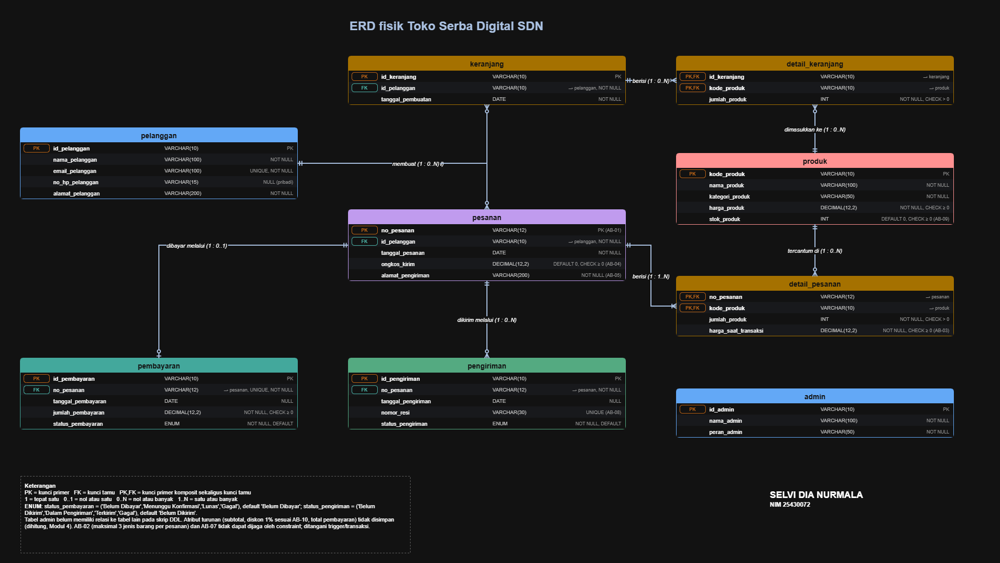

**ERD fisik Kopma**

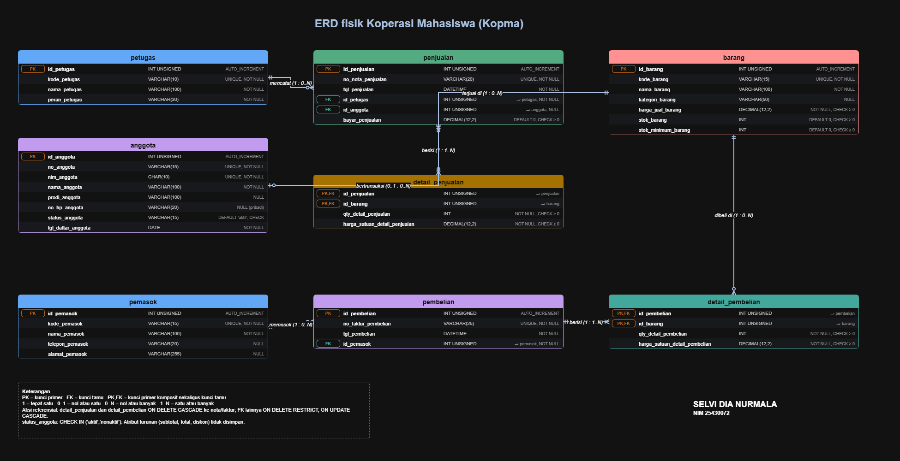

**Designer phpMyAdmin - `toko_072`**

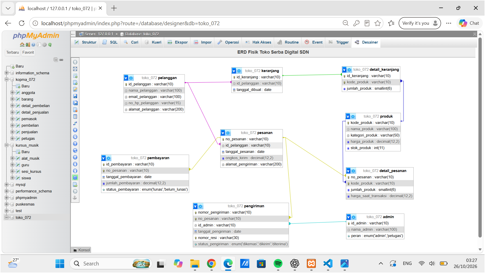

**Designer phpMyAdmin - `kopma_072`**

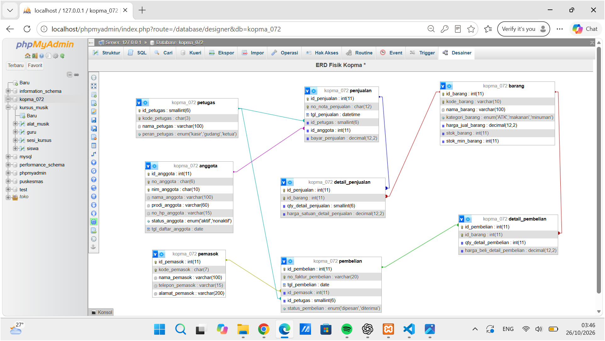

## 4. Jawaban Titik Analisis

### Titik Analisis 1

**Pertanyaan:** Mengapa `fk_detail_penjualan` memakai `ON DELETE CASCADE`, sedangkan `fk_detail_barang` tidak? Apa yang terjadi pada laporan penjualan lama jika barang boleh dihapus beserta seluruh detailnya?

**Jawaban:**

Pada skrip, nama constraint yang dimaksud adalah `fk_detail_penjualan_penjualan` (detail → nota) dan `fk_detail_penjualan_barang` (detail → barang). Keduanya berbeda perlakuan karena hubungan yang dijaganya berbeda:

| Constraint | Aksi | Alasan |
|---|---|---|
| `fk_detail_penjualan_penjualan` | `ON DELETE CASCADE` | `detail_penjualan` adalah bagian dari nota. Rincian tidak punya arti tanpa nota induknya, jadi bila satu nota dihapus, rinciannya ikut dihapus agar tidak ada baris yatim. |
| `fk_detail_penjualan_barang` | `ON DELETE RESTRICT` | `barang` adalah data master yang dirujuk oleh banyak transaksi. Barang yang sudah pernah terjual tidak boleh dihapus, sehingga basis data menolak penghapusannya. |

Jika barang boleh dihapus beserta seluruh detailnya (`CASCADE` pada FK ke `barang`), maka menghapus satu barang akan menghapus semua baris `detail_penjualan` dan `detail_pembelian` yang memuat barang itu, pada seluruh nota lama. Akibatnya:

1. Nota lama tetap ada tetapi rinciannya hilang atau tidak lengkap.
2. Total nota yang dihitung dari detail menjadi lebih kecil daripada `bayar_penjualan`, sehingga laporan omzet harian atau bulanan berubah dan tidak lagi sesuai dengan uang yang benar-benar diterima.
3. Riwayat pembelian dari pemasok dan pergerakan stok hilang, sehingga tidak bisa diaudit.

Dengan `RESTRICT`, barang yang tidak dijual lagi cukup ditandai (misalnya stok 0) dan tidak dihapus, sehingga laporan lama tetap utuh.

### Titik Analisis 2

**Pertanyaan:** Kode galat 1452, 4025, dan 1062 muncul pada tiga percobaan di atas. Petakan setiap kode ke aturan bisnis (AB-xx) yang dilindunginya. Aturan bisnis Kopma mana yang belum dapat dijaga oleh constraint apa pun?

**Jawaban:**

| Kode galat | Constraint | Percobaan | Aturan bisnis yang dilindungi |
|---|---|---|---|
| `#1452` | `fk_penjualan_petugas` (FOREIGN KEY) | `INSERT` penjualan dengan `id_petugas` = 99999 | Tidak ada AB tertulis. Constraint ini menjaga integritas referensial bahwa setiap nota dicatat oleh petugas (kasir) yang terdaftar (entitas Penjualan pada dokumen kebutuhan, proses PB-02). |
| `#4025` | `chk_barang_stok` (CHECK) | `INSERT` dan `UPDATE` dengan `stok_barang` = -1 | **AB-03**: stok barang tidak boleh negatif. |
| `#1062` | `uq_barang_kode` (UNIQUE) | `INSERT` dengan `kode_barang` = `BRG-UJI-02` yang sudah ada | Tidak ada AB tertulis. Aturannya tercantum pada kebutuhan integritas (kode barang harus unik) dan kamus data. Constraint `UNIQUE` sejenis menjaga **AB-01** (nomor nota), **AB-05** (NIM), dan **AB-07** (kode pemasok). |

Dua dari tiga galat melindungi aturan yang belum tertulis sebagai AB, sehingga dokumen kebutuhan sebaiknya dilengkapi dengan AB untuk keduanya.

Aturan bisnis Kopma yang tidak dapat dijaga sepenuhnya oleh constraint:

| AB | Aturan | Mengapa constraint tidak cukup |
|---|---|---|
| AB-01 (bagian kedua) | Setiap nota minimal memiliki satu baris barang | `FOREIGN KEY` hanya memastikan anak punya induk, bukan induk punya anak. Nota tanpa detail tetap bisa tersimpan. |
| AB-02 | Diskon 5% hanya untuk anggota berstatus aktif | Perlu membaca `anggota.status_anggota` dari tabel `penjualan`, dan `CHECK` tidak dapat melihat tabel lain. |
| AB-03 (bagian kedua) | Penjualan ditolak bila qty melebihi stok | `chk_barang_stok` hanya menolak jika stok sudah menjadi negatif saat diperbarui. Membandingkan `qty` pada `detail_penjualan` dengan `barang.stok_barang` dan memperbarui stok perlu transaksi atau trigger. |
| AB-04 | Harga pada nota sama dengan harga jual saat transaksi | Kolom `harga_satuan_detail_penjualan` sudah menyimpan harga per baris, tetapi constraint tidak dapat memeriksa bahwa nilainya sama dengan `barang.harga_jual_barang` saat itu. |
| AB-06 | Pesanan pembelian dibuat bila stok di bawah batas minimum | Aturan proses, bergantung pada perbandingan `stok_barang` dengan `stok_minimum_barang`. |
| AB-08 | Status aktif anggota hanya diubah oleh ketua | Aturan hak akses (siapa yang boleh `UPDATE`), bukan aturan nilai data. Ditangani lewat `GRANT`, role, dan view (Modul 13). |

Aturan-aturan tersebut ditangani pada tahap transaksi dan trigger (Modul 14) serta pengaturan hak akses (Modul 13).

### Titik Analisis 3

**Pertanyaan:** Mengapa `DROP TABLE IF EXISTS` harus dimulai dari `detail_pembelian` dan `detail_penjualan`, bukan dari `petugas`? Apa pesan galat yang muncul jika urutannya dibalik?

**Jawaban:**

Tabel anak memegang foreign key yang merujuk tabel induknya. `petugas` dirujuk oleh `penjualan`, dan `penjualan` dirujuk oleh `detail_penjualan`. Selama tabel yang merujuk masih ada, InnoDB menolak penghapusan tabel yang dirujuk, sebab baris anak akan kehilangan induknya. Karena itu urutan penghapusan harus kebalikan dari urutan pembuatan, dari paling anak ke induk:

```
detail_pembelian → pembelian → detail_penjualan → penjualan → pemasok → barang → anggota → petugas
```

Jika dibalik, misalnya `DROP TABLE petugas;` saat `penjualan` masih ada, perintah ditolak dengan galat sejenis:

```
#1451 - Cannot delete or update a parent row: a foreign key constraint fails
```

Skrip DDL saya memakai `SET FOREIGN_KEY_CHECKS = 0` sebelum rangkaian `DROP TABLE` sebagai pengaman, tetapi urutan dari tabel anak ke induk tetap dipertahankan sebagai praktik yang benar, dan pengecekan FK diaktifkan kembali (`= 1`) sesudahnya.

### Analisis Tambahan

**Alasan pemilihan tipe data**

- `DECIMAL(12,2)` untuk harga, ongkos kirim, bayar, dan jumlah pembayaran karena nilai uang harus tepat; `FLOAT/DOUBLE` dapat menimbulkan galat pembulatan.
- `INT` untuk stok dan kuantitas karena berupa bilangan bulat.
- `VARCHAR(n)` untuk kode/nomor alami (`kode_produk`, `no_pesanan`, `kode_barang`) dan untuk alamat (`VARCHAR(200)`) karena panjangnya dibatasi sesuai kamus data.
- `DATE` untuk tanggal pesanan/pembayaran/pengiriman (jam tidak diperlukan), sedangkan `DATETIME` dipakai pada `tgl_penjualan` dan `tgl_pembelian` di Kopma karena waktu transaksi kasir penting dicatat.
- `ENUM` untuk status pembayaran dan pengiriman karena pilihannya terbatas dan tetap.
- `INT UNSIGNED AUTO_INCREMENT` untuk kunci pengganti (surrogate key) di Kopma agar kunci ringkas dan dibuat otomatis, sedangkan kode alami (`kode_barang`, `no_anggota`) dijaga dengan `UNIQUE`.

**Alasan pemilihan constraint dan kaitannya dengan aturan bisnis (AB) pada proyek toko**

| Constraint | Lokasi | Alasan / kaitan AB |
|---|---|---|
| `PRIMARY KEY (no_pesanan)` | `pesanan` | Nomor pesanan unik (AB-01, bagian pertama). |
| `CHECK (jumlah_produk > 0)` | `detail_pesanan`, `detail_keranjang` | Jumlah pesanan harus positif. |
| `harga_saat_transaksi NOT NULL`, `CHECK >= 0` | `detail_pesanan` | Harga saat transaksi wajib tersimpan (AB-03). |
| `CHECK (ongkos_kirim >= 0)`, `DEFAULT 0` | `pesanan` | Ongkos kirim disimpan per pesanan (AB-04). |
| `alamat_pengiriman NOT NULL` | `pesanan` | Alamat pengiriman wajib disimpan per pesanan (AB-05). |
| `no_pesanan NOT NULL` + `FOREIGN KEY` | `pembayaran` | Pembayaran harus terkait dengan satu pesanan (AB-06). |
| `UNIQUE (no_pesanan)` | `pembayaran` | Satu pesanan memiliki paling banyak satu pembayaran (kardinalitas 1 : 0..1). |
| `UNIQUE (nomor_resi)` | `pengiriman` | Nomor resi unik (AB-08). |
| `CHECK (stok_produk >= 0)` | `produk` | Stok tidak boleh negatif (AB-09). Terbukti pada Bukti 10. |
| `UNIQUE (email_pelanggan)` | `pelanggan` | Satu email hanya untuk satu pelanggan. |
| `FOREIGN KEY` | seluruh tabel anak | Mencegah data yatim. Terbukti pada Bukti 5. |
| `ON DELETE CASCADE` | `detail_penjualan`, `detail_pembelian` (Kopma) | Rincian tidak bermakna tanpa nota induknya. |
| `ON DELETE RESTRICT` | FK ke tabel master (Kopma) | Petugas, anggota, barang, dan pemasok tidak boleh terhapus bila masih dipakai transaksi. |

Aturan toko yang tidak dapat dijaga constraint: AB-01 (minimal satu produk per pesanan), AB-02 (maksimal tiga jenis barang per pesanan), AB-07 (pesanan belum dibayar tidak boleh dikirim), dan AB-10 (diskon 1% dihitung lewat kueri). Keempatnya melibatkan banyak baris atau tabel sehingga ditangani dengan trigger atau transaksi.

Nilai turunan (subtotal, diskon 1%, total pembayaran) sengaja tidak dibuat kolom pada `pesanan`/`detail_pesanan`, sesuai keputusan normalisasi Modul 4 (dihitung dengan kueri).

## 5. Hasil Latihan dan Modifikasi

Latihan yang dikerjakan adalah pengujian constraint pada dua basis data:

- `kopma_072`: uji CHECK (INSERT dan UPDATE), UNIQUE, dan FOREIGN KEY (Bagian 3.2).
- `toko_072`: uji CHECK stok pada `produk` (Bagian 3.3).

## 6. Tugas Mandiri: Milestone Proyek 5

Berkas yang dikumpulkan:

| Berkas | Isi |
|---|---|
| `p05_ddl_25430072.sql` | DDL proyek `toko_072` (9 tabel), dapat dijalankan ulang dari basis data kosong |
| `p05_erd_fisik_25430072.drawio` / `.png` | ERD fisik proyek |
| `p05_ddl_kopma_25430072.sql` | DDL praktik `kopma_072` (8 tabel) |
| `p05_erd_fisik_kopma_25430072.drawio` / `p05_erd_kopma_25430072.png` | ERD fisik Kopma |

**Keputusan desain proyek:**

1. Kunci utama memakai kode alami (`id_pelanggan`, `kode_produk`, `no_pesanan`) sesuai standar penamaan: kunci tamu bernama sama persis dengan kunci primer yang dirujuk.
2. Tabel asosiatif `detail_pesanan` dan `detail_keranjang` memakai PK gabungan sehingga tidak ada baris ganda untuk produk yang sama.
3. Status pembayaran dan pengiriman memakai `ENUM` dengan nilai awal (`Belum Dibayar`, `Belum Dikirim`).
4. `tanggal_pembayaran`, `tanggal_pengiriman`, dan `nomor_resi` dapat bernilai NULL karena baru terisi setelah pembayaran dan pengiriman terjadi.
5. Tabel dibuat berurutan dari induk ke anak agar FK dapat dibuat tanpa galat.
6. Tabel `admin` pada skrip ini belum memiliki foreign key ke tabel lain, sehingga pada ERD fisik berdiri sendiri.

## 7. Pembahasan dan Kendala

**Cara membaca galat.**

- `#4025` (MariaDB) menandakan CHECK dilanggar; nama constraint (`chk_barang_stok`, `chk_stok_produk`) langsung menunjukkan aturan yang gagal. Nama constraint yang deskriptif mempermudah pelacakan.
- `#1062 Duplicate entry ... for key` menandakan UNIQUE/PK dilanggar; nama key (`uq_barang_kode`) menunjukkan kolomnya.
- `#1452 Cannot add or update a child row` menandakan FK dilanggar karena nilai `id_petugas` tidak ada di tabel induk.

**Kendala dan penyelesaian.**

- ERD fisik awal tidak sama dengan skrip DDL pada beberapa kolom (nama kolom, tipe data, dan relasi). ERD digambar ulang mengikuti skrip DDL, lalu database dibuat ulang dari skrip agar tampilan Designer phpMyAdmin sesuai dengan ERD.
- Agar skrip dapat dijalankan ulang, tabel lama dihapus lebih dulu. Karena ada FK, `FOREIGN_KEY_CHECKS` dimatikan sementara selama rangkaian `DROP TABLE`, lalu dihidupkan kembali.
- Tabel harus dibuat dari induk ke anak, karena FK hanya dapat merujuk tabel yang sudah ada.
- Pengujian FK memerlukan opsi "Perbolehkan cek foreign key" di phpMyAdmin tetap tercentang (terlihat pada tangkapan layar).

## 8. Kesimpulan

DDL berhasil membangun 8 tabel pada `kopma_072` dan 9 tabel pada `toko_072`. Constraint terbukti menolak data tidak valid: CHECK menolak stok negatif pada INSERT dan UPDATE, UNIQUE menolak kode ganda, dan FOREIGN KEY menolak rujukan ke induk yang tidak ada. Dengan demikian aturan bisnis dijaga langsung oleh basis data dan bukan hanya oleh aplikasi.

## 9. Pernyataan Penggunaan AI

Alat: Claude (Anthropic) dan ChatGPT. Digunakan untuk menyusun draf kerangka dan tabel laporan, membantu menyusun jawaban Titik Analisis, membantu membuat berkas ERD draw.io dari skrip DDL, serta memeriksa kesesuaian ERD dengan DDL. Skrip DDL, pengujian constraint, dan tangkapan layar dikerjakan dan dijalankan sendiri.

## 10. Bukti Git

- Repositori: https://github.com/selvidianurmala9-oss/basisdata_25430072
- Hash commit: `<>`
- Pesan commit: p05: membuat tabel inti proyek

## Checklist

- [x] Identitas (nama, NIM, kelas, pertemuan, tanggal)
- [x] Tujuan praktikum
- [x] Ringkasan teori
- [x] Langkah percobaan dengan tangkapan layar dan keterangan
- [x] Titik Analisis 1-3 dijawab dengan alasan
- [x] Latihan
- [x] Tugas Mandiri (berkas, bukti, keputusan desain)
- [x] Pembahasan dan kendala
- [x] Kesimpulan
- [x] Pernyataan Penggunaan AI
- [x] Bukti Git (tautan dan hash commit)
- [x] Keaslian (tangkapan layar menampilkan jam sistem; nama objek memuat NIM `_072`)
- [x] `p05_ddl_25430072.sql` dan ERD fisik `p05_erd_fisik_25430072`
- [x] `SHOW CREATE TABLE` tabel utama
- [x] Galat saat constraint dilanggar (FK, UNIQUE, CHECK)