# LAPORAN PRAKTIKUM BASIS DATA
## MODUL 6 – MENGISI, MENGUBAH, DAN MENGUJI DATA DENGAN DML

**Nama:** Selvi Dia Nurmala  
**NIM:** 25430072  
**Kelas:** C  
**Pertemuan:** 6  
**Tanggal Praktikum:** 03/11/2026  
**Dosen Pengampu:** Dedi Irawan, S.Kom, M.T.I  
**Database Praktikum:** `kopma_072`  
**Database Proyek:** `toko_072`

---

# 1. Tujuan Praktikum

1. Memahami penggunaan perintah DML untuk mengelola data dalam database.
2. Menerapkan perintah INSERT, UPDATE, DELETE, dan SELECT.
3. Memahami penggunaan WHERE agar perubahan data sesuai dengan kondisi yang ditentukan.
4. Menguji aturan database melalui skenario positif dan negatif.
5. Menerapkan pengelolaan data pada database proyek Toko Daring.

# 2. Ringkasan Dasar Teori

DML (Data Manipulation Language) merupakan bagian dari SQL yang digunakan untuk mengelola isi tabel dalam database. Perintah DML yang digunakan pada praktikum ini meliputi:

- **INSERT**, digunakan untuk menambahkan data ke dalam tabel.
- **UPDATE**, digunakan untuk mengubah data yang sudah tersimpan.
- **DELETE**, digunakan untuk menghapus data dari tabel.
- **SELECT**, digunakan untuk menampilkan dan mengambil data dari tabel.

Dalam pengisian data, tabel induk sebaiknya diisi terlebih dahulu sebelum tabel yang memiliki foreign key. Hal ini dilakukan agar hubungan antartabel tetap sesuai dan tidak terjadi kesalahan saat memasukkan data.

Penggunaan WHERE pada UPDATE dan DELETE juga penting agar perubahan atau penghapusan hanya dilakukan pada data yang dituju. Selain itu, fitur `sql_safe_updates` dapat membantu mencegah perubahan data secara tidak sengaja.

Pengujian database dilakukan menggunakan skenario positif dan negatif. Skenario positif digunakan untuk memastikan data yang benar dapat diterima, sedangkan skenario negatif digunakan untuk memastikan database menolak data yang melanggar aturan.

# 3. Hasil Langkah Percobaan

## A. Mengisi Data Menggunakan INSERT

Pada percobaan pertama, dilakukan pengisian data ke dalam database `kopma_072` menggunakan perintah INSERT. Pengisian data dilakukan mulai dari tabel induk hingga tabel transaksi agar hubungan foreign key tetap sesuai.

Data yang berhasil dimasukkan terdiri dari:

| Nama Tabel | Jumlah Data |
|---|---:|
| petugas | 5 |
| barang | 4 |
| anggota | 3 |
| pemasok | 2 |
| penjualan | 3 |
| detail_penjualan | 7 |

Selain menggunakan INSERT biasa, percobaan ini juga menerapkan INSERT SELECT untuk memasukkan data berdasarkan hasil pengambilan dari tabel lain.

Hasil pengisian data menunjukkan bahwa seluruh data berhasil dimasukkan ke dalam tabel sesuai dengan struktur database yang telah dibuat pada Modul 5.

**Bukti hasil percobaan:**

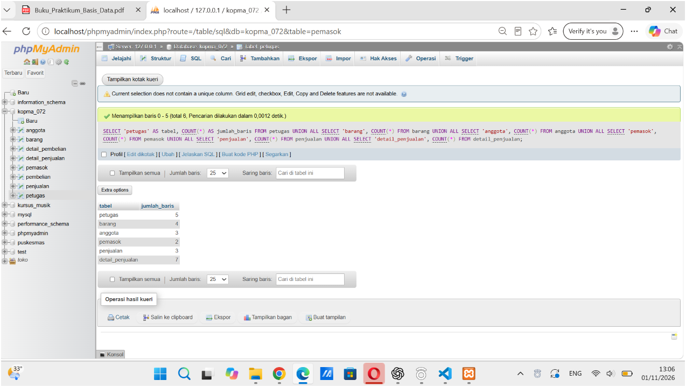

## B. Mengubah Data Menggunakan UPDATE

Percobaan berikutnya dilakukan menggunakan perintah UPDATE untuk mengubah data yang sudah tersimpan dalam tabel.

Pengubahan data dilakukan dengan menggunakan WHERE agar hanya data yang memenuhi kondisi tertentu yang mengalami perubahan.

Selain itu, dilakukan percobaan UPDATE tanpa WHERE. Perintah tersebut ditolak oleh MariaDB karena fitur `sql_safe_updates` sedang aktif.

Dari percobaan ini dapat diketahui bahwa penggunaan WHERE sangat penting untuk menghindari perubahan data secara keseluruhan.

**Bukti hasil percobaan:**

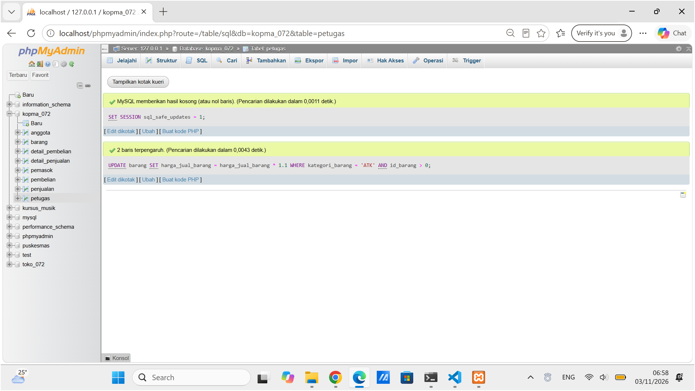

## C. Menghapus Data Menggunakan DELETE

Percobaan DELETE dilakukan untuk menghapus data tertentu dari tabel. Penghapusan dilakukan dengan memperhatikan hubungan antara tabel induk dan tabel anak.

Ketika data penjualan uji dihapus, data detail penjualan yang berhubungan ikut terhapus karena menggunakan aturan ON DELETE CASCADE.

Sebaliknya, penghapusan data petugas yang masih digunakan dalam transaksi ditolak karena adanya aturan ON DELETE RESTRICT.

**Bukti hasil percobaan:**

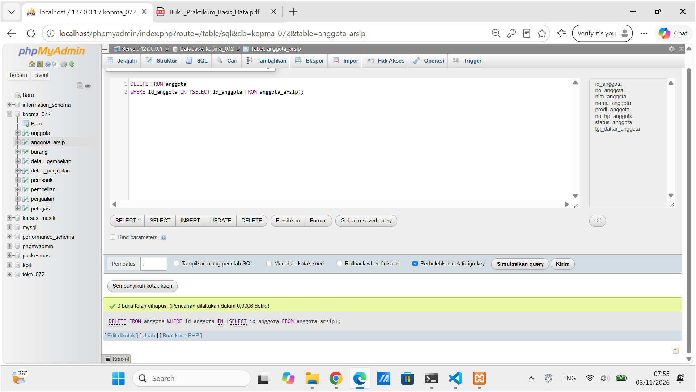

## D. Menguji Perintah DML

Pengujian dilakukan menggunakan beberapa skenario untuk memastikan perintah DML dan aturan database berjalan sesuai dengan yang diharapkan.

Pada database Kopma, pengujian mencakup penambahan data, pengujian constraint, pengujian foreign key, penggunaan `sql_safe_updates`, serta penghapusan data.

Hasil pengujian menunjukkan bahwa sebagian besar skenario berhasil sesuai dengan hasil yang diharapkan. Namun, pada pengujian UJ-09, database masih menerima jumlah barang yang melebihi stok tersedia.

Hal tersebut terjadi karena constraint CHECK yang digunakan hanya memeriksa nilai stok pada tabel barang dan belum dapat membandingkannya dengan jumlah barang pada tabel detail penjualan.

Hasil pengujian secara lengkap terdapat pada file `p06_uji_kopma_25430072.md`.

# 4. Jawaban Titik Analisis

## A. Mengapa INSERT SELECT dapat digunakan untuk menyalin data?

INSERT SELECT digunakan untuk memasukkan data ke suatu tabel berdasarkan hasil SELECT dari tabel lain. Cara ini lebih praktis karena data tidak perlu dimasukkan satu per satu secara manual.

## B. Mengapa harga pada nota lama tidak ikut berubah ketika harga barang diperbarui?

Harga pada detail penjualan disimpan sebagai data transaksi pada saat pembelian dilakukan. Oleh karena itu, ketika harga barang pada tabel barang diperbarui, harga pada transaksi lama tetap menggunakan harga sebelumnya.

Sebagai contoh, harga barang pada nota lama tetap Rp4.000 meskipun harga barang pada tabel barang sudah mengalami perubahan.

**Bukti hasil percobaan:**

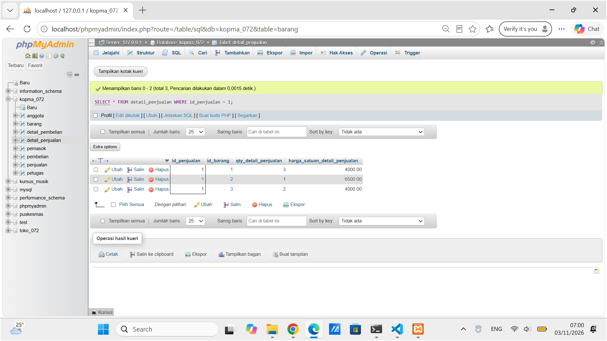

## C. Apa perbedaan ON DELETE CASCADE dan ON DELETE RESTRICT?

ON DELETE CASCADE memungkinkan data pada tabel anak ikut terhapus ketika data induk dihapus. Sementara itu, ON DELETE RESTRICT mencegah penghapusan data induk apabila masih terdapat data lain yang berhubungan dengannya.

Pada database Kopma, penghapusan nota dapat menghapus detail penjualannya secara otomatis. Namun, petugas yang masih memiliki riwayat transaksi tidak dapat langsung dihapus.

## D. Mengapa data anggota nonaktif tidak langsung dihapus?

Data anggota nonaktif sebaiknya tetap disimpan karena mungkin masih memiliki riwayat transaksi. Dengan mengubah status menjadi nonaktif, data anggota tetap tersedia tanpa harus menghapus seluruh informasi yang berkaitan dengannya.

## E. Mengapa pengujian UJ-09 masih diterima oleh database?

Pengujian UJ-09 masih diterima karena constraint CHECK tidak dapat digunakan untuk membandingkan jumlah barang pada tabel detail penjualan dengan stok pada tabel barang secara langsung.

Aturan tersebut membutuhkan validasi tambahan, misalnya menggunakan trigger atau validasi pada aplikasi. Hal ini dicatat sebagai Design Debt untuk diperbaiki pada Modul 14.

# 5. Hasil Latihan dan Modifikasi

## A. Mengarsipkan Anggota Nonaktif

Pada latihan ini dilakukan pembuatan tabel `anggota_arsip` menggunakan struktur yang sama dengan tabel anggota.

Selanjutnya, data anggota yang berstatus nonaktif dan memenuhi kondisi pengarsipan dipindahkan menggunakan INSERT SELECT. Data anggota yang masih memiliki transaksi tidak ikut dipindahkan agar riwayat transaksi tetap terjaga.

Setelah proses pengarsipan selesai, data anggota yang memenuhi kondisi dihapus dari tabel anggota.

Hasilnya, anggota bernama Citra dengan kode A-0003 berhasil dipindahkan ke tabel arsip. Sementara itu, data Andi dan Budi tetap berada pada tabel anggota karena masih digunakan.

**Bukti hasil latihan:**

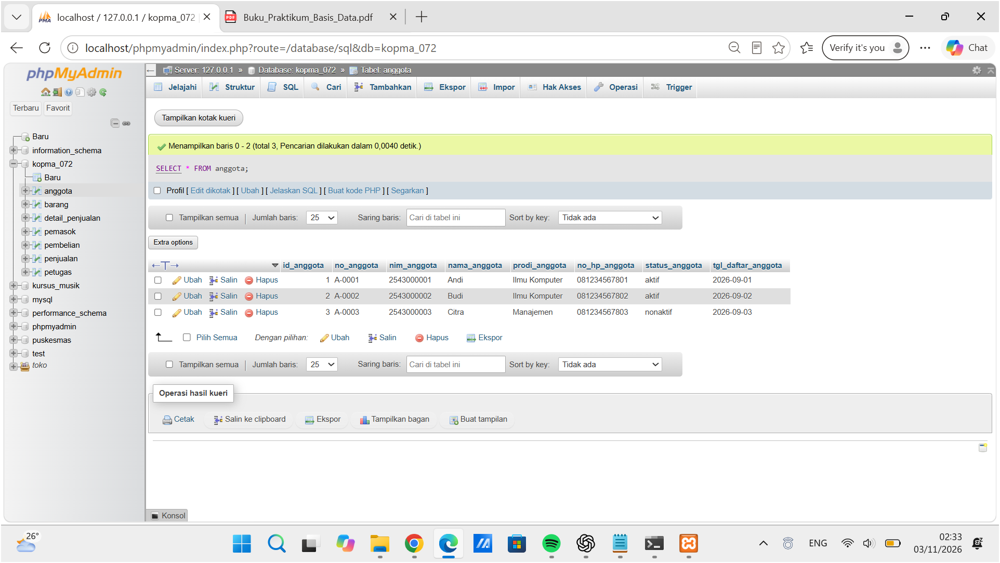

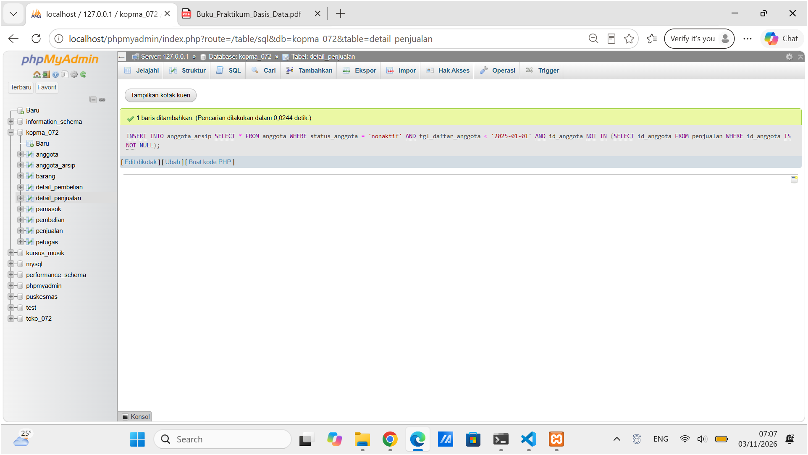

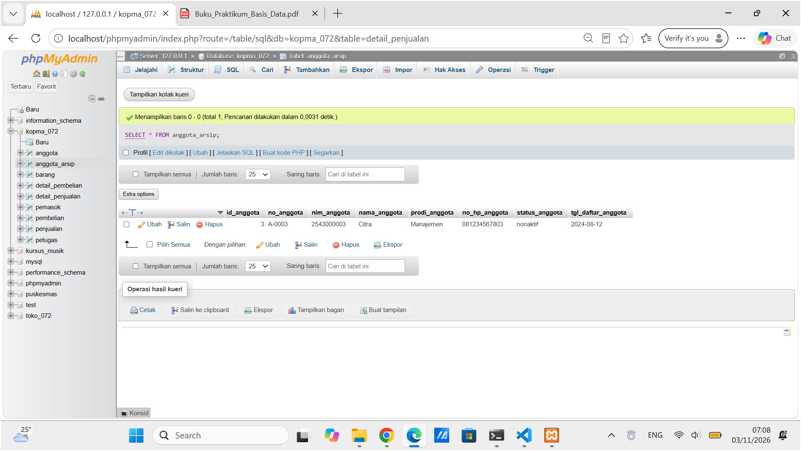

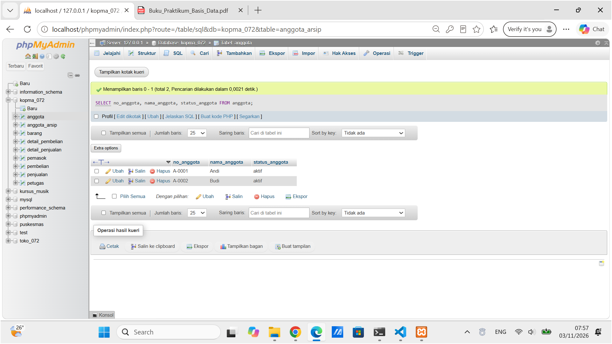

## B. Mengubah Harga Barang Kategori Makanan

Latihan berikutnya dilakukan dengan menaikkan harga jual barang sebesar 5% untuk barang dengan kategori makanan.

Perubahan dilakukan menggunakan UPDATE dengan kondisi kategori barang dan ID barang. Pembulatan harga dilakukan agar hasil harga lebih rapi.

Hasil perubahan menunjukkan bahwa harga Roti Cokelat yang sebelumnya Rp5.000 berubah menjadi Rp5.300.

**Bukti hasil latihan:**

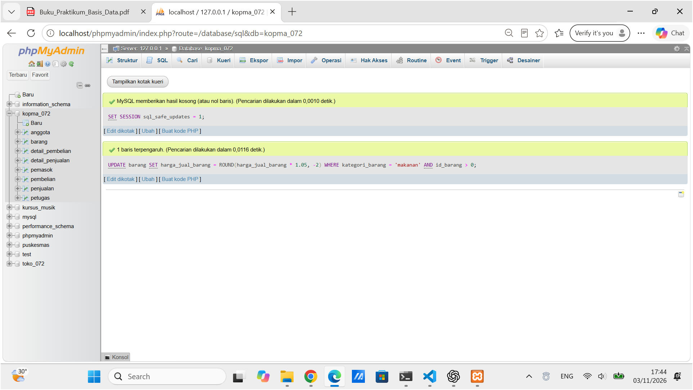

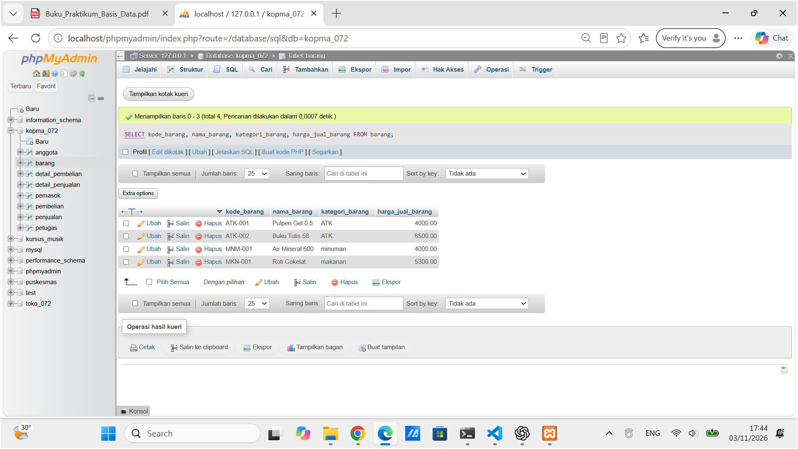

## C. Menjalankan Ulang Data

Setelah latihan selesai, tabel arsip dihapus dan database dikembalikan menggunakan file DDL dan data Modul 6 agar kondisi awal dapat digunakan kembali.

Hasil pemeriksaan menunjukkan bahwa jumlah data pada setiap tabel kembali sesuai dengan data awal.

**Bukti hasil latihan:**

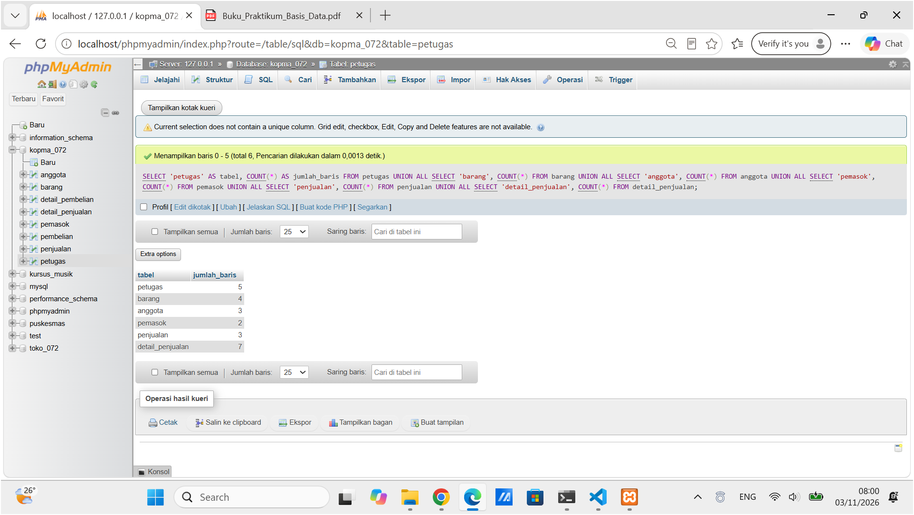

# 6. Tugas Mandiri: Milestone Proyek 6

Pada tugas mandiri ini, penerapan DML dilakukan pada database proyek Toko Daring dengan nama database `toko_072`.

## A. Pengisian Data Proyek

Pengisian data dilakukan menggunakan file `p06_data_25430072.sql`. Data dimasukkan ke dalam sembilan tabel sesuai dengan hubungan antartabel.

Berikut jumlah data yang berhasil dimasukkan:

| Nama Tabel | Jumlah Data |
|---|---:|
| pelanggan | 5 |
| produk | 5 |
| admin | 5 |
| keranjang | 5 |
| detail_keranjang | 10 |
| pesanan | 10 |
| detail_pesanan | 20 |
| pembayaran | 10 |
| pengiriman | 10 |
| **Total** | **80** |

Data pesanan terdiri dari 10 transaksi yang dibuat pada tiga tanggal berbeda, yaitu 10, 11, dan 12 Oktober 2026.

Dengan demikian, pengisian data telah memenuhi ketentuan jumlah data pada setiap tabel dan jumlah transaksi yang diperlukan dalam milestone proyek.

**File pengisian data:** `p06_data_25430072.sql`

## B. Hasil Pengujian Proyek

Pengujian dilakukan menggunakan file `p06_uji_25430072.md`. Pengujian terdiri dari lima skenario positif dan lima skenario negatif.

Hasil pengujian menunjukkan bahwa skenario positif berhasil menampilkan data sesuai hubungan antartabel. Sementara itu, skenario negatif berhasil menguji penolakan data yang melanggar aturan primary key, CHECK, dan foreign key.

Ringkasan hasil pengujian:

| Jenis Pengujian | Jumlah | Hasil |
|---|---:|---|
| Skenario positif | 5 | Berhasil |
| Skenario negatif | 5 | Berhasil ditolak sesuai aturan |

Bukti hasil pengujian proyek secara lengkap, termasuk screenshot setiap skenario, terdapat pada file `p06_uji_25430072.md`.

## C. Design Debt

Pada pengujian tambahan ditemukan bahwa database belum dapat memastikan jumlah pembayaran selalu sama dengan total pesanan menggunakan constraint CHECK biasa.

Pengujian dilakukan dengan mengubah sementara jumlah pembayaran menjadi Rp1, padahal total pesanan yang benar adalah Rp400.000. Perubahan tersebut masih dapat diterima oleh sistem.

Setelah pengujian selesai, transaksi dikembalikan menggunakan ROLLBACK sehingga jumlah pembayaran kembali seperti semula.

Hal ini menunjukkan bahwa aturan kesesuaian jumlah pembayaran dengan total pesanan masih membutuhkan validasi tambahan. Perbaikan dapat direncanakan menggunakan trigger atau validasi pada aplikasi pada Modul 14.

**Bukti pengujian:** `p06_uji_25430072.md`

# 7. Pembahasan dan Kendala

Berdasarkan hasil praktikum, perintah DML dapat digunakan untuk mengelola data mulai dari menambahkan, mengubah, hingga menghapus isi tabel. Pengujian juga menunjukkan bahwa constraint dan foreign key membantu menjaga konsistensi data dalam database.

Pada database Kopma, sebagian besar skenario pengujian berhasil sesuai dengan hasil yang diharapkan. Namun, pada pengujian UJ-09 ditemukan bahwa database masih menerima jumlah barang yang melebihi stok tersedia. Hal tersebut terjadi karena aturan CHECK belum dapat membandingkan data dari dua tabel yang berbeda.

Pada database proyek Toko Daring, pengujian berhasil dilakukan terhadap lima skenario positif dan lima skenario negatif. Namun, validasi kesesuaian jumlah pembayaran dengan total pesanan masih menjadi kekurangan yang perlu diperbaiki.

Salah satu hal yang perlu diperhatikan selama praktikum adalah penggunaan WHERE pada UPDATE dan DELETE agar perubahan data tidak mengenai seluruh isi tabel secara tidak sengaja.

# 8. Kesimpulan

Berdasarkan praktikum Modul 6, dapat disimpulkan bahwa perintah DML digunakan untuk mengelola data dalam database melalui INSERT, UPDATE, DELETE, dan SELECT. Penggunaan constraint, foreign key, serta WHERE membantu menjaga konsistensi dan keamanan data. Melalui pengujian positif dan negatif, dapat diketahui bahwa sebagian besar aturan database sudah berjalan dengan baik, meskipun masih terdapat beberapa aturan yang membutuhkan validasi tambahan.

# 9. Pernyataan Penggunaan AI

Dalam pengerjaan praktikum ini, AI digunakan sebagai alat bantu untuk memahami konsep DML, menjelaskan kesalahan perintah SQL, memahami hasil pengujian, serta membantu merapikan penyajian laporan.

Proses pengujian dilakukan pada database menggunakan MariaDB dan hasilnya diperiksa berdasarkan keluaran yang diperoleh. Penggunaan AI tidak menggantikan proses menjalankan dan mengamati hasil praktikum secara langsung.

# 10. BUKTI GIT

## 10.1 Repository GitHub

Repository praktikum dapat diakses melalui tautan berikut:

[GitHub - basisdata_25430072](https://github.com/selvidianurmala9-oss/basisdata_25430072)

## 10.2 File yang Dikumpulkan

File Modul 6 yang terdapat di repository:

1. `p06_laporan_25430072.md`
2. `p06_data_kopma_25430072.sql`
3. `p06_uji_kopma_25430072.md`
4. `p06_data_25430072.sql`
5. `p06_uji_25430072.md`

## 10.3 Bukti Commit dan Push

Commit Modul 6 berhasil dibuat dan dikirim ke repository GitHub.

**Hash Commit:** `08ebb60`

**Pesan Commit:**

`p06: data dan uji kopma serta milestone toko daring`

**Screenshot Bukti Git Push:**

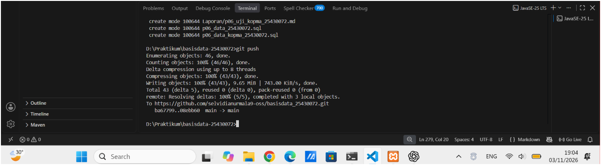

# CHECKLIST LAPORAN

- [x] Identitas dan judul laporan sudah lengkap.
- [x] Tujuan praktikum sudah dituliskan.
- [x] Ringkasan dasar teori sudah dicantumkan.
- [x] Hasil langkah percobaan sudah disertai bukti.
- [x] Jawaban titik analisis sudah lengkap.
- [x] Hasil latihan dan modifikasi sudah disertai bukti.
- [x] Tugas mandiri Milestone Proyek 6 sudah dijelaskan.
- [x] File pengujian Kopma dan proyek sudah dicantumkan.
- [x] Pembahasan dan kendala sudah dituliskan.
- [x] Kesimpulan sudah dibuat.
- [x] Pernyataan penggunaan AI sudah dicantumkan.
- [x] Bukti Git dan commit sudah ditambahkan.
- [x] Semua gambar yang digunakan sudah tampil di Markdown Preview.
- [x] Semua file sudah disimpan dan diunggah ke repository GitHub.