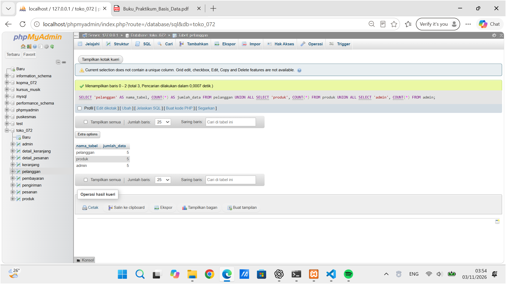
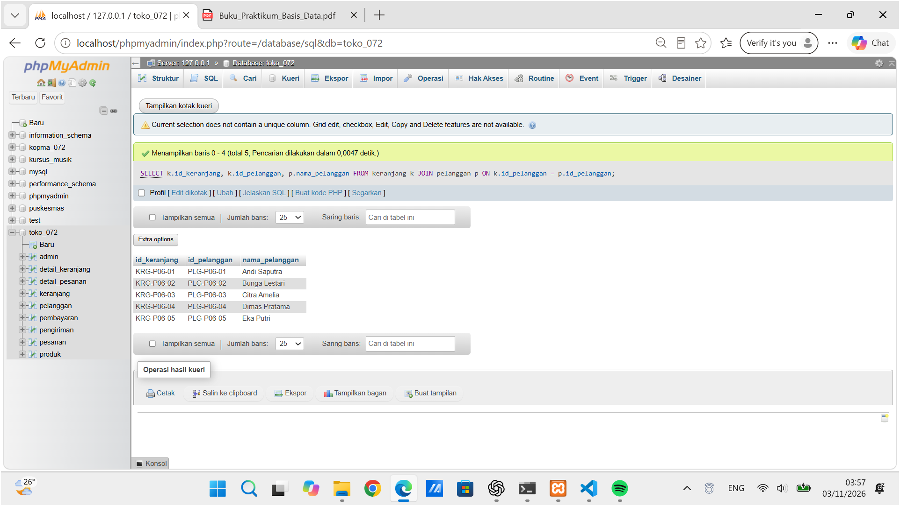
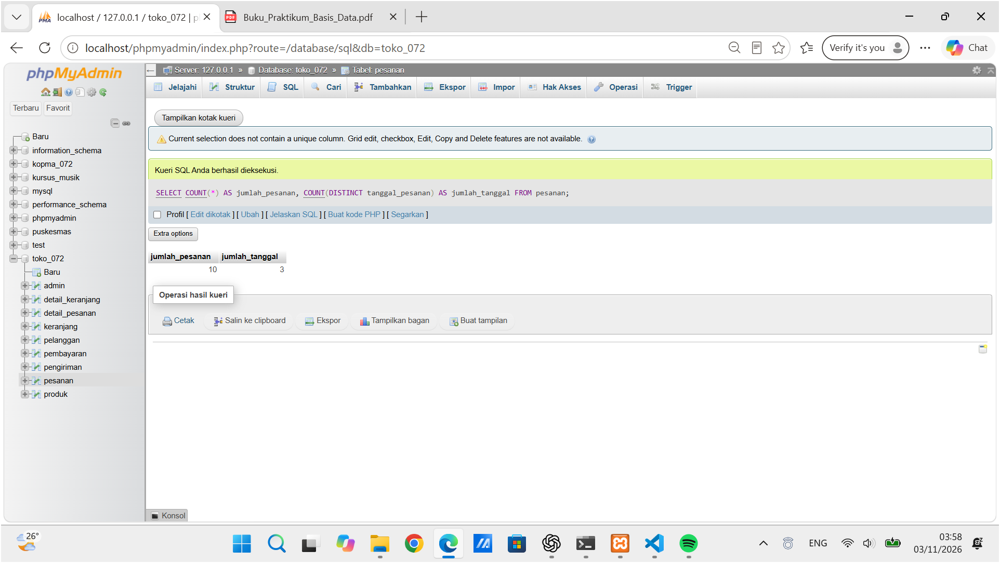
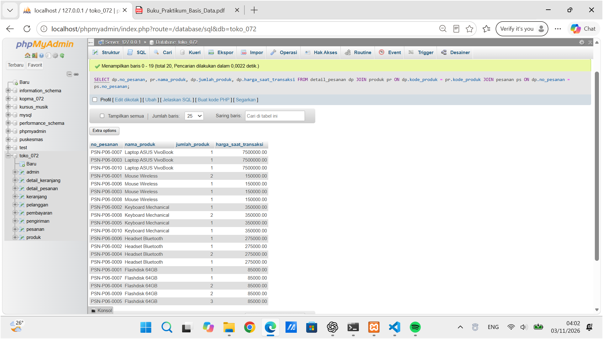
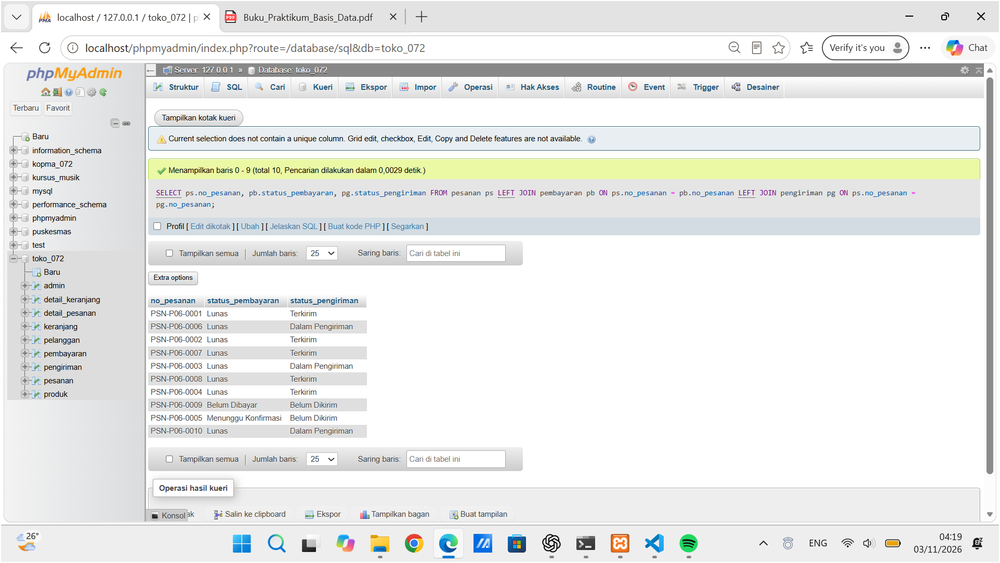
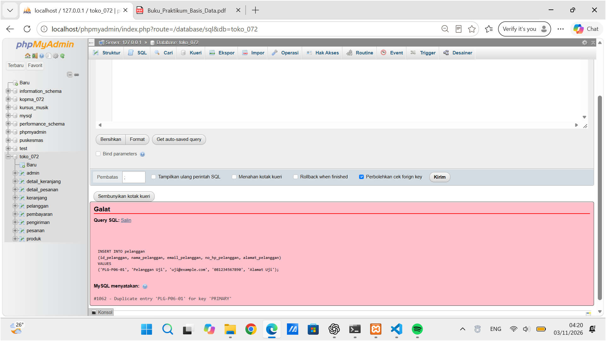
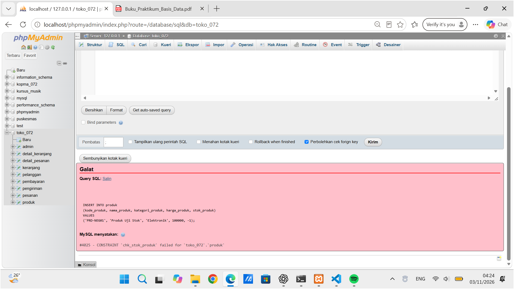
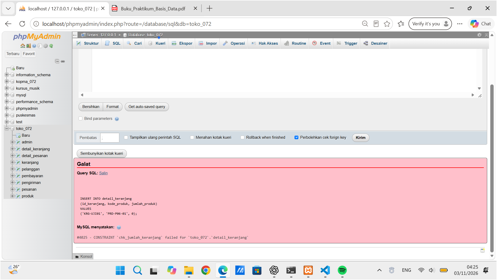
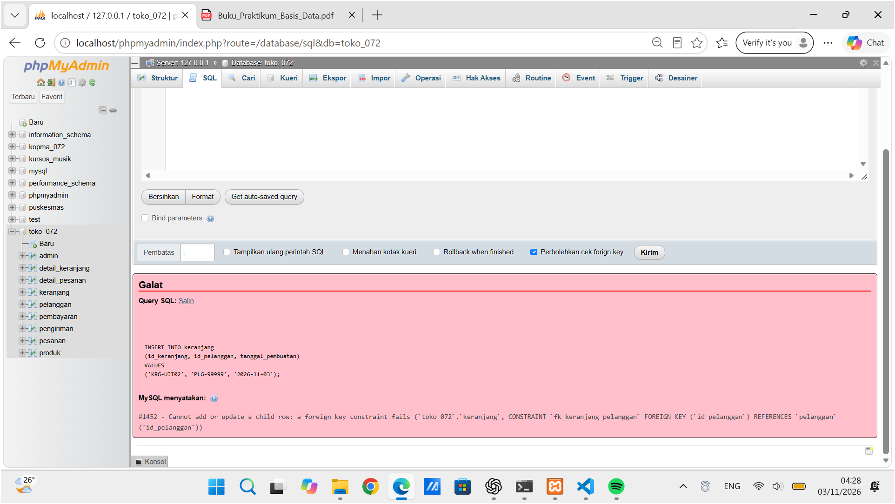
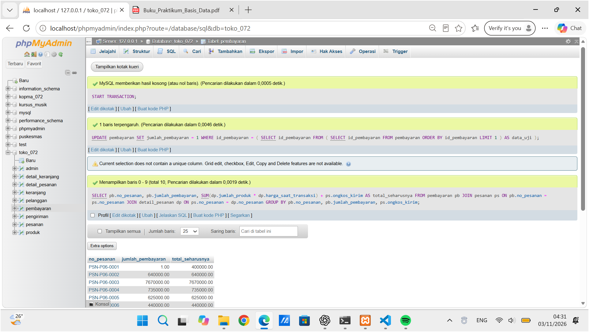

# PENGUJIAN MODUL 6 – TOKO DARING SERBA DIGITAL

**Nama:** Selvi Dia Nurmala  
**NIM:** 25430072  
**Kelas:** C  
**Database:** toko_072

## A. Tujuan Pengujian

Pengujian dilakukan untuk memastikan data pada database Toko Daring Serba Digital tersimpan dengan baik, hubungan antar tabel berjalan sesuai ketentuan, serta aturan database dapat menolak data yang tidak sesuai. Pengujian juga bertujuan untuk mengetahui aturan yang belum dapat diterapkan menggunakan constraint.

## B. Hasil Pengujian

### 1. Pengujian Data dan Hubungan Antar Tabel

| No. | Pengujian | Aturan | Hasil Aktual | Status |
|---|---|---|---|---|
| 1 | Memeriksa jumlah data tabel master | Setiap tabel master minimal 5 data | Pelanggan 5 data, produk 5 data, admin 5 data | Berhasil |
| 2 | Hubungan keranjang dengan pelanggan | FK keranjang.id_pelanggan | 5 keranjang berhasil ditampilkan bersama nama pelanggan | Berhasil |
| 3 | Jumlah dan tanggal pesanan | Minimal 10 pesanan dan 3 tanggal berbeda | Ditemukan 10 pesanan dari 3 tanggal berbeda | Berhasil |
| 4 | Hubungan detail pesanan dengan produk | FK detail_pesanan | Berhasil menampilkan 20 baris detail pesanan | Berhasil |
| 5 | Hubungan pembayaran dan pengiriman | FK pembayaran dan pengiriman | 10 pesanan berhasil ditampilkan bersama status pembayaran dan pengiriman | Berhasil |

### 2. Pengujian Data yang Tidak Sesuai

| No. | Pengujian | Jenis | Aturan | Hasil Aktual | Status |
|---|---|---|---|---|---|
| 6 | Memasukkan ID pelanggan yang sama | Negatif | PRIMARY KEY | Ditolak dengan error 1062 karena ID sudah digunakan | Berhasil |
| 7 | Memasukkan harga produk negatif | Negatif | chk_harga_produk | Ditolak dengan error 4025 | Berhasil |
| 8 | Memasukkan stok produk negatif | Negatif | chk_stok_produk | Ditolak dengan error 4025 | Berhasil |
| 9 | Memasukkan jumlah produk nol | Negatif | chk_jumlah_keranjang | Ditolak dengan error 4025 | Berhasil |
| 10 | Memasukkan ID pelanggan yang tidak terdaftar | Negatif | fk_keranjang_pelanggan | Ditolak dengan error 1452 karena ID pelanggan tidak ditemukan | Berhasil |

**Keterangan:**

Pengujian nomor 1 sampai 5 merupakan pengujian positif untuk memastikan data dan hubungan antar tabel berjalan dengan benar. Pengujian nomor 6 sampai 10 merupakan pengujian negatif untuk memastikan database menolak data yang melanggar aturan.

Pada pengujian nomor 9, keranjang sementara dibuat terlebih dahulu. Setelah pengujian selesai, keranjang sementara berhasil dihapus.

## C. Pengujian Aturan yang Belum Dapat Ditegakkan oleh Constraint (Design Debt)

Aturan yang diuji adalah jumlah pembayaran harus sesuai dengan total harga produk yang dipesan ditambah ongkos kirim.

Aturan ini belum dapat ditegakkan hanya menggunakan CHECK CONSTRAINT karena membutuhkan perhitungan dari beberapa tabel.

| Bagian | Keterangan |
|---|---|
| Tujuan | Memastikan jumlah pembayaran sesuai dengan total pesanan |
| Data yang diuji | PSN-P06-0001 |
| Kondisi pengujian | Jumlah pembayaran sementara diubah menjadi Rp1,00 |
| Hasil yang diharapkan | Database menolak pembayaran yang tidak sesuai |
| Hasil aktual | Database menerima perubahan menjadi Rp1,00, sedangkan total yang seharusnya Rp400.000,00 |
| Pemulihan data | ROLLBACK berhasil mengembalikan pembayaran menjadi Rp400.000,00 |
| Status | Design Debt |

**Kesimpulan Design Debt:**

Database masih menerima jumlah pembayaran yang tidak sesuai dengan total pesanan. Aturan tersebut perlu dikembangkan menggunakan trigger atau validasi aplikasi pada Modul 14.

## D. Bukti Screenshot

### 1. Pengujian Jumlah Data Tabel Master

### 2. Pengujian Hubungan Keranjang dengan Pelanggan

### 3. Pengujian Jumlah dan Tanggal Pesanan

### 4. Pengujian Detail Pesanan dengan Produk

### 5. Pengujian Pembayaran dan Pengiriman

### 6. Pengujian ID Pelanggan Duplikat

### 7. Pengujian Harga Produk Negatif

### 8. Pengujian Stok Produk Negatif

### 9. Pengujian Jumlah Produk Nol

### 10. Pengujian ID Pelanggan Tidak Terdaftar

### 11. Pengujian Design Debt

## E. Kesimpulan

Berdasarkan hasil pengujian, database Toko Daring Serba Digital berhasil menyimpan dan menampilkan data sesuai kebutuhan. Hubungan antar tabel juga berjalan dengan baik melalui penggunaan PRIMARY KEY dan FOREIGN KEY.

Pengujian negatif menunjukkan bahwa database berhasil menolak data yang tidak sesuai dengan aturan, seperti ID duplikat, harga negatif, stok negatif, jumlah produk nol, dan ID pelanggan yang tidak terdaftar.

Dari 10 pengujian utama, seluruhnya berhasil dilakukan, terdiri dari 5 pengujian positif dan 5 pengujian negatif. Pengujian Design Debt menunjukkan bahwa aturan kesesuaian jumlah pembayaran dengan total pesanan masih perlu dikembangkan menggunakan trigger atau validasi aplikasi pada Modul 14.