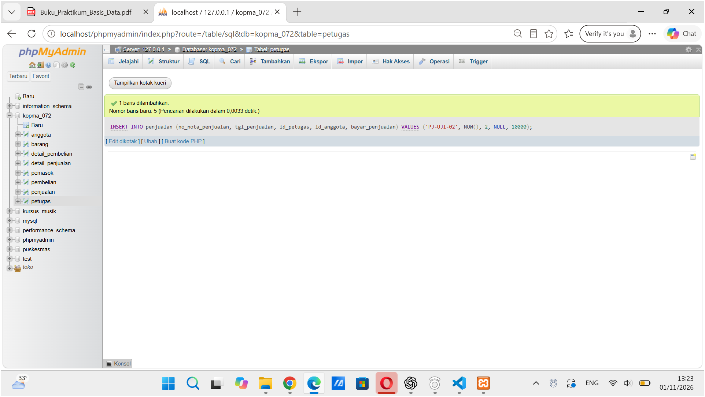
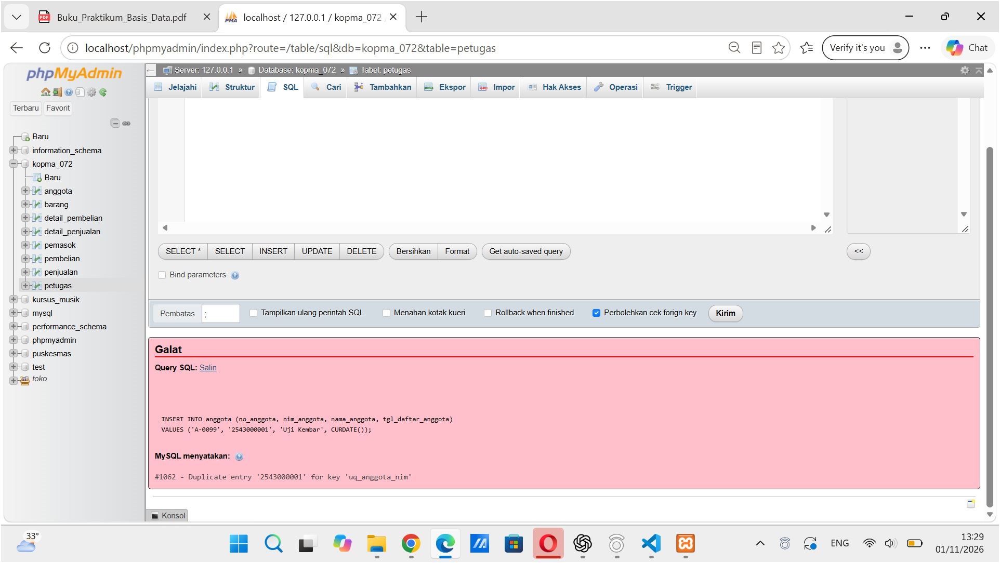
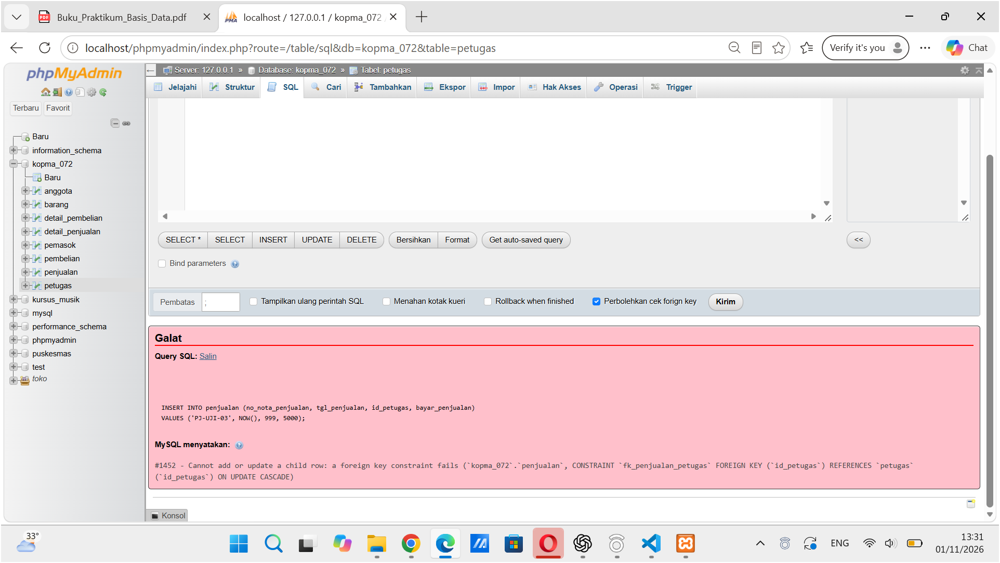
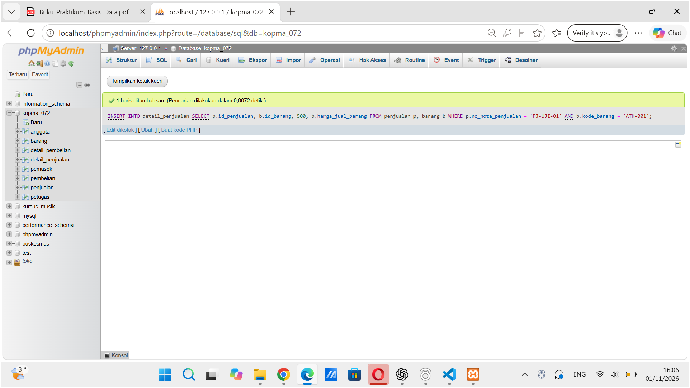
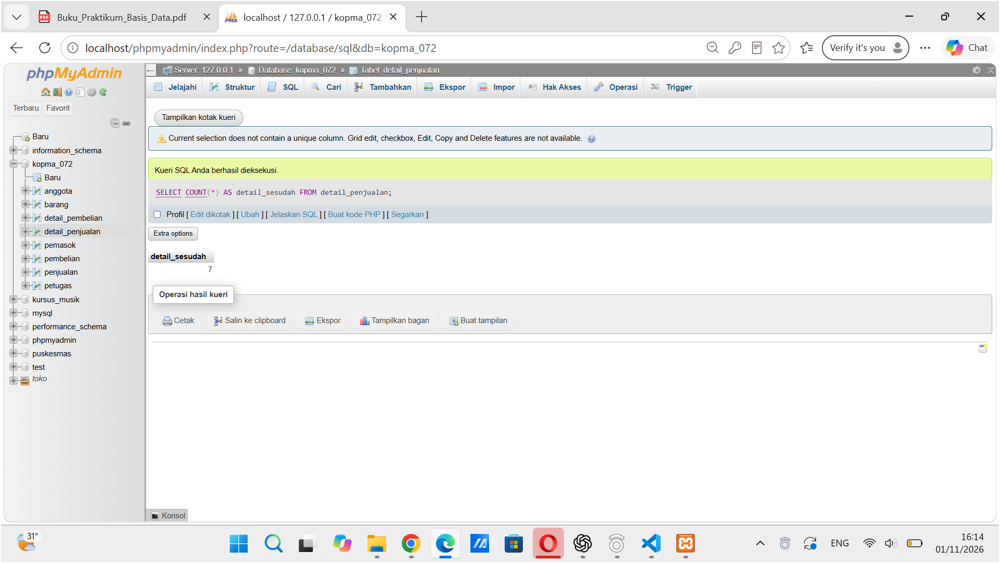

# Pengujian Modul 6 – Database Kopma

**Nama:** Selvi Dia Nurmala
**NIM:** 25430072
**Kelas:** C
**Database:** kopma_072

**Prasyarat:** `p05_ddl_kopma_25430072.sql` lalu `p06_data_kopma_25430072.sql` sudah dijalankan (petugas 5, barang 4, anggota 3, pemasok 2, penjualan 3, detail_penjualan 7).

## Hasil Pengujian

| Kode  | Masukan | Aturan | Hasil yang Diharapkan | Hasil Aktual | Status |
| ----- | ------- | ------ | --------------------- | ------------ | ------ |
| UJ-01 | `INSERT INTO penjualan (no_nota_penjualan, tgl_penjualan, id_petugas, id_anggota, bayar_penjualan) VALUES ('PJ-UJI-01', NOW(), 1, 1, 10000);` | AB-02 | Diterima (anggota aktif) | Diterima, 1 baris ditambahkan (nomor baris baru 4) | LULUS |
| UJ-02 | `INSERT INTO penjualan (no_nota_penjualan, tgl_penjualan, id_petugas, id_anggota, bayar_penjualan) VALUES ('PJ-UJI-02', NOW(), 2, NULL, 10000);` | AB-02 | Diterima (id_anggota NULL) | Diterima, 1 baris ditambahkan, id_anggota NULL (nomor baris baru 5) | LULUS |
| UJ-03 | `UPDATE barang SET stok_barang = -5 WHERE kode_barang = 'ATK-001';` | AB-03, chk_barang_stok | Ditolak, ERROR 4025 | `#4025 - CONSTRAINT chk_barang_stok failed for kopma_072.barang` | LULUS |
| UJ-04 | `INSERT INTO penjualan (no_nota_penjualan, tgl_penjualan, id_petugas, bayar_penjualan) VALUES ('PJ-UJI-01', NOW(), 1, 5000);` | AB-01, uq_penjualan_no_nota | Ditolak, ERROR 1062 | `#1062 - Duplicate entry 'PJ-UJI-01' for key 'uq_penjualan_no_nota'` | LULUS |
| UJ-05 | `INSERT INTO detail_penjualan VALUES (1, 4, 0, 5000);` | chk_detail_penjualan_qty | Ditolak, ERROR 4025 | `#4025 - CONSTRAINT chk_detail_penjualan_qty failed for kopma_072.detail_penjualan` | LULUS |
| UJ-06 | `INSERT INTO anggota (no_anggota, nim_anggota, nama_anggota, tgl_daftar_anggota) VALUES ('A-0099', '2543000001', 'Uji Kembar', CURDATE());` | AB-05, uq_anggota_nim | Ditolak, ERROR 1062 | `#1062 - Duplicate entry '2543000001' for key 'uq_anggota_nim'` | LULUS |
| UJ-07 | `INSERT INTO penjualan (no_nota_penjualan, tgl_penjualan, id_petugas, bayar_penjualan) VALUES ('PJ-UJI-03', NOW(), 999, 5000);` | fk_penjualan_petugas | Ditolak, ERROR 1452 | `#1452 - Cannot add or update a child row: a foreign key constraint fails (kopma_072.penjualan, CONSTRAINT fk_penjualan_petugas FOREIGN KEY (id_petugas) REFERENCES petugas (id_petugas) ON UPDATE CASCADE)` | LULUS |
| UJ-08 | `SET SESSION sql_safe_updates = 1; UPDATE barang SET harga_jual_barang = harga_jual_barang * 1.1;` | safe updates | Ditolak, ERROR 1175 | `#1175 - You are using safe update mode and you tried to update a table without a WHERE that uses a KEY column` | LULUS |
| UJ-09 | `INSERT INTO detail_penjualan SELECT p.id_penjualan, b.id_barang, 500, b.harga_jual_barang FROM penjualan p, barang b WHERE p.no_nota_penjualan = 'PJ-UJI-01' AND b.kode_barang = 'ATK-001';` | AB-03 | Seharusnya ditolak (qty 500 melebihi stok 112) | Diterima, 1 baris ditambahkan (qty 500 melebihi stok 112), stok ATK-001 tetap 112 | GAGAL |
| UJ-10 | `DELETE FROM penjualan WHERE no_nota_penjualan IN ('PJ-UJI-01', 'PJ-UJI-02');` lalu `SELECT COUNT(*) FROM detail_penjualan;` | fk_detail_penjualan_penjualan | Nota uji terhapus, detail ikut terhapus | Dua nota uji dihapus, jumlah detail kembali 7 (detail milik nota uji ikut terhapus) | LULUS |
| UJ-11 | `DELETE FROM petugas WHERE kode_petugas = 'K03';` | fk_penjualan_petugas (RESTRICT) | Ditolak, ERROR 1451 | `#1451 - Cannot delete or update a parent row: a foreign key constraint fails (kopma_072.penjualan, CONSTRAINT fk_penjualan_petugas FOREIGN KEY (id_petugas) REFERENCES petugas (id_petugas) ON UPDATE CASCADE)` | LULUS |

## Bukti Tangkapan Layar

### Uji positif

**UJ-01** Nota dengan anggota aktif diterima.

**UJ-02** Nota tanpa anggota (id_anggota NULL) diterima.

### Uji negatif

**UJ-03** Stok negatif ditolak.

**UJ-04** Nomor nota kembar ditolak.

**UJ-05** Qty 0 ditolak.

**UJ-06** NIM kembar ditolak.

**UJ-07** Petugas tidak dikenal ditolak.

**UJ-08** UPDATE tanpa WHERE ditolak mode aman.

### Uji yang gagal

**UJ-09** Qty 500 diterima padahal stok hanya 112.

### Uji relasi

**UJ-10** Setelah dua nota uji dihapus, jumlah detail kembali 7, jadi detail ikut terhapus.

**UJ-11** Hapus petugas yang punya nota ditolak.

## Catatan

- UJ-09 berstatus **GAGAL**: server menerima qty 500 padahal stok hanya 112. Penyebabnya, `chk_barang_stok` hanya memeriksa nilai stok di tabel barang dan tidak melihat qty di `detail_penjualan`, sehingga AB-03 belum dijaga server. Ini dicatat sebagai utang desain untuk Modul 14.
- UJ-10 sekaligus membersihkan data uji. Setelah itu penjualan kembali 3 baris dan detail_penjualan 7 baris.

## Kesimpulan

Dari 11 skenario uji, 10 berstatus LULUS dan 1 berstatus GAGAL (UJ-09). Constraint CHECK, UNIQUE, dan FOREIGN KEY di database Kopma menolak data yang salah sesuai rancangan: stok negatif, nomor nota kembar, qty 0, NIM kembar, petugas tidak dikenal, dan penghapusan petugas yang sudah punya nota. Mode aman juga menolak UPDATE tanpa WHERE, dan penghapusan nota ikut menghapus detailnya (ON DELETE CASCADE).

Temuan utamanya, aturan AB-03 (penjualan ditolak bila qty melebihi stok) belum dijaga server. Constraint pada tabel barang tidak dapat membandingkan qty penjualan dengan stok, sehingga penjualan 500 buah diterima padahal stok 112. Perlindungan ini perlu ditambahkan pada tahap berikutnya, misalnya lewat transaksi atau trigger di Modul 14.