# Laporan Praktikum Basis Data - Pertemuan 07

**Nama:** Selvi Dia Nurmala   **NIM:** 25430072   **Kelas:** C   **Tanggal:** 07/11/2026  
**Modul:** 7 – Menjawab Pertanyaan dengan SELECT dan Fungsi Skalar  
**Dosen Pengampu:** Dedi Irawan, S.Kom, M.T.I  
**Database Praktikum:** `kopma_072`   **Database Proyek:** `toko_072`

---

## 1. Tujuan Praktikum

1. Menampilkan data dari tabel dengan SELECT, alias, dan DISTINCT.
2. Menyaring baris memakai LIKE, BETWEEN, IN, IS NULL, dan operator logika.
3. Mengurutkan dan membatasi hasil dengan ORDER BY dan LIMIT.
4. Memakai fungsi skalar agar hasil kueri sesuai kebutuhan informasi.

## 2. Ringkasan Dasar Teori

SELECT ditulis dengan urutan SELECT–FROM–WHERE–ORDER BY–LIMIT, tetapi dievaluasi dengan urutan FROM, WHERE, SELECT, ORDER BY, lalu LIMIT. Karena SELECT dievaluasi setelah WHERE, alias yang dibuat di SELECT tidak bisa dipakai di WHERE, tetapi bisa dipakai di ORDER BY.

Kesalahan sintaksis ditolak server, sedangkan kesalahan semantik berjalan tanpa galat tetapi hasilnya tidak menjawab pertanyaan. Karena itu hasil yang diharapkan ditulis sebelum kueri dijalankan.

Fungsi skalar yang dipakai: CONCAT, UPPER, FORMAT (string); DATE_FORMAT, DATEDIFF, CURDATE (tanggal); ROUND (numerik); IFNULL dan CASE (kondisional).

## 3. Hasil Langkah Percobaan

### 3.1 Proyeksi dan penyaringan (D.1)

**Kueri KI-03, barang di bawah stok minimum.** Kueri memakai alias `kurang` pada SELECT dan ORDER BY. Hasilnya 0 baris karena seluruh stok (112, 79, 21, 57) masih di atas stok minimum.

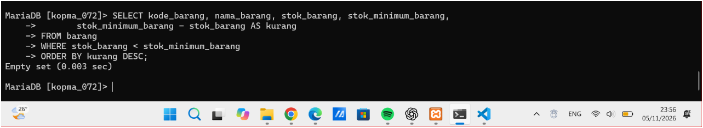

**Tiga kueri penyaringan.**

1. `IN`: barang kategori ATK atau minuman, hasilnya 3 baris (ATK-001, ATK-002, MNM-001).

   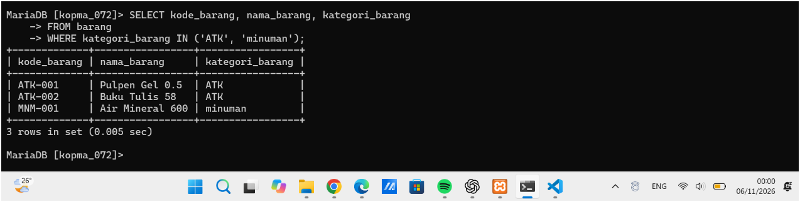

2. `BETWEEN`: nota pada rentang 24 sampai 26 September 2026 dengan batas akhir `'2026-09-26 23:59:59'` karena kolom `tgl_penjualan` bertipe DATETIME. Hasilnya 3 nota (PJ-2609-0142, 0143, 0144).

   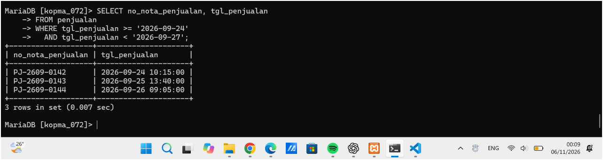

3. `IS NULL`: nota tanpa anggota, hasilnya 1 baris (PJ-2609-0143).

   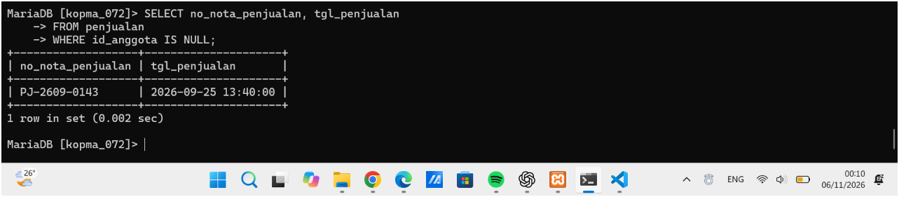

   Pencarian anggota tanpa nomor HP juga memakai `IS NULL` dan menghasilkan 0 baris karena semua anggota memiliki nomor HP.

   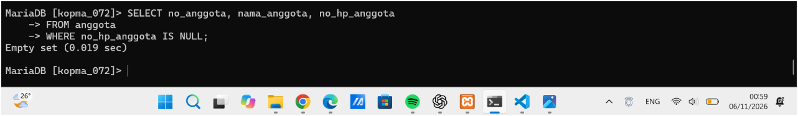

**Titik Analisis 1.** `WHERE kurang > 0` menghasilkan ERROR 1054.

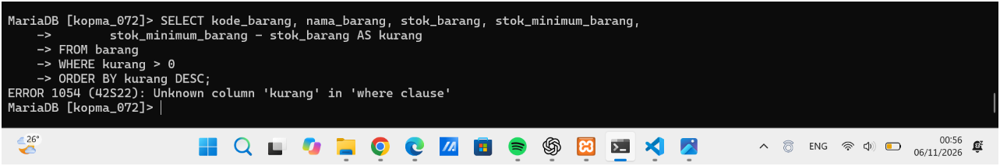

Syarat yang setara tanpa alias menghasilkan 0 baris dan tidak ada galat.

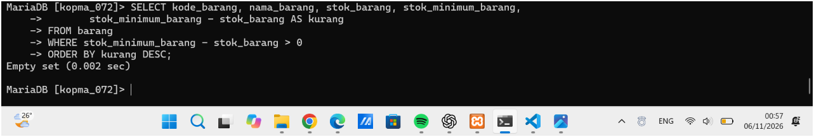

### 3.2 Pola teks dan nilai kosong (D.2)

Kueri mencari anggota yang namanya mengandung huruf "a" dengan label yang mudah dibaca (`CONCAT`, `DATE_FORMAT`, `IFNULL`, `CASE`). Hasilnya 2 baris: Andi (A-0001) dan Citra (A-0003). Budi tidak muncul karena namanya tidak mengandung huruf "a".

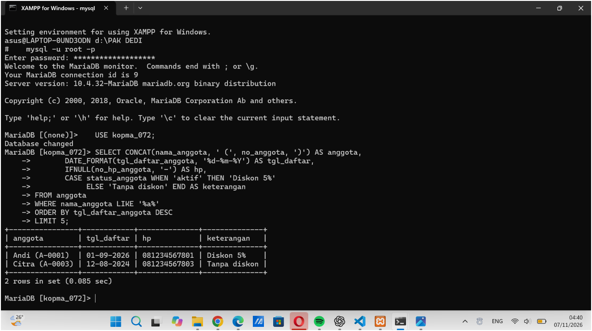

**Titik Analisis 2.** Pengujian memakai anggota uji tanpa nomor HP di dalam transaksi, lalu dibatalkan dengan `ROLLBACK`. Hasilnya `= NULL` menghasilkan 0 baris, `IS NULL` menemukan 1 baris, dan `= ''` menghasilkan 0 baris. Setelah `ROLLBACK`, jumlah anggota kembali 3.

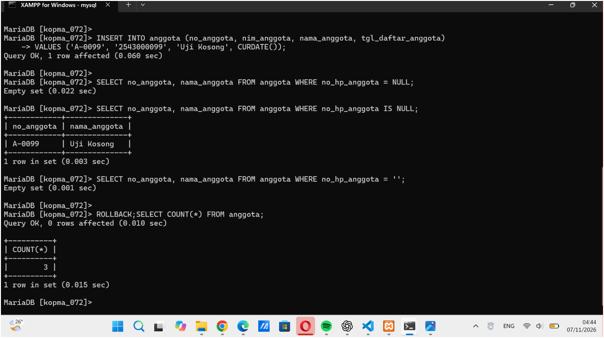

### 3.3 Tanggal dan perhitungan per baris (D.3)

**Lama keanggotaan** dihitung dengan `DATEDIFF(CURDATE(), tgl_daftar_anggota)`. Kurang dari 180 hari dikategorikan "baru", selainnya "lama". Andi dan Budi tergolong baru, sedangkan Citra (daftar 12-08-2024) tergolong lama.

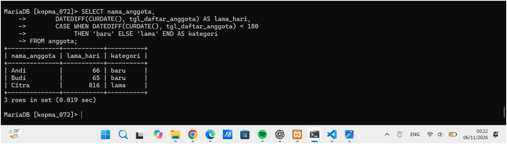

**Subtotal nota PJ-2609-0142** dihitung per baris dengan `qty_detail_penjualan * harga_satuan_detail_penjualan`: 12000, 6500, dan 8000. Jumlah manualnya 26500, sama dengan perhitungan pada Modul 2.

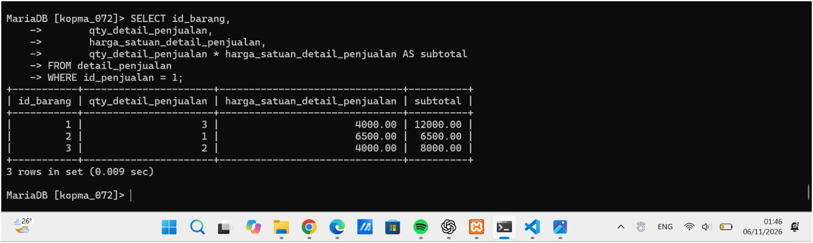

### 3.4 Kueri Kopma lainnya

Kueri pendukung pada `p07_kueri_kopma_25430072.sql`:

| Kueri | Fungsi/operator | Bukti |
|---|---|---|
| Status stok barang | CASE | 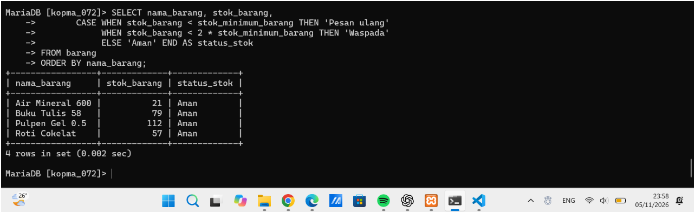 |
| Barang harga 4000 sampai 5000 | BETWEEN | 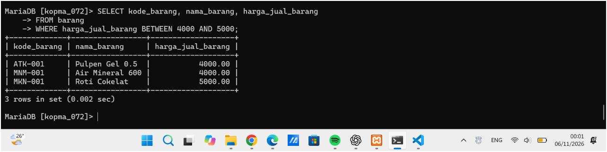 |
| Nama kapital dan harga format rupiah | UPPER, CONCAT, FORMAT | 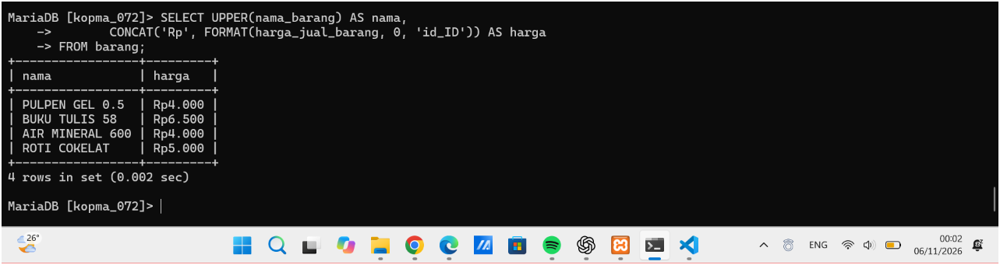 |
| Simulasi kenaikan harga 5% | ROUND | 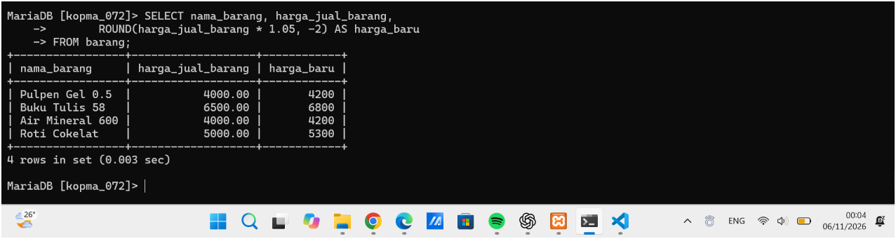 |
| Tanggal nota format Indonesia | DATE_FORMAT | 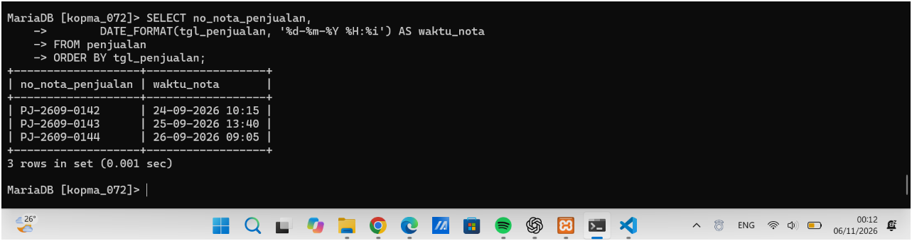 |
| Label anggota | CONCAT, DATE_FORMAT, IFNULL, CASE | 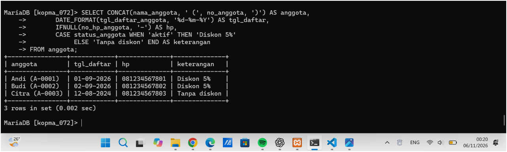 |
| Subtotal seluruh baris detail | perkalian per baris | 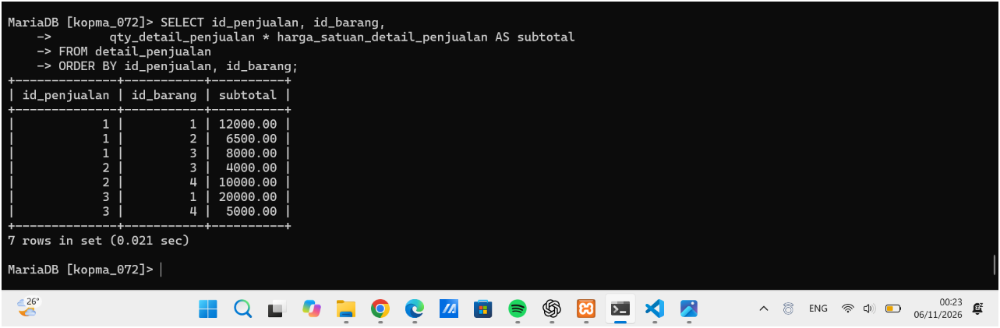 |

## 4. Jawaban Titik Analisis

**Titik Analisis 1: mengapa `WHERE kurang > 0` menimbulkan galat?**  
WHERE dievaluasi sebelum SELECT, sehingga alias `kurang` belum dikenal saat WHERE dijalankan (Gambar 7.1 pada modul). ORDER BY dievaluasi setelah SELECT, sehingga boleh memakai alias. Syarat tanpa alias ditulis `WHERE stok_minimum_barang - stok_barang > 0`.

**Titik Analisis 2: mengapa `no_hp_anggota = NULL` tidak mengembalikan baris?**  
`NULL` berarti nilai tidak diketahui atau tidak ada. Perbandingan `= NULL` menghasilkan UNKNOWN, bukan TRUE, sehingga tidak ada baris yang lolos walaupun ada anggota tanpa nomor HP. Cara yang benar adalah `IS NULL`. Teks kosong `''` adalah nilai yang ada tetapi tidak berisi karakter, jadi `= ''` tidak menemukan baris yang berisi `NULL`.

**Titik Analisis 3: fitur SQL untuk menyatukan banyak baris menjadi satu nilai.**  
Subtotal per baris tidak otomatis menjadi total nota. Dibutuhkan fungsi agregat seperti `SUM` bersama `GROUP BY`, yang dipelajari pada pertemuan 9.

## 5. Hasil Latihan dan Modifikasi

### E.1 Nama huruf kapital dan harga format rupiah

```sql
SELECT UPPER(nama_barang) AS nama,
       CONCAT('Rp', FORMAT(harga_jual_barang, 0, 'id_ID')) AS harga
FROM barang;
```

Harga 4000 tampil sebagai "Rp4.000".


### E.2 Kueri salah secara semantik (OR tanpa kurung)

Maksud kueri: barang kategori ATK atau minuman yang harganya di atas 4000.

**Versi salah** (tanpa kurung):

```sql
SELECT kode_barang, nama_barang, kategori_barang, harga_jual_barang
FROM barang
WHERE kategori_barang = 'ATK'
   OR kategori_barang = 'minuman'
  AND harga_jual_barang > 4000;
```

Hasilnya 2 baris (ATK-001 dan ATK-002). Pulpen Gel 0.5 ikut muncul padahal harganya tepat 4000 dan tidak memenuhi syarat. Penyebabnya `AND` diproses sebelum `OR`, sehingga kueri dibaca sebagai "ATK, atau (minuman dengan harga di atas 4000)".

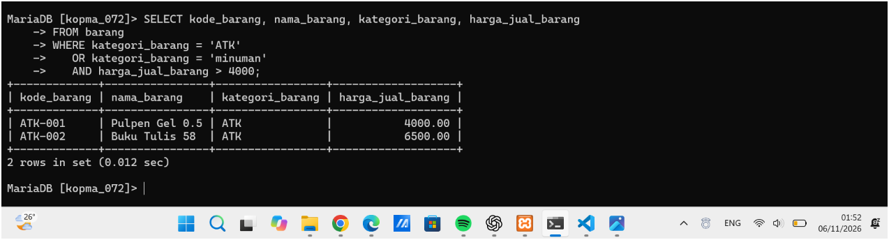

**Versi benar** (dengan kurung):

```sql
SELECT kode_barang, nama_barang, kategori_barang, harga_jual_barang
FROM barang
WHERE (kategori_barang = 'ATK' OR kategori_barang = 'minuman')
  AND harga_jual_barang > 4000;
```

Hasilnya 1 baris (ATK-002, Buku Tulis 58, harga 6500).

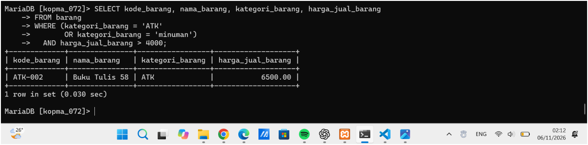

## 6. Tugas Mandiri: Milestone Proyek 7

Milestone dikerjakan pada database `toko_072` dengan berkas `p07_kueri_25430072.sql`. Berkas berisi 10 kueri satu tabel. Setiap kueri memuat komentar kode KI, pertanyaan dalam bahasa sehari-hari, dan hasil yang diharapkan yang ditulis sebelum kueri dijalankan. Seluruh hasil sesuai dengan yang diharapkan.

### A. Daftar kueri dan hasil

| No | KI | Pertanyaan | Operator/Fungsi | Hasil |
|---|---|---|---|---|
| 01 | KI-03 | Pembayaran mana yang belum lunas? | IN | 2 baris (PSN-P06-0005, 0009) |
| 02 | KI-04 | Pengiriman mana yang belum punya nomor resi? | IS NULL | 2 baris (KRM-P06-05, 09) |
| 03 | KI-04 | Bagaimana status tiap pengiriman dalam bahasa mudah dimengerti? | CASE | 10 baris (5 Selesai, 3 Sedang di jalan, 2 Menunggu dikirim) |
| 04 | KI-01 | Pesanan apa yang masuk 10 sampai 11 Oktober 2026? | BETWEEN | 6 baris |
| 05 | KI-01 | Pesanan 12 Oktober beserta ongkos kirimnya? | DATE_FORMAT | 4 baris |
| 06 | KI-05 | Siapa pelanggan yang namanya mengandung "pu"? | LIKE, UPPER, CONCAT, IFNULL | 2 baris (Andi Saputra, Eka Putri) |
| 07 | KI-02 | Tiga produk Elektronik atau Aksesoris termahal? | IN, ORDER BY, LIMIT, FORMAT | 3 baris |
| 08 | KI-01 | Subtotal tiap barang pada PSN-P06-0001? | perkalian per baris | 2 baris (300000, 85000) |
| 09 | KI-05 | Pesanan apa saja milik PLG-P06-01? | `=`, ORDER BY | 2 baris |
| 10 | KI-01 | Pembayaran lunas di atas Rp1.000.000? | `>`, AND, ORDER BY | 3 baris |

### B. Bukti hasil

Kueri 01 sampai 03:

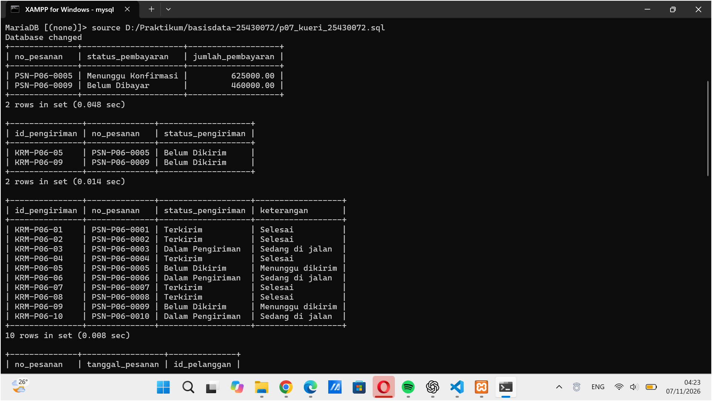

Kueri 04 sampai 07:

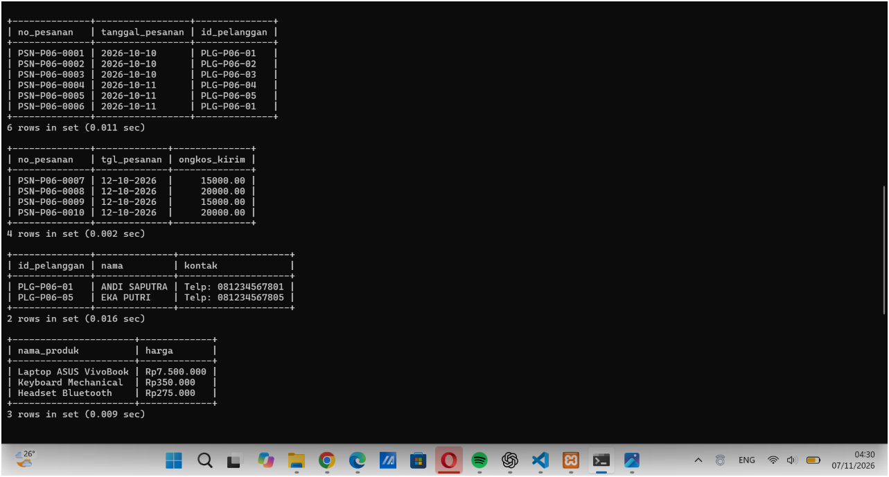

Kueri 08 sampai 10:

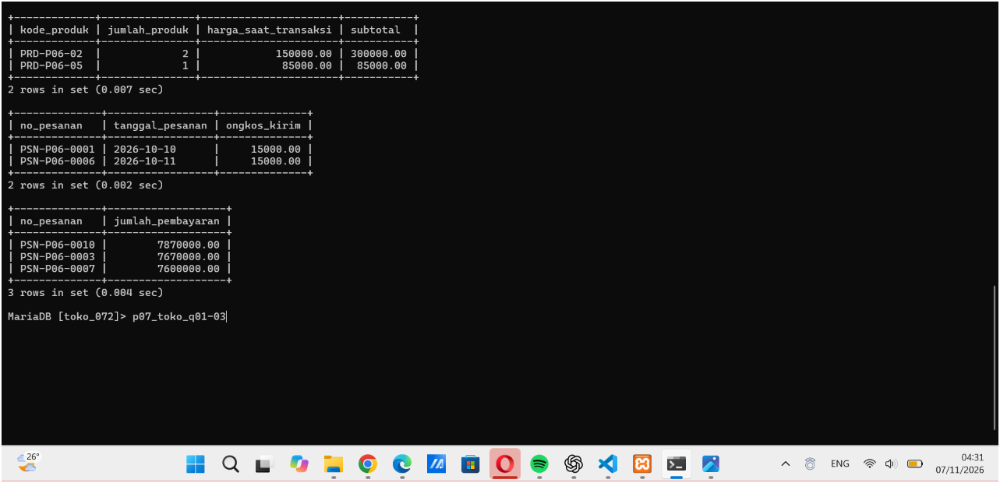

### C. Pemetaan kueri ke kebutuhan informasi

| KI | Kebutuhan Informasi | Kueri | Status |
|---|---|---|---|
| KI-01 | Jumlah dan nilai penjualan per hari dan per bulan | 04, 05, 08, 10 | Sebagian. Nilai penjualan per hari/bulan butuh JOIN pesanan–detail_pesanan dan SUM/GROUP BY |
| KI-02 | Produk paling banyak terjual | 07 | Belum dapat dijawab penuh. Butuh JOIN produk–detail_pesanan dan SUM/GROUP BY |
| KI-03 | Daftar pesanan belum dibayar | 01 | Sebagian. Data pesanan ikut tampil setelah JOIN pesanan–pembayaran |
| KI-04 | Status pengiriman pesanan | 02, 03 | Sebagian. Data pesanan ikut tampil setelah JOIN pesanan–pengiriman |
| KI-05 | Riwayat pembelian pelanggan | 06, 09 | Belum dapat dijawab penuh. Butuh JOIN pelanggan–pesanan–detail_pesanan |

KI yang ditandai "sebagian" atau "belum" tidak dapat dijawab dengan satu tabel dan akan dijawab pada pertemuan 9 sampai 12. Hal ini juga ditandai di akhir berkas `p07_kueri_25430072.sql`.

### D. Alasan pemilihan fungsi skalar

- **CONCAT dan UPPER:** menyusun label nama dan kontak agar langsung terbaca tanpa mengubah data asli.
- **FORMAT:** menampilkan harga dalam format rupiah dengan pemisah ribuan.
- **DATE_FORMAT:** menampilkan tanggal dalam format hari-bulan-tahun yang lazim di Indonesia.
- **DATEDIFF dan CURDATE:** menghitung lama keanggotaan dalam hari agar bisa dikategorikan baru atau lama.
- **IFNULL:** mengganti nilai kosong pada nomor HP dengan "-" supaya tidak tampil sebagai NULL.
- **CASE:** menerjemahkan nilai status menjadi keterangan yang mudah dimengerti, misalnya "Terkirim" menjadi "Selesai".
- **ROUND:** membulatkan harga hasil perhitungan ke ratusan agar rapi.

### E. Keputusan desain

- Setiap kueri sengaja hanya memakai satu tabel sesuai ketentuan milestone, sehingga KI yang butuh JOIN atau agregasi ditandai belum bisa dijawab penuh.
- Kueri 04 memakai BETWEEN pada kolom `tanggal_pesanan` yang bertipe DATE, sehingga batas akhir tidak perlu diberi jam.
- Kueri 03 memakai CASE agar status pengiriman mudah dipahami pembaca non-teknis.
- Kueri 10 memakai `> 1000000` karena pertanyaannya "di atas" satu juta, bukan "sekurangnya".
- Hasil yang diharapkan ditulis di komentar sebelum kueri dijalankan sebagai pembanding hasil nyata.

## 7. Pembahasan dan Kendala

Perbedaan penting pada modul ini adalah kesalahan sintaksis, yang ditolak server (misalnya ERROR 1054), dan kesalahan semantik, yang berjalan tetapi hasilnya salah (misalnya `OR` tanpa kurung dan `= NULL`). Kesalahan semantik lebih sulit ditemukan sehingga hasil yang diharapkan ditulis lebih dahulu sebagai pembanding. Pada kolom DATETIME, batas akhir `BETWEEN` perlu memuat jam agar data di tanggal terakhir tidak terlewat. Pada kolom DATE seperti `tanggal_pesanan`, hal itu tidak menjadi masalah.

**Galat yang ditemui.**

- `ERROR 1054 (Unknown column 'kurang' in 'where clause')` dibaca sebagai kolom tidak dikenal pada klausa WHERE. Penyebabnya `kurang` adalah alias dari SELECT yang belum ada saat WHERE dievaluasi. Diatasi dengan menulis ulang ekspresinya di WHERE.
- `Failed to open file ..., error: 2` pada perintah `source` berarti berkas tidak ditemukan di folder kerja shell. Diatasi dengan memakai path lengkap berkas dan garis miring `/`.
- Nama kolom stok minimum pada modul (`stok_min_barang`) berbeda dengan DDL (`stok_minimum_barang`). Diatasi dengan memeriksa nama kolom memakai `DESCRIBE`.

**Temuan tambahan.** Jumlah pembayaran PSN-P06-0001 (400000) sama dengan subtotal 385000 ditambah ongkos kirim 15000, sehingga diskon 1% (AB-10) belum terlihat diterapkan pada data. Hal ini dicatat untuk diperiksa pada tahap berikutnya.

## 8. Kesimpulan

SELECT dapat menjawab kebutuhan informasi melalui proyeksi kolom, penyaringan (LIKE, BETWEEN, IN, IS NULL), pengurutan, dan fungsi skalar. Urutan evaluasi SELECT menjelaskan mengapa alias tidak bisa dipakai di WHERE, dan perilaku NULL menjelaskan mengapa harus memakai `IS NULL`. Hasil kueri perlu diprediksi lebih dahulu agar kesalahan semantik terdeteksi. KI yang membutuhkan lebih dari satu tabel atau agregasi akan dijawab pada pertemuan berikutnya.

## 9. Pernyataan Penggunaan AI

Alat yang dipakai: Claude (Anthropic). Digunakan untuk menjelaskan konsep urutan evaluasi SELECT dan perilaku NULL, membantu menyusun kerangka kueri milestone beserta prediksi hasilnya, dan merapikan kerangka laporan. Bagian yang dibantu: kueri 01 sampai 10 pada `p07_kueri_25430072.sql`, kueri tambahan pada `p07_kueri_kopma_25430072.sql`, dan jawaban Titik Analisis. Seluruh kueri dijalankan sendiri di MariaDB melalui XAMPP Shell dan hasilnya dicocokkan dengan prediksi. Kalimat laporan sudah disesuaikan dengan pemahaman sendiri.

## 10. Bukti Git

**Repositori:** [GitHub - basisdata_25430072](https://github.com/selvidianurmala9-oss/basisdata_25430072)

**Berkas yang dikumpulkan:**

1. `p07_laporan_25430072.md`
2. `p07_kueri_kopma_25430072.sql`
3. `p07_kueri_25430072.sql`

**Hash commit:** `ISI_HASH`

**Pesan commit:** `p07: kueri kopma dan milestone toko daring`

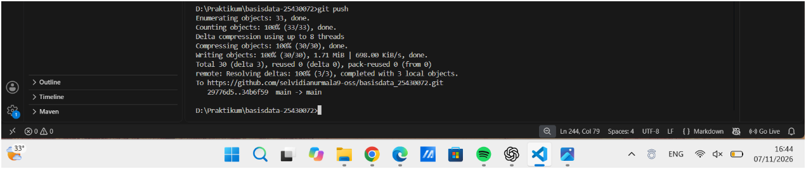

## Checklist

**Checklist umum**

- [x] Identitas
- [x] Tujuan
- [x] Ringkasan teori
- [x] Langkah percobaan (D)
- [x] Titik Analisis
- [x] Latihan (E)
- [x] Tugas Mandiri (F)
- [x] Pembahasan dan kendala
- [x] Kesimpulan
- [x] Pernyataan Penggunaan AI
- [x] Bukti Git

**Checklist khusus Pertemuan 7**

- [x] Berkas wajib: `p07_kueri_25430072.sql` berisi minimal 10 kueri satu tabel, masing-masing diberi komentar KI dan hasil yang diharapkan
- [x] Bukti tangkapan layar: hasil setiap kueri
- [x] Analisis wajib: pemetaan kueri → KI; alasan pemilihan fungsi skalar yang dipakai