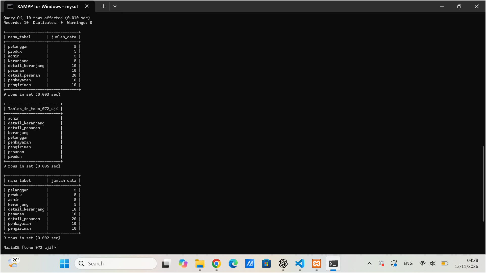
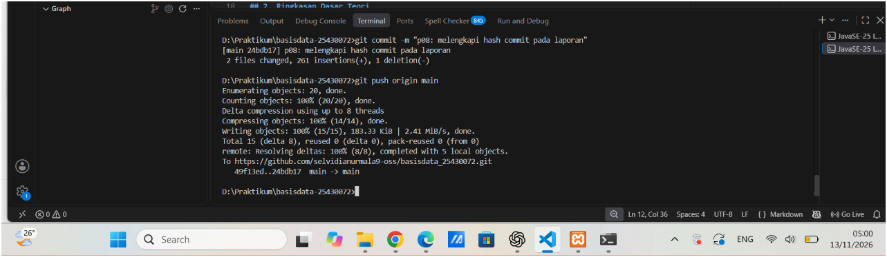

# Laporan Praktikum Basis Data - Pertemuan 08 (UTS)

**Nama:** Selvi Dia Nurmala  
**NIM:** 25430072  
**Kelas:** C  
**Tanggal:** 13 November 2026  
**Mata Kuliah:** Praktikum Basis Data  
**Dosen Pengampu:** Dedi Irawan, S.Kom., M.T.I.

## 1. Tujuan Praktikum

1. Mengintegrasikan hasil pengerjaan proyek basis data dari Milestone 1 sampai Milestone 7.
2. Menguji proses instalasi basis data proyek dari awal menggunakan satu file SQL.
3. Memastikan struktur tabel, relasi, constraint, dan data dapat dibuat dengan benar.
4. Menyiapkan dokumentasi dan bukti pengerjaan proyek untuk pelaksanaan UTS.
5. Mengevaluasi rancangan basis data serta menentukan bagian yang masih dapat diperbaiki.

## 2. Ringkasan Dasar Teori

Instalasi basis data merupakan proses pembuatan struktur dan pengisian data ke dalam basis data. Proses ini dapat dilakukan menggunakan beberapa file SQL yang dijalankan secara berurutan.

Perintah `CREATE DATABASE` digunakan untuk membuat basis data, sedangkan `CREATE TABLE` digunakan untuk membuat tabel. Relasi antartabel dapat dibentuk menggunakan Primary Key dan Foreign Key. Constraint seperti `NOT NULL`, `UNIQUE`, dan `CHECK` digunakan untuk menjaga konsistensi data.

File instalasi dapat menggunakan perintah `SOURCE` untuk menjalankan file SQL lainnya secara berurutan. Dengan demikian, seluruh basis data proyek dapat dibangun kembali dari awal menggunakan satu perintah.

## 3. Hasil Langkah Percobaan

### A. Persiapan Instalasi

Pada tahap ini dilakukan pemeriksaan file SQL proyek toko daring. File yang digunakan yaitu:

- `p05_ddl_25430072.sql` untuk pembuatan struktur tabel.
- `p06_data_25430072.sql` untuk pengisian data.
- `install_uts_25430072.sql` sebagai file utama instalasi.

File DDL dan data disesuaikan agar tidak memilih basis data secara langsung. Pemilihan basis data dilakukan oleh file instalasi utama sehingga proses pengujian dapat dilakukan pada basis data baru.

### B. Membuat File Instalasi

File `install_uts_25430072.sql` berisi perintah untuk menghapus basis data pengujian jika sudah ada, membuat basis data baru, menjalankan file DDL dan data, serta memeriksa hasil instalasi.

Isi file instalasi:

```sql
DROP DATABASE IF EXISTS toko_072_uji;

CREATE DATABASE toko_072_uji
CHARACTER SET utf8mb4
COLLATE utf8mb4_unicode_ci;

USE toko_072_uji;

SOURCE p05_ddl_25430072.sql;
SOURCE p06_data_25430072.sql;

SHOW TABLES;

SELECT 'admin' AS nama_tabel, COUNT(*) AS jumlah_data FROM admin
UNION ALL
SELECT 'pelanggan', COUNT(*) FROM pelanggan
UNION ALL
SELECT 'produk', COUNT(*) FROM produk
UNION ALL
SELECT 'keranjang', COUNT(*) FROM keranjang
UNION ALL
SELECT 'detail_keranjang', COUNT(*) FROM detail_keranjang
UNION ALL
SELECT 'pesanan', COUNT(*) FROM pesanan
UNION ALL
SELECT 'detail_pesanan', COUNT(*) FROM detail_pesanan
UNION ALL
SELECT 'pembayaran', COUNT(*) FROM pembayaran
UNION ALL
SELECT 'pengiriman', COUNT(*) FROM pengiriman;
```

### C. Menjalankan Instalasi Bersih

Pengujian dilakukan menggunakan XAMPP Shell dengan MariaDB versi 10.4.32.

Perintah yang dijalankan:

```text
cd /d D:\Praktikum\basisdata-25430072
mysql -u root -p
```

Setelah masuk ke MariaDB, file instalasi dijalankan menggunakan perintah:

```sql
SOURCE D:/Praktikum/basisdata-25430072/install_uts_25430072.sql;
```

### D. Hasil Pengujian

Berdasarkan hasil pengujian, proses instalasi berhasil dilakukan pada basis data `toko_072_uji`.

Hasil pemeriksaan menunjukkan bahwa terdapat 9 tabel yang berhasil dibuat, yaitu:

1. `admin`
2. `detail_keranjang`
3. `detail_pesanan`
4. `keranjang`
5. `pelanggan`
6. `pembayaran`
7. `pengiriman`
8. `pesanan`
9. `produk`

Jumlah data yang berhasil dimasukkan sebanyak 80 baris dengan rincian:

| No. | Nama Tabel | Jumlah Data |
|---|---|---:|
| 1 | admin | 5 |
| 2 | pelanggan | 5 |
| 3 | produk | 5 |
| 4 | keranjang | 5 |
| 5 | detail_keranjang | 10 |
| 6 | pesanan | 10 |
| 7 | detail_pesanan | 20 |
| 8 | pembayaran | 10 |
| 9 | pengiriman | 10 |
| | **Total** | **80** |

Hasil tersebut menunjukkan bahwa struktur tabel dan data berhasil dibuat melalui satu file instalasi.

### E. Bukti Hasil Percobaan

**Gambar 1. Hasil instalasi bersih basis data proyek toko daring.**



## 4. Jawaban Titik Analisis

Pertemuan 8 tidak memiliki Titik Analisis. Analisis wajib dijawab pada bagian 4.1, sedangkan bagian 4.2 sampai 4.4 adalah analisis tambahan dari persiapan instalasi.

### 4.1 Refleksi Keputusan Desain yang Akan Diperbaiki

1. **Jumlah pembayaran belum divalidasi terhadap total pesanan.** Pada pengujian P06, pembayaran pesanan PSN-P06-0001 dapat diubah menjadi Rp1 padahal total pesanan Rp400.000, dan perubahan itu tetap diterima. Rencana perbaikan: trigger atau transaksi.
2. **Aturan AB-01 dan AB-02** (pesanan minimal satu produk dan maksimal tiga jenis barang) melibatkan banyak baris sehingga tidak dapat dijaga oleh `CHECK`. Rencana perbaikan: trigger.
3. **Aturan AB-07** (pesanan yang belum dibayar tidak boleh dikirim) menghubungkan dua tabel sehingga membutuhkan trigger atau validasi aplikasi.
4. **Diskon 1% (AB-10)** belum tampak pada data. Pembayaran PSN-P06-0001 sebesar Rp400.000 sama dengan subtotal Rp385.000 ditambah ongkos kirim Rp15.000. Perlu diputuskan apakah diskon dihitung lewat kueri atau disimpan.

### 4.2 Mengapa instalasi bersih perlu dilakukan?

Instalasi bersih diperlukan untuk memastikan bahwa seluruh struktur dan data proyek dapat dibuat dari awal tanpa bergantung pada basis data yang sudah tersedia sebelumnya. Pengujian ini juga membantu mengetahui apakah file DDL dan data sudah tersusun dengan benar.

### 4.3 Mengapa file instalasi menggunakan basis data `toko_072_uji`?

Basis data pengujian digunakan agar proses instalasi tidak mengubah atau menghapus basis data proyek utama. Dengan demikian, pengujian dapat dilakukan secara terpisah dan lebih aman.

### 4.4 Mengapa perintah `USE toko_072` perlu dihapus dari file DDL dan data?

Perintah tersebut dapat menyebabkan proses instalasi berpindah ke basis data utama. Oleh karena itu, pemilihan basis data dikendalikan melalui file instalasi utama agar seluruh tabel dan data masuk ke `toko_072_uji`.

## 5. Hasil Latihan dan Modifikasi

Modifikasi dilakukan pada file DDL dan data agar dapat digunakan kembali oleh file instalasi utama.

Perubahan yang dilakukan:

1. Menghapus perintah `CREATE DATABASE` dan `USE toko_072` dari file DDL.
2. Menghapus perintah `USE toko_072` dari file data.
3. Mempertahankan definisi tabel, kolom, relasi, dan constraint yang sudah dibuat.
4. Menggunakan file `install_uts_25430072.sql` untuk mengatur basis data tujuan dan menjalankan file SQL secara berurutan.

Setelah perubahan dilakukan, instalasi diuji kembali menggunakan basis data baru `toko_072_uji`. Hasilnya, seluruh 9 tabel dan 80 baris data berhasil dibuat.

## 6. Tugas Mandiri: Milestone Proyek 08

Proyek yang dikembangkan adalah **Toko Daring Serba Digital (SDN)**, yaitu rancangan basis data untuk mendukung pengelolaan toko daring.

Proyek memiliki 9 tabel utama:

- `pelanggan`
- `produk`
- `admin`
- `keranjang`
- `detail_keranjang`
- `pesanan`
- `detail_pesanan`
- `pembayaran`
- `pengiriman`

Relasi antartabel digunakan untuk menghubungkan pelanggan dengan keranjang dan pesanan, pesanan dengan detail pesanan, produk dengan detail keranjang dan detail pesanan, serta pesanan dengan pembayaran dan pengiriman.

Beberapa keputusan rancangan yang diterapkan:

1. Menggunakan Primary Key untuk membedakan setiap data.
2. Menggunakan Foreign Key untuk menjaga hubungan antartabel.
3. Menggunakan Primary Key gabungan pada tabel `detail_pesanan` dan `detail_keranjang`.
4. Menggunakan `DECIMAL(12,2)` untuk menyimpan nilai keuangan.
5. Menyimpan `harga_saat_transaksi` agar harga produk pada transaksi lama tetap dapat diketahui meskipun harga produk berubah.
6. Tidak menyimpan nilai subtotal dan total sebagai kolom tetap karena nilai tersebut dapat dihitung dari detail transaksi.

**Berkas pendukung proyek:**

| No. | Nama File | Keterangan |
|---|---|---|
| 1 | `p05_ddl_25430072.sql` | Struktur tabel dan constraint |
| 2 | `p06_data_25430072.sql` | Data awal proyek |
| 3 | `p07_kueri_25430072.sql` | Kumpulan kueri proyek |
| 4 | `install_uts_25430072.sql` | Instalasi seluruh basis data dari awal |
| 5 | [`p08_uts_25430072.md`](../p08_uts_25430072.md) | Ringkasan proyek Milestone 1–7 beserta tautan setiap berkasnya |

## 7. Pembahasan dan Kendala

Kendala yang ditemukan selama persiapan UTS adalah file DDL dan data sebelumnya masih menggunakan perintah `USE toko_072`. Hal tersebut dapat menyebabkan proses instalasi menggunakan basis data utama, bukan basis data pengujian.

Solusinya adalah menghapus perintah pemilihan basis data dari kedua file tersebut dan mengatur basis data tujuan melalui file instalasi utama. Setelah `SOURCE`, nama basis data pada keluaran `SHOW TABLES` (`Tables_in_toko_072_uji`) diperiksa untuk memastikan tabel terbentuk di basis data yang benar.

Pengujian kemudian dilakukan menggunakan perintah `SOURCE` dengan alamat file lengkap. Hasilnya, seluruh tabel dan data berhasil dibuat pada basis data `toko_072_uji`.

Terdapat juga pesan peringatan (`1 warning`) saat perintah `DROP DATABASE IF EXISTS` dijalankan ketika basis data pengujian belum tersedia. Hal tersebut tidak menghalangi proses instalasi karena basis data kemudian berhasil dibuat dan seluruh proses berikutnya berjalan.

## 8. Kesimpulan

Persiapan UTS proyek basis data berhasil dilakukan dengan membuat file instalasi yang menjalankan DDL dan data secara berurutan. Pengujian pada basis data baru `toko_072_uji` berhasil menghasilkan 9 tabel dengan total 80 baris data. Dengan hasil tersebut, file instalasi sudah dapat digunakan untuk membangun ulang basis data proyek dari awal.

## 9. Pernyataan Penggunaan AI

Alat: Claude (Anthropic). Digunakan untuk memeriksa susunan file SQL dan skrip `install_uts_25430072.sql`, menelusuri penyebab kendala instalasi (perintah `USE` di dalam file DDL dan data yang memindahkan sesi ke basis data lain), dan merapikan dokumentasi laporan.

Verifikasi saya lakukan sendiri: instalasi dijalankan di MariaDB melalui XAMPP Shell, jumlah baris dicocokkan dengan data Milestone 6, dan nama basis data pada keluaran `SHOW TABLES` diperiksa. Hasil yang dicantumkan dalam laporan sesuai dengan hasil pengujian tersebut.

## 10. Bukti Git

**Repository GitHub:**  
https://github.com/selvidianurmala9-oss/basisdata_25430072

**Hash commit P08:** `<780712d>`

**Pesan commit:** `p08: uts proyek toko daring`

**Bukti Git push:**



## Checklist

### Checklist Umum Laporan

- [x] Identitas: nama, NIM, kelas, pertemuan ke-N, tanggal, dosen
- [x] Tujuan praktikum (maksimal 5 baris, bahasa sendiri)
- [x] Ringkasan teori (maksimal setengah halaman, tanpa menyalin buku)
- [x] Langkah percobaan dengan tangkapan layar dan keterangan
- [x] Titik Analisis / analisis wajib dijawab lengkap dengan alasan
- [x] Latihan beserta bukti berjalan
- [x] Tugas Mandiri: berkas, bukti, dan penjelasan keputusan desain
- [x] Pembahasan dan kendala: galat, cara membacanya, cara mengatasinya
- [x] Kesimpulan (dua sampai empat kalimat)
- [x] Pernyataan Penggunaan AI
- [x] Bukti Git: tautan repositori, hash commit, dan pesan `p08: ...`
- [x] Keaslian: tangkapan layar menampilkan akun ber-NIM dan jam sistem; nama objek memuat NIM/inisial

### Checklist Khusus Pertemuan 8

- [x] Berkas wajib: `p08_uts_25430072.md` (ringkasan milestone 1–7) dan `install_uts_25430072.sql`
- [x] Bukti tangkapan layar: basis data berjalan dari skrip DDL dan data (instalasi bersih)
- [x] Analisis wajib: refleksi keputusan desain yang akan diperbaiki