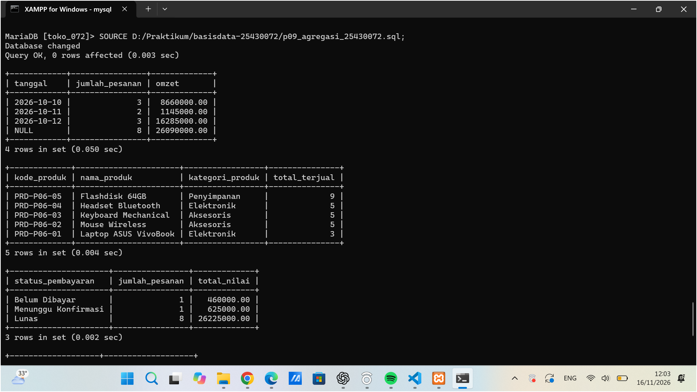
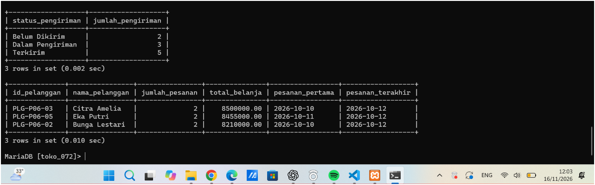
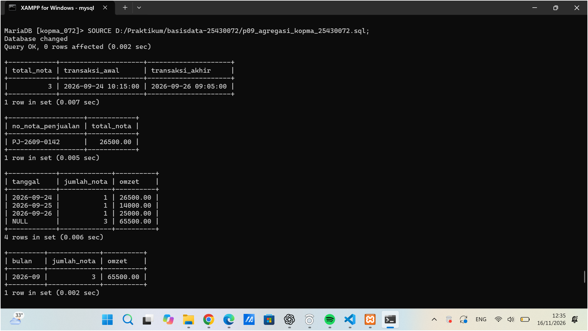
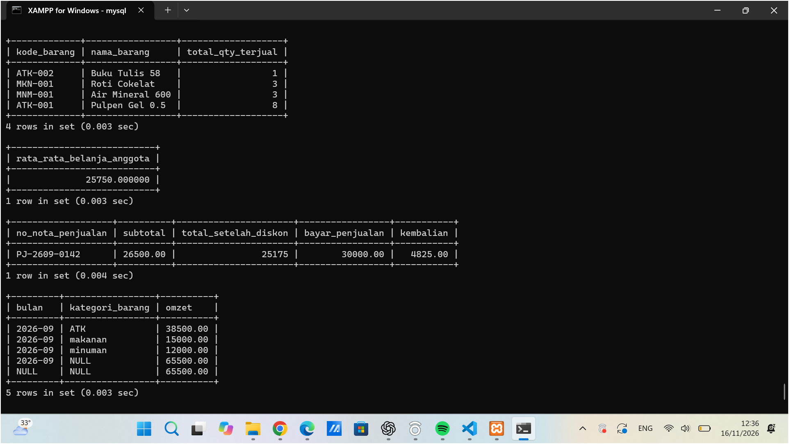
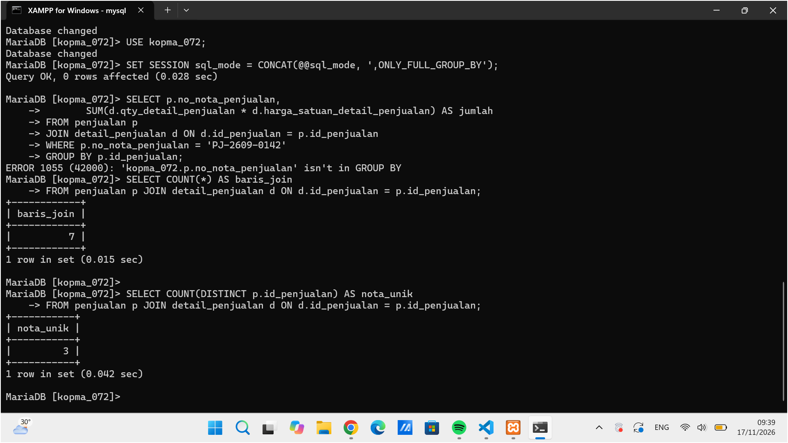

# Laporan Praktikum Basis Data - Pertemuan 09

**Nama:** Selvi Dia Nurmala  
**NIM:** 25430072  
**Kelas:** C  
**Tanggal:** 17 November 2026  
**Mata Kuliah:** Praktikum Basis Data  
**Dosen:** Dedi Irawan, S.Kom., M.T.I.

## 1. Tujuan Praktikum

1. Memahami penggunaan fungsi agregat seperti COUNT, SUM, AVG, MIN, dan MAX untuk mengolah data.
2. Memahami penggunaan GROUP BY untuk mengelompokkan data berdasarkan kategori tertentu.
3. Memahami penggunaan HAVING untuk menyaring hasil pengelompokan.
4. Membuat laporan ringkasan berdasarkan data transaksi pada basis data Kopma dan proyek Toko Daring.

## 2. Ringkasan Dasar Teori

Fungsi agregat merupakan fungsi SQL yang digunakan untuk menghitung dan meringkas sekumpulan data. COUNT digunakan untuk menghitung jumlah data, SUM untuk menjumlahkan nilai, AVG untuk mencari rata-rata, MIN untuk mencari nilai terkecil, dan MAX untuk mencari nilai terbesar. Fungsi-fungsi tersebut mengabaikan nilai NULL, kecuali COUNT(*) yang menghitung semua baris.

GROUP BY digunakan untuk mengelompokkan data berdasarkan kolom tertentu agar hasil perhitungan dapat ditampilkan per kelompok. HAVING digunakan untuk menyaring kelompok berdasarkan hasil agregasi, sedangkan WHERE digunakan untuk menyaring baris sebelum proses pengelompokan.

WITH ROLLUP menambahkan baris subtotal atau total keseluruhan pada hasil pengelompokan, yang ditandai dengan NULL pada kolom pengelompokan. Mode ONLY_FULL_GROUP_BY mewajibkan setiap kolom non-agregat pada SELECT tercantum di GROUP BY, sehingga kueri yang melanggar ditolak dengan galat 1055. Fungsi DATE dan DATE_FORMAT dapat digunakan untuk mengelompokkan transaksi berdasarkan tanggal maupun bulan.

## 3. Hasil Langkah Percobaan

### A. Pengujian Proyek Toko Daring

Berkas yang digunakan: `p09_agregasi_25430072.sql`.

Skrip dijalankan melalui XAMPP Shell menggunakan perintah `SOURCE`. Hasil pengujian menampilkan laporan omzet per hari, lima produk paling banyak terjual, ringkasan pembayaran, ringkasan pengiriman, dan total belanja pelanggan.

**Keterangan:** Hasil laporan omzet dan jumlah pesanan per hari, lima produk paling banyak terjual, serta ringkasan pembayaran berdasarkan status.

**Keterangan:** Hasil ringkasan status pengiriman dan total belanja pelanggan beserta tanggal pesanan pertama dan terakhir.

Catatan: Headset, Keyboard, dan Mouse sama-sama terjual 5 unit, sehingga urutan ketiganya dapat berbeda pada tangkapan layar yang diambil sebelum ORDER BY ditambah `pr.nama_produk`.

### B. Pengujian Basis Data Kopma

Berkas yang digunakan: `p09_agregasi_kopma_25430072.sql`.

Skrip dijalankan menggunakan perintah `SOURCE` pada basis data `kopma_072`. Pengujian menggunakan data sampel yang tersedia karena berkas `kopma_data_lanjutan.sql` belum tersedia, sehingga hasilnya tidak sama dengan contoh pada buku.

**Keterangan:** Hasil verifikasi jumlah transaksi, total nota PJ-2609-0142, omzet harian, dan omzet bulanan.

**Keterangan:** Hasil total kuantitas barang terjual, rata-rata belanja anggota, perhitungan diskon 5%, dan omzet berdasarkan kategori barang.

### C. Pengujian Mode ONLY_FULL_GROUP_BY

Pengujian dilakukan dengan mengaktifkan mode `ONLY_FULL_GROUP_BY` untuk memastikan kolom yang ditampilkan sesuai dengan aturan pengelompokan SQL.

**Keterangan:** Muncul galat 1055 karena kolom `p.no_nota_penjualan` ditampilkan pada SELECT tetapi tidak ada di GROUP BY. Bagian bawah gambar menunjukkan perbandingan COUNT(*) yang menghasilkan 7 baris dengan COUNT(DISTINCT p.id_penjualan) yang menghasilkan 3 nota.

## 4. Jawaban Titik Analisis

**Titik Analisis 1**

Ketika `p.no_nota_penjualan` dihapus dari GROUP BY sementara kolom itu masih ada di SELECT, MariaDB menolak kueri dengan ERROR 1055 (lihat gambar pada bagian 3.C). Secara logika satu `id_penjualan` hanya punya satu nomor nota, tetapi MariaDB tidak menyimpulkan hubungan itu sendiri. Server hanya memeriksa daftar kolom di GROUP BY apa adanya, sehingga kolom yang tidak tercantum dianggap bisa bernilai ambigu dalam satu kelompok. Karena itu semua kolom non-agregat ditulis di GROUP BY, yaitu `GROUP BY p.id_penjualan, p.no_nota_penjualan`.

**Titik Analisis 2**

JOIN antara `penjualan` dan `detail_penjualan` menghasilkan 7 baris, padahal notanya hanya 3 (lihat gambar pada bagian 3.C). Satu nota dapat memiliki beberapa baris barang, sehingga setelah JOIN setiap nota muncul sebanyak jumlah barangnya. COUNT(*) menghitung baris hasil JOIN sehingga laporan akan menampilkan 7 nota. COUNT(DISTINCT p.id_penjualan) menghitung nota yang berbeda, jadi hasilnya benar, yaitu 3.

**Titik Analisis 3**

Syarat "anggota saja" adalah syarat pada baris (`id_anggota IS NOT NULL`), sehingga ditulis di WHERE yang bekerja sebelum pengelompokan. HAVING dipakai untuk syarat yang bergantung pada hasil agregat, seperti COUNT(...) > 20. Subquery menghitung total tiap nota anggota, lalu AVG menghasilkan rata-rata Rp25.750 per nota. Nota pembeli umum tidak ikut dihitung.

## 5. Hasil Latihan dan Modifikasi

### A. Hasil Latihan Kopma

1. **Verifikasi transaksi:** terdapat 3 nota, transaksi paling awal pada 24 September 2026 dan transaksi terakhir pada 26 September 2026.
2. **Total satu nota:** nota PJ-2609-0142 memiliki total belanja Rp26.500.
3. **Omzet harian:**

   | Tanggal | Jumlah Nota | Omzet |
   |---|---:|---:|
   | 24-09-2026 | 1 | Rp26.500 |
   | 25-09-2026 | 1 | Rp14.000 |
   | 26-09-2026 | 1 | Rp25.000 |
   | **Total** | **3** | **Rp65.500** |

4. **Omzet bulanan:** September 2026 memiliki 3 nota dengan omzet Rp65.500. Tidak terdapat transaksi Oktober pada data yang digunakan.
5. **Kasir dengan lebih dari 20 nota:** hasilnya Empty set karena tidak ada petugas yang memenuhi kondisi tersebut.
6. **Barang dengan kuantitas terjual kurang dari 10:**

   | Nama Barang | Total Terjual |
   |---|---:|
   | Buku Tulis 58 | 1 |
   | Roti Cokelat | 3 |
   | Air Mineral 600 | 3 |
   | Pulpen Gel 0.5 | 8 |

7. **Rata-rata belanja anggota:** Rp25.750.
8. **Perhitungan diskon anggota aktif:** nota PJ-2609-0142 memiliki subtotal Rp26.500. Setelah diskon 5%, total menjadi Rp25.175. Dengan pembayaran Rp30.000, kembalian sebesar Rp4.825.
9. **Omzet berdasarkan kategori barang (WITH ROLLUP):**

   | Bulan | Kategori | Omzet |
   |---|---|---:|
   | 2026-09 | ATK | Rp38.500 |
   | 2026-09 | makanan | Rp15.000 |
   | 2026-09 | minuman | Rp12.000 |
   | 2026-09 | NULL | Rp65.500 |
   | NULL | NULL | Rp65.500 |

   Baris `2026-09 | NULL` adalah subtotal satu bulan, yaitu jumlah seluruh kategori pada September. Baris `NULL | NULL` adalah total keseluruhan. Keduanya bernilai Rp65.500 karena data hanya mencakup satu bulan. Baris NULL tersebut berasal dari ROLLUP, bukan dari data barang, karena pemeriksaan barang tanpa kategori menghasilkan 0.

### B. Hasil Latihan Proyek Toko Daring

1. **Laporan omzet per hari:**

   | Tanggal | Jumlah Pesanan | Omzet |
   |---|---:|---:|
   | 10-10-2026 | 3 | Rp8.660.000 |
   | 11-10-2026 | 2 | Rp1.145.000 |
   | 12-10-2026 | 3 | Rp16.285.000 |
   | **Total** | **8** | **Rp26.090.000** |

2. **Lima produk paling banyak terjual:** Flashdisk 64GB sebanyak 9 unit; Headset Bluetooth, Keyboard Mechanical, dan Mouse Wireless masing-masing 5 unit; serta Laptop ASUS VivoBook sebanyak 3 unit.
3. **Ringkasan pembayaran:**

   | Status Pembayaran | Jumlah Pesanan | Total Nilai |
   |---|---:|---:|
   | Belum Dibayar | 1 | Rp460.000 |
   | Menunggu Konfirmasi | 1 | Rp625.000 |
   | Lunas | 8 | Rp26.225.000 |

4. **Ringkasan pengiriman:**

   | Status Pengiriman | Jumlah |
   |---|---:|
   | Belum Dikirim | 2 |
   | Dalam Pengiriman | 3 |
   | Terkirim | 5 |

5. **Pelanggan dengan total belanja lebih dari Rp5.000.000:**

   | Nama Pelanggan | Jumlah Pesanan | Total Belanja |
   |---|---:|---:|
   | Citra Amelia | 2 | Rp8.500.000 |
   | Eka Putri | 2 | Rp8.455.000 |
   | Bunga Lestari | 2 | Rp8.210.000 |

### C. Modifikasi

Modifikasi dilakukan dengan menggunakan WITH ROLLUP untuk menampilkan total keseluruhan, DATE_FORMAT untuk laporan bulanan, dan HAVING untuk menyaring hasil berdasarkan nilai agregasi.

Pada proyek Toko Daring, omzet dihitung dari jumlah produk dikalikan harga saat transaksi. Ongkos kirim tidak dijumlahkan agar tidak terhitung berulang ketika dilakukan JOIN dengan detail pesanan. Total pesanan Lunas pada ringkasan pembayaran (Rp26.225.000) lebih besar Rp135.000 dari omzet harian (Rp26.090.000). Selisih ini diduga berasal dari ongkos kirim, karena jumlah pembayaran memuat ongkos kirim sedangkan omzet hanya dihitung dari harga produk.

## 6. Tugas Mandiri: Milestone Proyek 09

Tugas mandiri dilakukan dengan membuat berkas `p09_agregasi_25430072.sql` untuk menghasilkan laporan ringkasan pada proyek Toko Daring Serba Digital SDN. Seluruh kueri dijalankan dengan mode ONLY_FULL_GROUP_BY aktif.

Laporan yang dibuat terdiri dari lima bagian:

| Laporan | KI | Teknik |
|---|---|---|
| Jumlah pesanan dan omzet per hari (pesanan Lunas) | KI-01 | COUNT(DISTINCT), SUM, WITH ROLLUP |
| Lima produk paling banyak terjual | KI-02 | SUM, ORDER BY, LIMIT |
| Ringkasan pesanan berdasarkan status pembayaran | KI-03 | COUNT, SUM |
| Ringkasan pesanan berdasarkan status pengiriman | KI-04 | COUNT |
| Pelanggan dengan total belanja lebih dari Rp5.000.000 | KI-05 | HAVING, COUNT, SUM, MIN, MAX |

Pada laporan pelanggan, HAVING digunakan untuk menyaring pelanggan berdasarkan total belanja yang dihitung menggunakan SUM. HAVING dipilih karena kondisi tersebut bergantung pada hasil agregasi setelah pengelompokan, sedangkan WHERE tidak dapat memakai fungsi agregat. Dengan syarat ini, dua dari lima pelanggan tersaring. Pada laporan omzet per hari, baris total (tanggal NULL) cocok dengan jumlah rincian: 3 + 2 + 3 = 8 pesanan dan Rp8.660.000 + Rp1.145.000 + Rp16.285.000 = Rp26.090.000.

## 7. Pembahasan dan Kendala

1. **Galat 1055.** Muncul ketika kolom `no_nota_penjualan` ditampilkan pada SELECT tetapi tidak ada di GROUP BY dengan mode ONLY_FULL_GROUP_BY. Cara membacanya: pesan galat menyebut kolom yang tidak tercantum di GROUP BY. Perbaikannya adalah menambahkan kolom itu ke GROUP BY.
2. **Galat 1044 pada `toko_072`.** Akun `mhs_072` belum memiliki izin ke basis data tersebut. Pemberian izin sempat gagal dengan galat 1034 karena tabel `mysql.db` rusak. Perbaikannya dengan `REPAIR TABLE mysql.db`, kemudian `GRANT ALL PRIVILEGES` diulang dari akun root.
3. **Data Kopma lanjutan belum tersedia,** sehingga pengujian Kopma menggunakan data sampel pada `kopma_072` dan hasilnya tidak sama dengan contoh buku. Pencarian kasir dengan lebih dari 20 nota menghasilkan Empty set karena jumlah transaksi belum memenuhi kondisi tersebut.
4. **HAVING awal tidak menyaring.** Syarat awal laporan pelanggan (`COUNT > 1`) meloloskan semua pelanggan karena masing-masing punya 2 pesanan. Syaratnya diganti menjadi total belanja lebih dari Rp5.000.000 agar HAVING benar-benar bekerja.

## 8. Kesimpulan

Praktikum pertemuan 9 memberikan pemahaman mengenai penggunaan fungsi agregat, GROUP BY, HAVING, dan WITH ROLLUP untuk membuat laporan ringkasan data. Melalui pengujian pada basis data Kopma dan proyek Toko Daring, data transaksi dapat diolah menjadi informasi berupa omzet, jumlah pesanan, produk terlaris, serta ringkasan pembayaran dan pengiriman. Mode ONLY_FULL_GROUP_BY mencegah hasil yang ambigu, dan COUNT(DISTINCT) diperlukan saat JOIN ke tabel detail agar nota tidak terhitung berulang.

## 9. Pernyataan Penggunaan AI

AI yang digunakan adalah Claude (Anthropic). AI membantu merancang dan memeriksa kueri agregasi, menjelaskan galat (1044, 1034, dan 1055), serta menyusun draf kerangka laporan. Seluruh kueri dijalankan sendiri di MariaDB melalui XAMPP Shell, dan semua angka serta tangkapan layar berasal dari hasil tersebut. Draf dari AI dibaca dan disesuaikan dengan hasil praktikum.

## 10. Bukti Git

**Tautan repositori:** https://github.com/selvidianurmala9-oss/basisdata_25430072

**Berkas:** `p09_agregasi_25430072.sql`, `p09_agregasi_kopma_25430072.sql`, `Laporan/p09_laporan_25430072.md`, dan gambar pada `Laporan/img/`.

**Commit (pesan dan hash):**
- `p09: agregasi proyek` (155396f)
- `p09: agregasi kopma` (e504c7d)
- `p09: laporan pertemuan 9` ( )

## Checklist

### Checklist Umum

- [x] Identitas mahasiswa dicantumkan.
- [x] Tujuan praktikum ditulis dengan bahasa sendiri.
- [x] Ringkasan dasar teori dibuat.
- [x] Hasil langkah percobaan disertai screenshot dan keterangan.
- [x] Titik analisis diberikan jawaban dan alasan.
- [x] Hasil latihan disertai data pengujian.
- [x] Tugas mandiri Milestone Proyek 09 dijelaskan.
- [x] Pembahasan dan kendala dijelaskan.
- [x] Kesimpulan dibuat dengan bahasa sendiri.
- [x] Pernyataan penggunaan AI dicantumkan.
- [x] Bukti Git dilengkapi dengan hash commit.
- [x] Pemeriksaan keaslian: tangkapan layar memperlihatkan akun ber-NIM dan jam sistem.

### Checklist Khusus Pertemuan 09

- [x] Berkas `p09_agregasi_25430072.sql` dan `p09_agregasi_kopma_25430072.sql` tersedia.
- [x] Kueri laporan ringkasan berhasil dijalankan.
- [x] Bukti laporan ringkasan tersedia.
- [x] Hasil omzet per hari dan per bulan tersedia.
- [x] Hubungan laporan dengan KI dijelaskan.
- [x] Penggunaan HAVING dijelaskan.
- [x] Commit dan push hasil praktikum ke GitHub.