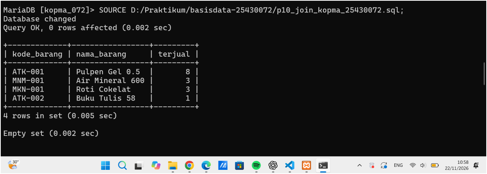
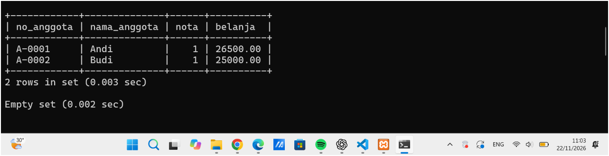
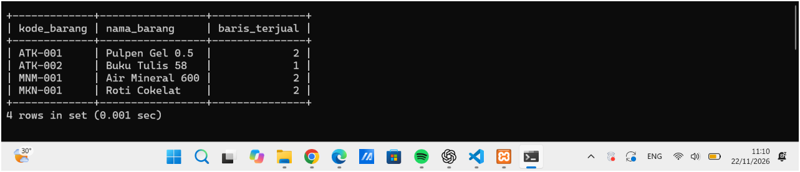
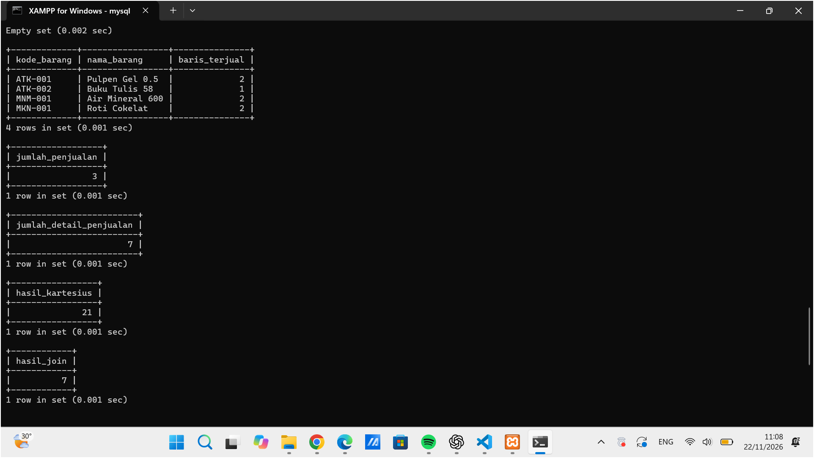
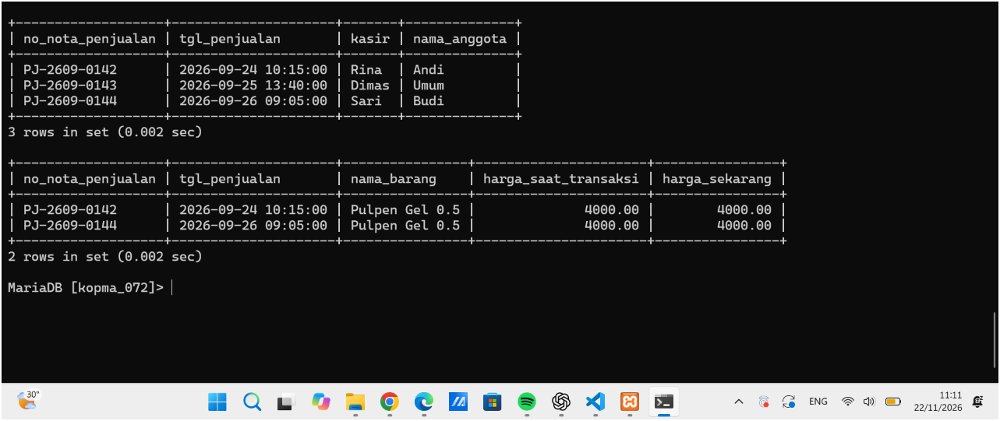
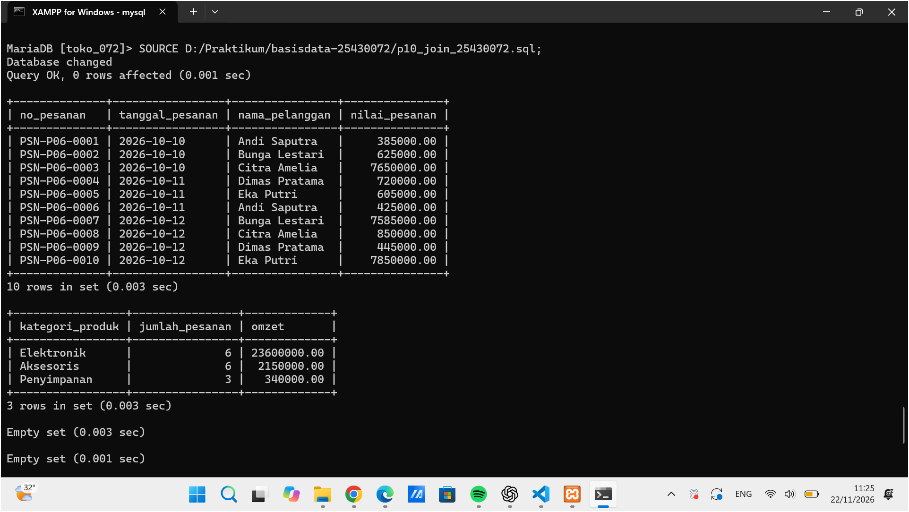
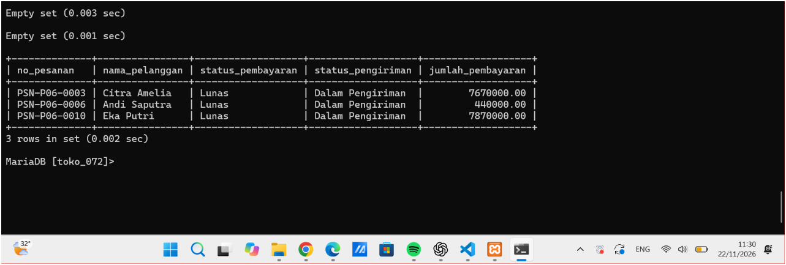
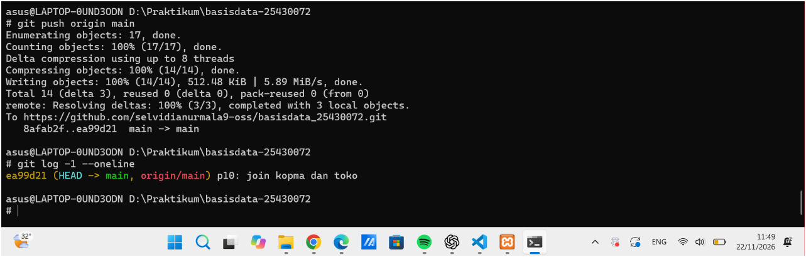

# LAPORAN PRAKTIKUM BASIS DATA
## PERTEMUAN 10: MENGHUBUNGKAN TABEL DENGAN JOIN

**Nama:** Selvi Dia Nurmala  
**NIM:** 25430072  
**Kelas:** C  
**Pertemuan:** 10  
**Tanggal:** 22 November 2026  
**Dosen:** Dedi Irawan, S.Kom., M.T.I.

---

## 1. Tujuan Praktikum

1. Memahami penggunaan INNER JOIN dan LEFT JOIN.
2. Menggabungkan beberapa tabel berdasarkan relasinya.
3. Menampilkan data dari beberapa tabel.
4. Menghindari perkalian Kartesius dalam JOIN.

## 2. Ringkasan Dasar Teori

JOIN merupakan perintah SQL untuk menggabungkan data dari dua tabel atau lebih berdasarkan hubungan antar kolom, yaitu pasangan kunci primer dan kunci tamu pada ERD.

Jenis JOIN yang dipelajari:

- **INNER JOIN:** Menampilkan data yang memiliki pasangan pada kedua tabel.
- **LEFT JOIN:** Menampilkan seluruh data dari tabel kiri, termasuk data yang tidak memiliki pasangan.
- **Perkalian Kartesius:** Terjadi jika syarat penggabungan terlupa sehingga setiap baris tabel kiri dipasangkan dengan setiap baris tabel kanan.

## 3. Hasil Langkah Percobaan

### 3.1 INNER JOIN – Barang Terlaris

Jalur ERD: `barang` → `detail_penjualan` → `penjualan`.

Kueri menggabungkan ketiga tabel untuk mengetahui jumlah barang yang terjual.

**Keterangan:** Pulpen Gel 0.5 menjadi barang paling banyak terjual sebanyak 8 buah, disusul Air Mineral 600 sebanyak 3, Roti Cokelat sebanyak 3, dan Buku Tulis 58 sebanyak 1.

### 3.2 JOIN – Anggota Belanja Terbesar

Jalur ERD: `anggota` → `penjualan` → `detail_penjualan`.

Kueri digunakan untuk menghitung total belanja anggota. `COUNT(DISTINCT p.id_penjualan)` digunakan agar nota tidak terhitung berulang.

**Keterangan:** Andi memiliki 1 nota dengan total Rp26.500, sedangkan Budi memiliki 1 nota dengan total Rp25.000. Nota pembeli umum tidak tampil karena menggunakan INNER JOIN.

### 3.3 LEFT JOIN – Barang Belum Terjual

Jalur ERD: `barang` → `detail_penjualan`.

LEFT JOIN digunakan untuk mencari barang yang belum pernah terjual.

**Keterangan:** Hasil pencarian barang belum terjual adalah `Empty set`. Artinya, semua barang pada data yang diuji sudah pernah terjual. Perbandingan `COUNT(*)` dan `COUNT(d.id_barang)` juga dilakukan pada percobaan ini.

### 3.4 Perkalian Kartesius

Percobaan membandingkan penggabungan tabel tanpa kondisi JOIN dan dengan kondisi JOIN.

**Keterangan:** Tanpa kondisi JOIN menghasilkan 21 baris (3 × 7), sedangkan dengan kondisi JOIN menghasilkan 7 baris. Kondisi JOIN diperlukan agar tidak terjadi perkalian Kartesius.

## 4. Jawaban Titik Analisis

### 4.1 Titik Analisis 1

Informasi yang dibutuhkan gudang adalah nama barang, stok saat ini, stok minimum, jumlah kekurangan, dan jumlah barang terjual. Informasi tersebut membantu menentukan barang yang perlu ditambah stoknya.

### 4.2 Titik Analisis 2

`COUNT(kolom)` tidak menghitung nilai NULL, sedangkan `COUNT(*)` tetap menghitung seluruh baris. Pada LEFT JOIN, barang tanpa pasangan akan menghasilkan NULL pada kolom tabel kanan.

### 4.3 Titik Analisis 3

Perkalian Kartesius terjadi ketika tabel digabungkan tanpa kondisi JOIN yang sesuai. Cara mencegahnya adalah menggunakan kondisi `ON` berdasarkan relasi antar tabel.

### 4.4 Perbedaan INNER JOIN dan LEFT JOIN

INNER JOIN hanya menampilkan data yang memiliki pasangan. LEFT JOIN menampilkan seluruh data dari tabel kiri, meskipun tidak memiliki pasangan di tabel kanan.

## 5. Hasil Latihan dan Modifikasi

### 5.1 Latihan E.1

Jalur ERD: `penjualan` → `petugas` dan `penjualan` → `anggota`.

Kueri menggabungkan tabel penjualan, petugas, dan anggota untuk menampilkan nomor nota, tanggal, kasir, serta nama anggota.

| No. Nota | Tanggal | Kasir | Anggota |
|---|---|---|---|
| PJ-2609-0142 | 24-09-2026 | Rina | Andi |
| PJ-2609-0143 | 25-09-2026 | Dimas | Umum |
| PJ-2609-0144 | 26-09-2026 | Sari | Budi |

### 5.2 Latihan E.2

Jalur ERD: `barang` → `detail_penjualan` → `penjualan`.

Kueri membandingkan harga barang saat transaksi dengan harga jual saat ini.

**Keterangan:** Harga transaksi dan harga sekarang Pulpen Gel 0.5 sama-sama Rp4.000 pada kedua nota yang diuji.

## 6. Tugas Mandiri: Milestone Proyek 10

Pengujian dilakukan menggunakan database `toko_072` dengan berkas `p10_join_25430072.sql`.

| No. | Percobaan | Hasil |
|---|---|---|
| 1 | INNER JOIN pelanggan, pesanan, dan detail pesanan | Menampilkan 10 pesanan beserta nama pelanggan. |
| 2 | JOIN dan agregasi omzet per kategori | Total omzet Rp26.090.000. |
| 3 | LEFT JOIN produk dan detail pesanan | `Empty set`. |
| 4 | LEFT JOIN pelanggan dan pesanan | `Empty set`. |
| 5 | JOIN pesanan, pelanggan, pembayaran, dan pengiriman | Menampilkan 3 pesanan yang masih dalam pengiriman. |

Total omzet kueri 2 sebesar Rp26.090.000.

### Bukti Hasil Pengujian

## 7. Pembahasan dan Kendala

JOIN mempermudah pengambilan informasi dari beberapa tabel yang saling berhubungan. INNER JOIN menampilkan data yang memiliki pasangan, sedangkan LEFT JOIN menampilkan seluruh data dari tabel utama.

Kendala yang dialami:

1. Nama kolom `stok_min_barang` diperbaiki menjadi `stok_minimum_barang`.
2. Login MariaDB menggunakan `mysql -u root -p` karena akun root menggunakan kata sandi.
3. Beberapa kueri menghasilkan `Empty set` karena tidak terdapat data yang memenuhi kondisi pencarian.

## 8. Kesimpulan

Praktikum ini memberikan pemahaman mengenai penggunaan INNER JOIN, LEFT JOIN, dan penggabungan beberapa tabel. Penggunaan kondisi `ON` yang tepat membantu menghasilkan informasi yang sesuai dan menghindari perkalian Kartesius.

## 9. Pernyataan Penggunaan AI

AI yang digunakan adalah Claude (Anthropic). AI membantu memahami materi JOIN, menyusun draf kueri, menjelaskan hasil pengujian, dan merapikan laporan. Seluruh kueri dijalankan menggunakan MariaDB melalui XAMPP Shell.

## 10. Bukti Git

**Repositori:** https://github.com/selvidianurmala9-oss/basisdata_25430072

**Pesan Commit:** `p10: join kopma dan toko`

**Hash Commit:** (ea99d21)

## 11. Checklist

- [x] Identitas dan tujuan praktikum.
- [x] Ringkasan dasar teori.
- [x] Hasil percobaan JOIN.
- [x] Jawaban seluruh titik analisis.
- [x] Hasil latihan E.
- [x] Hasil tugas mandiri proyek Toko.
- [x] Pembahasan dan kesimpulan.
- [x] Pernyataan penggunaan AI.
- [x] Commit dan push ke GitHub.
- [x] Bukti Git ditambahkan.